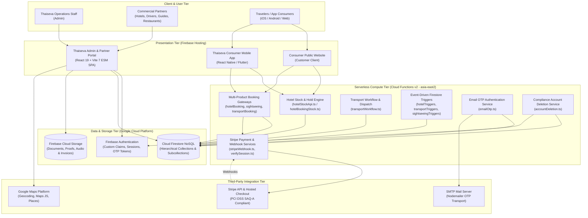
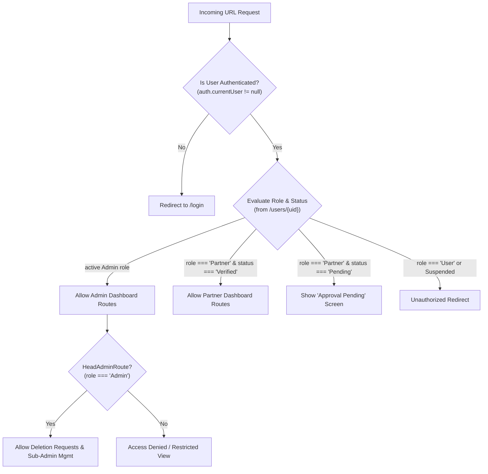
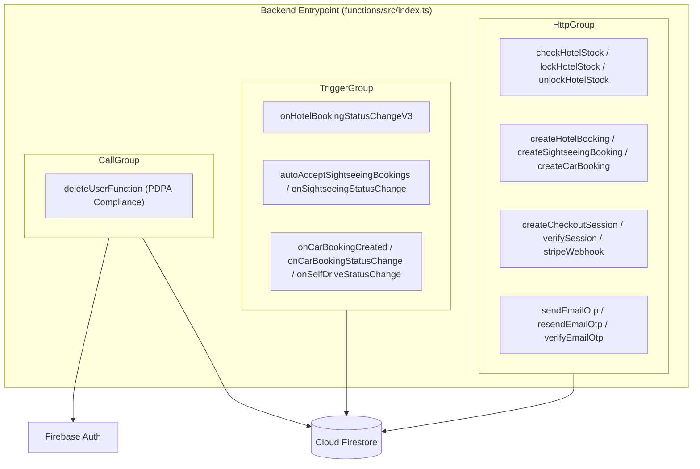
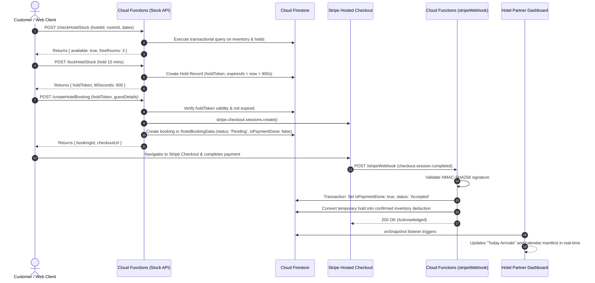
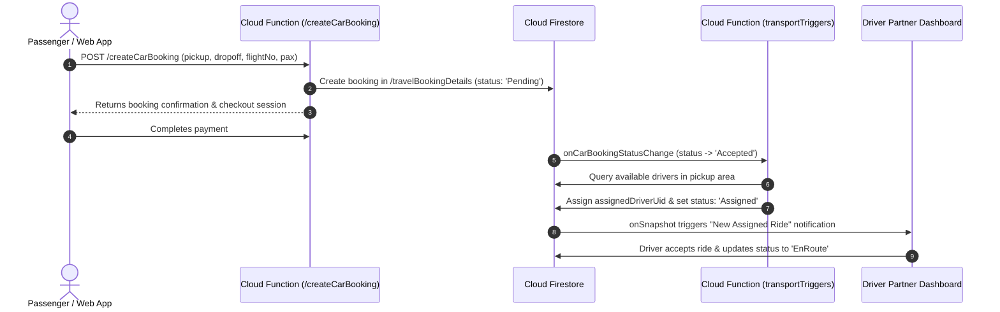
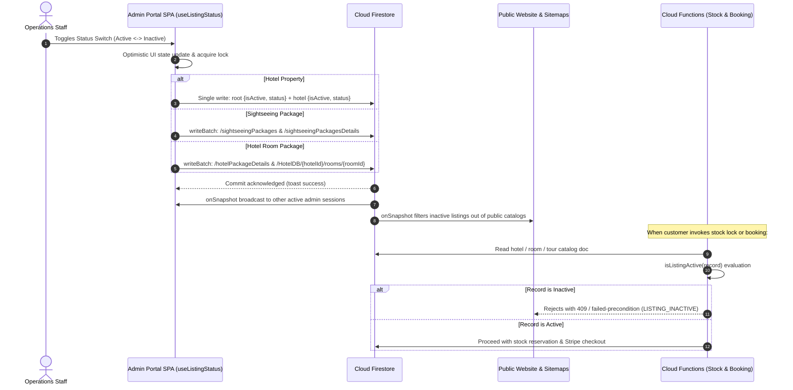

# System Architecture Document (SAD)

**System Name:** Thaiseva Admin Portal, Partner Dashboard & Booking Ecosystem  
**Target Codebase:** `Thaiseva-Admin-Portal-Web-App`  
**System Classification:** Multi-Tenant B2B SaaS & Serverless E-Commerce Booking Engine  
**Version:** 2.0 (Comprehensive Living Architecture)

---

## 1. System Overview & Context

Thaiseva is an integrated hospitality, transport, and tour booking marketplace operating in Thailand. The platform bridges three distinct user groups:
1. **Administrative Staff & Operations:** Centralized back-office operators governing catalog listings, approving partner credentials, monitoring platform-wide financial statistics, resolving customer disputes, and executing statutory privacy requests.
2. **B2B Commercial Partners:** Hoteliers, transport fleet operators, private taxi drivers, tour guides, and restaurants managing their inventory calendars, viewing bookings, and tracking payouts.
3. **Consumers / Travelers (Indirect via APIs):** Mobile application and public website users browsing properties, holding room stock, booking rides, and executing credit card checkouts.



---

## 2. Frontend Architecture (React 19 SPA)

The frontend is an enterprise-grade Single Page Application (SPA) built on **React 19** and bundled with **Vite 7** as native ECMAScript Modules (ESM). It is deployed statically to Firebase Hosting.

### 2.1 Directory Blueprint & Module Structure
```
src/
├── assets/            # Static assets, branding, and Lottie animations
├── components/        # Reusable presentation components
│   ├── reports/       # Invoicing templates, table generators (@react-pdf/renderer)
│   ├── websiteConfig/ # Banners, SEO metadata editors, media uploaders
│   └── shared/        # Modals, confirmation dialogs (SweetAlert2), breadcrumbs
├── contextAPIs/       # Global State: AuthProvider, PartnerProvider, StatisticsProvider
├── data/              # Static dictionaries, slot definitions, constant enums
├── firebase/          # Client Firebase SDK initialization & collection references
├── layouts/           # Master layouts: Dashboard.jsx (Responsive Sidebar), Main.jsx
├── pages/             # Route-level views categorized by security domain
│   ├── dashboard/
│   │   ├── adminDashboard/   # Operations: Orders, Stats, Partners, Deletions, Invoices
│   │   ├── partnerDashboard/ # Vendor: Hotel rooms, driver manifests, chats, calendar
│   │   └── communication/    # Multi-channel real-time support chats
│   └── login/         # Portal authentication screen & OTP challenge
├── routes/            # Route definitions & hierarchical route guards
├── services/          # Abstracted data access layer (Firestore queries & mutations)
├── utils/             # Formatters, Excel export engine, date normalization
└── validation/        # Zod input validation schemas
```

### 2.2 Routing & Access Control Enforcement
Routing is governed by **React Router DOM v7** (`createBrowserRouter`) in `src/routes/Route.jsx`. Route trees are strictly gated by wrapper components:



| Route Guard | File Location | Enforcement Target |
|---|---|---|
| `PrivetRouter` | `src/routes/PrivetRouter.jsx` | Verifies active session token. Blocks anonymous requests. |
| `AdminRoute` | `src/routes/AdminRoute.jsx` | Restricts access to platform operators (active `Admin`). |
| `HeadAdminRoute` | `src/routes/HeadAdminRoute.jsx` | Restricts access strictly to Super Admins (deletions, sub-admins, gross margins). |
| `PartnerRoute` | `src/routes/PartnerRoute.jsx` | Verifies vendor status (`status === 'Verified'`). Unverified partners cannot access orders. |

### 2.3 Global Context & State Management
Rather than introducing heavy Redux architectures, state is cleanly isolated into React Context Providers:
- **`AuthProvider` (`src/contextAPIs/AuthProvider.jsx`):** Maintains Firebase Auth session state, listens to token changes via `onAuthStateChanged`, retrieves matching Firestore user profile documents, and exposes role booleans (`isAdmin`, `isSubAdmin`, `isPartner`).
- **`PartnerProvider` (`src/contextAPIs/PartnerProvider.jsx`):** Evaluates the verified partner's service category (`Hotel`, `Driving`, `Sightseeing`, `Local`) and automatically pre-fetches partner inventory documents and active reservations into context.
- **`StatisticsProvider` (`src/contextAPIs/StatisticsProvider.jsx`):** Caches aggregate revenue, order counts, and registration growth numbers across time windows to optimize dashboard rendering speed.

### 2.4 Presentation & Styling Architecture
- **Dual UI Library Strategy:**
  - **Material UI v6 (`@mui/material`):** Used for complex enterprise data grids, calendars, modals, and date pickers.
  - **Tailwind CSS v3:** Used for rapid responsive layouts, spacing, flex/grid systems, and color utility styling.
  - **Emotion Engine (`@emotion/react`, `@emotion/styled`):** Powers MUI theme overrides and custom styled components.
- **Visual Analytics:** **Chart.js** & **React ChartJS 2** provide responsive multi-axis revenue charts, booking distribution donuts, and monthly growth trends.

### 2.5 Real-Time Communication Architecture
The support chat module (`src/pages/dashboard/communication/`) provides bi-directional, real-time messaging using Firestore `onSnapshot` listeners:
- **Channels:** Dedicated channels for `Customer Support`, `Driver Support`, `Hotel Support`, `Local Partner Support`, and `Restaurant Support`.
- **Audio Voice Notes:** Integrated via `react-audio-voice-recorder`. Audio blobs are captured client-side, streamed to Firebase Cloud Storage under `/chat_audio/`, and embedded as playable voice messages inside chat threads.

### 2.6 Dynamic PDF Invoicing & Excel Data Export
- **PDF Generation:** Powered by `@react-pdf/renderer` and `jspdf-autotable`. The application compiles invoices, commissions, and tax splits dynamically in the browser, rendering client-side PDF previews without requiring backend server rendering.
- **Excel Export Engine:** Powered by `exceljs` and `write-excel-file`. Supports streaming administrative exports (`exportAdminStatisticsExcel.js`) of booking manifests and financial ledgers, preventing browser memory exhaustion on large datasets.

---

## 3. Serverless Backend Architecture (Firebase Cloud Functions v2)

The backend is architected as an event-driven serverless ecosystem running on **Node.js 22 (TypeScript)** deployed to **`asia-east2`** (Hong Kong).



### 3.1 Hotel Stock & Concurrency Hold Engine
Implemented in `functions/src/hotelStockApi.ts` and `functions/src/hotelBookingStock.ts`:
- **Mathematical Invariant:** $\text{Free Rooms} = \text{Total Inventory} - (\text{Locked Rooms} + \text{Booked Rooms})$.
- **Atomic Concurrency Protection:** All stock locking operations execute inside Firestore transactions (`runTransaction`). This prevents race conditions where two simultaneous shoppers attempt to book the final available room.
- **15-Minute Expiration Hold:** When a customer enters checkout, `/lockHotelStock` generates an atomic hold token valid for 900 seconds. If checkout is completed, the hold converts to a confirmed reservation; if abandoned, `/expireHotelStockHolds` automatically restores capacity.

### 3.2 Multi-Product Booking Gateways (`functions/src/bookingCheckout/`)
- **`hotelBooking.ts`:** Verifies room availability, validates hold tokens, verifies pricing formulas against rack rates, creates pending orders in `hotelBookingData`, and generates Stripe checkout sessions.
- **`sightseeingBooking.ts`:** Processes tour package reservations in `travelBookingDetails`. Calculates per-adult, per-child, and extra-adult pricing, tracks pickup hotel logistics, and assigns travel operators.
- **`transportBooking.ts`:** Handles Point-to-Point rides, Airport Taxi, Van Fleet transfers, and Self-Drive car rentals. Captures flight numbers, luggage counts, and vehicle category requirements.
- **`payExisting.ts`:** Generates fresh checkout sessions for previously created bookings whose payment sessions expired.

### 3.3 Event-Driven Database Triggers (`functions/src/triggers/`)
- **`hotelTriggers.ts`:** Listens to `hotelBookingData/{id}` write events. Automatically updates inventory date matrices upon booking status changes (`Accepted` decrements inventory; `Canceled` restores it).
- **`sightseeingTriggers.ts`:** Evaluates tour package bookings. Can automatically transition confirmed payments to `Accepted` and dispatch email notifications to assigned guides.
- **`transportTriggers.ts`:** Listens to car and van bookings. Updates driver availability flags and triggers push notifications to drivers upon dispatch.

### 3.4 Payment Processing & Webhook Infrastructure (`functions/src/payments/`)
- **`stripeWebhook.ts`:** Receives raw Stripe event payloads. Validates cryptographic signatures (`Stripe-Signature`) against the webhook secret.
- **Idempotency Protection:** Checks if the target booking is already marked paid (`isPaymentDone === true`). Prevents duplicate billing and duplicate inventory decrementing if Stripe resends webhooks.
- **Atomic Transition:** Atomically updates `isPaymentDone: true`, sets `status: 'Accepted'`, converts stock holds into confirmed bookings, and generates customer confirmation emails.

### 3.5 Account Deletion Compliance Service (`functions/src/accountDeletion.ts`)
- Implements `deleteUserFunction` callable function.
- Strictly restricted to authenticated users with `admin === true` custom claims.
- Destroys the login profile in Firebase Authentication via `admin.auth().deleteUser(uid)`.
- Removes direct profiles and supported operational records, marks the request `Erasure Pending` and creates a `PENDING_RECORD_REVIEW` erasure job.

---

## 4. End-to-End Dynamic Workflows

### 4.1 Hotel Room Reservation & Hold Concurrency Sequence



---

### 4.2 Transport Fleet Dispatch Sequence



---

### 4.3 Catalog Visibility & Dual-Store Synchronization Architecture (12 October 2026)

Catalog items (Hotels, Tour Packages, and Hotel Room Packages) support active and inactive visibility. Inactive items are hidden from public discovery, search engines, and booking gateways while remaining fully manageable by platform operators.



---

## 5. Storage & Static Media Asset Architecture

Cloud Storage buckets are governed by `storage.rules`:
- **Public Website Media (`/banners/`, `/public/`):** Publicly readable by all web clients; modifications restricted exclusively to Super Admins.
- **Partner KYC & Verification Proofs (`/partner_docs/`):** Readable only by the document owner (`request.auth.uid`) and verified platform administrators.
- **Support Chat Audio Records (`/chat_audio/`):** Uploaded directly from client voice recorders using short-lived upload permissions; access restricted to thread participants.
- **Dynamic Invoices (`/invoices/`):** Secured storage for historical PDF receipts and partner billing summaries.

---

## 6. Architectural Debt, Risks & Remediation Roadmaps

| Risk Category | Current Architectural Finding | Severity | Proposed Engineering Remediation |
|---|---|:---:|---|
| **Authentication & RBAC** | Hardcoded admin emails in `firestore.rules` and `accountDeletion.ts` (`admin@gmail.com`). | 🔴 **CRITICAL** | Transition completely to cryptographically signed **Firebase Custom Claims** (`token.admin === true`). Remove email whitelists. |
| **Data Encryption** | Client-side AES encryption in `src/services/DataEncrypter.js` uses `VITE_SECRET_KEY`, which is exposed in public JS bundles. | 🔴 **CRITICAL** | Deprecate client-side encryption. Encrypt sensitive partner banking fields on the backend via Cloud Functions using Google Cloud KMS or Secret Manager. |
| **Data Privacy (PDPA)** | Account deletion destroys Firebase Auth profile but retains raw PII across Firestore booking records indefinitely. | 🟠 **HIGH** | Implement automated Cloud Function sanitization to redact guest names, phone numbers, and flight details while preserving financial figures for tax audits. |
| **API Versioning** | Coexistence of newer endpoints (`checkHotelStock`) alongside legacy aliases (`checkHotelAvailability`) without formal version prefixing. | 🟡 **MEDIUM** | Implement explicit API route versioning (`/v1/`, `/v2/`) with deprecation schedules for legacy mobile clients. |
| **CI/CD Automation** | Absence of committed GitHub Actions workflows; deployments currently depend on manual local CLI execution (`firebase deploy`). | 🟡 **MEDIUM** | Introduce automated GitHub Actions pipeline validating lint, TypeScript compilation, rules test simulations, and staged deployments. |
