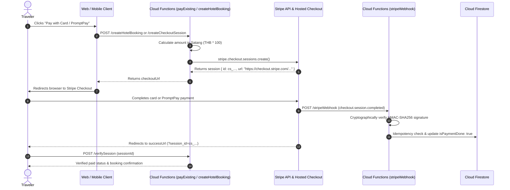
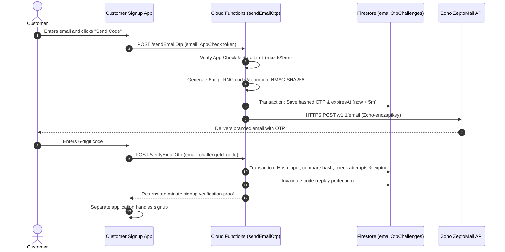

# Third-Party Integrations Guide

This document details the architecture, credential management, security controls, error handling, and compliance obligations for external third-party services integrated into the Thaiseva ecosystem.

---

## 1. Stripe Payments Gateway

Thaiseva uses **Stripe** for all customer credit/debit card transactions and prompt payment methods across hotel accommodations and sightseeing tour packages.

### 1.1 Architecture & PCI DSS Compliance
- **Compliance Scope:** **PCI DSS SAQ-A**.
- **Data Boundary:** Thaiseva servers and Firestore databases **never** capture, transmit, or store Primary Account Numbers (PANs), cardholder names, expiration dates, or CVV/CVC codes.
- **Workflow:**
  1. Consumer selects `paymentMethod: 'STRIPE'` via web or mobile application.
  2. Cloud Function backend invokes `stripe.checkout.sessions.create()` using server-side secrets.
  3. Customer is redirected to the Stripe-hosted domain (`checkout.stripe.com`).
  4. Payment completion triggers an asynchronous webhook to the Cloud Functions listener.



### 1.2 Currency & Amount Calculations (Thai Baht Satang)
- All Stripe checkout sessions in Thaiseva are billed in **Thai Baht (`THB`)**.
- Stripe requires amounts in the smallest currency unit (**Satang**):
  $$\text{Unit Amount} = \text{Math.round}(\text{amountMajor} \times 100)$$
- Handled centrally by `functions/src/payments/stripeClient.ts`:
  ```typescript
  export const toStripeUnitAmount = (amountMajor: number): number => {
    const n = Math.round(Number(amountMajor) * 100);
    if (!Number.isFinite(n) || n < 1) {
      throw new Error("Amount must be at least 0.01 for Stripe Checkout.");
    }
    return n;
  };
  ```

### 1.3 Webhook Security & Idempotency Safeguards
- **Endpoint:** `POST https://asia-east2-<PROJECT_ID>.cloudfunctions.net/stripeWebhook`
- **HMAC Signature Verification:** The raw binary body (`req.rawBody`) is verified against the `Stripe-Signature` header using `STRIPE_WEBHOOK_SECRET`:
  ```typescript
  const sig = req.headers["stripe-signature"] as string;
  let event: Stripe.Event;
  try {
    event = stripe.webhooks.constructEvent(req.rawBody, sig, webhookSecret);
  } catch (err) {
    logger.error("Stripe webhook signature validation failed", { err });
    return res.status(400).send(`Webhook Error: ${err.message}`);
  }
  ```
- **Idempotency Protection:** Stripe may retry events up to 72 hours if delivery is delayed. The webhook handler queries the target order in `hotelBookingData` or `travelBookingDetails`. If `isPaymentDone === true`, the event returns `200 OK` immediately, preventing double stock decrements or redundant confirmation emails.

### 1.4 Required Stripe Configuration & Secrets
Configured in Firebase Secret Manager:
```bash
firebase functions:secrets:set STRIPE_SECRET_KEY --project <project-id>
firebase functions:secrets:set STRIPE_WEBHOOK_SECRET --project <project-id>
```
Non-secret parameters configured in `functions/.env`:
```dotenv
STRIPE_SUCCESS_URL=https://thaiseva.com/booking/success?session_id={CHECKOUT_SESSION_ID}
STRIPE_CANCEL_URL=https://thaiseva.com/booking/cancel
```

---

## 2. Google Maps Platform

Integrated across the administrative portal and partner dashboard for interactive hotel geotagging, passenger pickup location verification, and routing displays.

### 2.1 Services & Packages Consumed
- **Frontend Packages:** `@googlemaps/js-api-loader` (v1.16.6) and `@react-google-maps/api` (v2.19.2).
- **APIs Activated in Google Cloud Console:**
  1. **Maps JavaScript API:** Interactive map rendering for hotel and attraction locations.
  2. **Geocoding API:** Converts textual addresses to `GeoPoint(lat, lng)`.
  3. **Places API:** Autocomplete search for passenger airport and hotel pickup addresses.

### 2.2 Security Controls & Key Restrictions
- **Environment Variable:** `VITE_GOOGLE_MAPS_API_KEY` (Stored in root `.env`).
- **Mandatory Cloud Console Restrictions:**
  1. **Application Restriction:** Restrict key to authorized HTTP Referrers:
     - `https://hotel-booking-admin.web.app/*`
     - `https://hotel-booking-admin.firebaseapp.com/*`
     - `https://thaiseva.com/*`
     - `http://localhost:5173/*` *(Development only; separate API keys must be used for dev vs prod)*.
  2. **API Restrictions:** Restrict the key strictly to Maps JavaScript API, Geocoding API, and Places API.
  3. **Quota Alerts:** Set daily cost and request caps in Google Cloud Console to guard against scraping or billing spikes.

---

## 3. Transactional Email & OTP Authentication (Zoho ZeptoMail)

Thaiseva uses **Zoho CPaaS** (`cpaas.zoho.com/v1.1/email`) for customer signup email verification. See [the OTP API contract](../../documentation/EMAIL_OTP_API.md).

### 3.1 Security Policy & Abuse Mitigations

| Dimension | Policy Specification | Enforcement Mechanism |
|---|---|---|
| **OTP Format** | 6-digit numeric code generated with Node's cryptographic RNG (`crypto.randomInt`) | Server-side generator |
| **Expiration (TTL)** | Exactly **5 minutes** (300 seconds) | Evaluated on verification request |
| **Resend Cooldown** | **60 seconds** minimum between requests | Server rate limiter |
| **Per-Email Limit** | Max **5 send requests per 15-minute window** | Firestore fixed-window counter |
| **Wrong Attempts** | Max **5 failed attempts** before locking | Account lockout for 15 minutes |
| **IP Quotas** | 20 sends and 50 verifications per 15-minute window | Shared IP rate limit |
| **Project Quotas** | 500 sends and 2,000 verifications per 15-minute window | Global project rate limit |
| **Storage Security** | Codes and emails are **never** stored in plain text. Stored as `HMAC-SHA256(otp, OTP_HASH_KEY)` | Server hashing in `otp/core.ts` |
| **App Check** | Firebase App Check token verification enforced by default | `OTP_ENFORCE_APP_CHECK=true` |
| **Data Retention** | Firestore TTL auto-deletes expired codes after 24 hours | Firestore `deleteAfter` TTL index |

### 3.2 Email OTP Delivery Flow


### 3.3 Required Zoho ZeptoMail Configuration
Configured in Firebase Secret Manager:
```bash
firebase functions:secrets:set ZOHO_MAIL_API_KEY --project <project-id>
firebase functions:secrets:set OTP_HASH_KEY --project <project-id>
```
*Note: `OTP_HASH_KEY` must be a cryptographically random secret string of at least 32 characters.*

Configured in `functions/.env`:
```dotenv
ZOHO_MAIL_API_URL=https://cpaas.zoho.com/v1.1/email
OTP_BUSINESS_DOMAIN=thaiseva.com
OTP_FROM_EMAIL=no-reply@thaiseva.com
OTP_SENDER_NAME=Thaiseva
OTP_REPLY_TO_EMAIL=support@thaiseva.com
OTP_ENFORCE_APP_CHECK=true
```

---

## 4. Consumer Website Integration (`useWebsiteMedia` Hook)

The consumer frontend connects directly to Firestore's `image` collection using real-time listeners to render marketing assets, hero visuals, and live counters.

### 4.1 Drop-in React Hook
Frontend applications import the following drop-in hook to consume real-time media and stats:

```javascript
import { useState, useEffect } from 'react';
import { collection, onSnapshot } from 'firebase/firestore';
import { db } from '@/firebase/config';

export function useWebsiteMedia() {
  const [mediaMap, setMediaMap] = useState({});
  const [siteStats, setSiteStats] = useState(null);
  const [loading, setLoading] = useState(true);

  useEffect(() => {
    const unsubscribe = onSnapshot(
      collection(db, 'image'),
      (snapshot) => {
        const map = {};
        snapshot.forEach((doc) => {
          const data = doc.data();
          if (doc.id === 'stats') {
            setSiteStats(data);
          } else {
            map[doc.id] = data;
          }
        });
        setMediaMap(map);
        setLoading(false);
      },
      (error) => {
        console.error('Error fetching website media:', error);
        setLoading(false);
      }
    );

    return () => unsubscribe();
  }, []);

  const getMediaUrl = (slotId, fallbackUrl = '') => {
    const record = mediaMap[slotId];
    if (record && record.status === 'active' && record.isActive !== false && record.url) {
      return record.url;
    }
    return fallbackUrl;
  };

  return { mediaMap, siteStats, getMediaUrl, loading };
}
```

---

## 5. WhatsApp Multi-Channel Communications

Thaiseva integrates WhatsApp for both direct operator chat fallbacks and automated administrative incident notifications.

### 5.1 Direct Chat Redirection (Web / Mobile)
Implemented in [src/pages/dashboard/communication/Chat.jsx](file:///d:/projects/Thaiseva-Admin-Portal-Web-App/src/pages/dashboard/communication/Chat.jsx). When customers or partners request direct WhatsApp engagement:
- The system extracts the internationalized phone number (`+66...`).
- Constructs a sanitized direct click-to-chat URL:
  ```javascript
  const waUrl = `https://wa.me/${sanitizedPhone}?text=${encodeURIComponent(welcomeGreeting)}`;
  window.open(waUrl, '_blank', 'noopener,noreferrer');
  ```

### 5.2 Automated Admin Alert Dispatch (Cloud Functions)
- **Trigger:** Firestore `onCreate` on `notifications/{id}`.
- **Provider:** Twilio Messaging API / Meta Cloud API.
- **Flow:** High-priority system alerts (such as critical booking errors or partner escalations) dispatch automated WhatsApp template messages to designated administrator phone numbers.

---

## 6. Third-Party Monitoring & Incident Failures

| Integration | Failure Symptom | Immediate Diagnosis | Recovery Action |
|---|---|---|---|
| **Stripe** | Webhook returning HTTP 400 Signature Errors | Secret rotation or mismatch in `STRIPE_WEBHOOK_SECRET`. | Inspect Stripe Console Webhooks. Re-copy signing secret into Firebase Secrets. |
| **Stripe** | Amount mismatch / Satang calculation error | Floating point precision issues on custom packages. | Verify `toStripeUnitAmount` utility is rounding cleanly before sending to Stripe. |
| **Google Maps** | Map canvas greyed out with `RefererNotAllowedMapError` | Domain origin missing from Google Cloud Console HTTP Referrers. | Add deployment domain (e.g. `*.web.app`) to allowed referrers in Google Cloud Console. |
| **Zoho ZeptoMail** | OTP emails not arriving in partner inboxes | DKIM, SPF, or CNAME domain verification failed in Zoho CPaaS. | Check Zoho ZeptoMail Agent domain verification status; check spam folders. |
| **Zoho ZeptoMail** | Function throws `OTP security configuration is incomplete` | `OTP_HASH_KEY` secret missing or shorter than 32 characters. | Re-set secret via `firebase functions:secrets:set OTP_HASH_KEY`. |
| **WhatsApp / Twilio** | Messages fail with error `21614` | Target number has not opted into Twilio WhatsApp sandbox or template not pre-approved. | Submit WhatsApp message template for pre-approval in Meta / Twilio console. |
