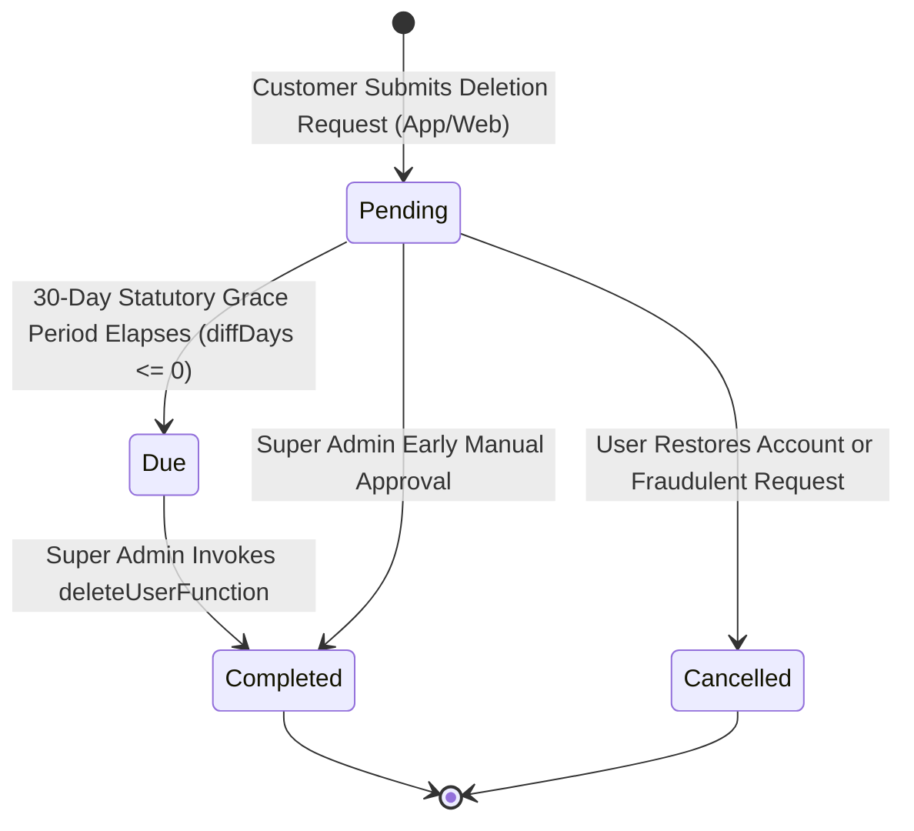

# Thailand PDPA & Data Privacy Compliance Guide

**Jurisdiction:** Kingdom of Thailand  
**Primary Legislation:** Personal Data Protection Act B.E. 2562 (2019) (PDPA)  
**Supervisory Authority:** Office of the Personal Data Protection Commission (PDPC)  
**System Scope:** Thaiseva Admin Portal, Partner Dashboard, Consumer Mobile App & Public Websites  
**Data Controller:** Thaiseva Platform Co., Ltd.

---

## 1. Regulatory Context & Lawful Basis for Processing

Under the Thailand PDPA, digital travel and marketplace platforms must establish a lawful basis under Section 24 prior to collecting, storing, or processing personal data.

### 1.1 Lawful Basis Mapping (PDPA Section 24)

| Data Category | Specific Personal Identifiers | Firestore Storage Location | PDPA Section 24 Lawful Basis |
|---|---|---|---|
| **Customer Travel Details** | Full name, personal email, phone number, flight number, pickup hotel address, special requests | `hotelBookingData`, `travelBookingDetails`, `car_bookings` | **Section 24(3) — Contractual Performance:** Necessary for booking fulfillment, transport dispatch, and hotel check-in. |
| **Partner Identification & KYC** | Full name, national Thai ID card / passport copy, commercial tourism license, driver's license | `partners`, `drivers`, Cloud Storage (`/partner_docs/`) | **Section 24(3) & 24(6) — Contractual & Legal Obligation:** Tourism Authority of Thailand (TAT) partner vetting. |
| **Partner Banking & Payout Data** | Commercial bank name, bank account number, account holder name, branch address | `partners.paymentInformation` | **Section 24(3) — Contractual Performance:** B2B financial settlements and commission payouts. |
| **Customer Support Transcripts** | Chat logs, audio voice note recordings, inquiry forms | `chatRooms`, `chats`, `ContactMessages`, Storage (`/chat/`) | **Section 24(5) — Legitimate Interests:** Dispute resolution, service quality, fraud detection. |
| **Customer Authentication** | Firebase Auth UID, email, hashed OTP records | Firebase Authentication, `users`, `emailOtpChallenges` | **Section 24(3) — Service Security:** Identity verification and account security. |

---

## 2. Cross-Border Data Transfers (PDPA Sections 28 & 29)

Personal data collected in Thailand is processed across cloud infrastructure located in:
1. **Google Cloud Platform / Firebase (Region `asia-east2` — Hong Kong):** Houses Firestore databases, Cloud Functions serverless execution, and Cloud Storage.
2. **Stripe Payments Inc. (Global / US / Singapore):** Processes payment tokens and checkout authentication.

**Compliance Safeguards:** Both Google Cloud and Stripe operate under Binding Corporate Rules (BCR) and ISO/IEC 27001 certifications, providing personal data protection standards deemed equivalent to or exceeding the Thailand PDPA under Section 28.

---

## 3. Data Subject Rights & The Right to Erasure

Under Section 33 of the PDPA, data subjects retain the **Right to Erasure** ("Right to be Forgotten"). Thaiseva operationalizes this via the administrative deletion queue (`DeletionRequests.jsx`) and backend callable functions (`accountDeletion.ts`).

### 3.1 Account Deletion State Machine



| Request State | UI Tab | Condition | Permitted Admin Action |
|---|---|---|---|
| **`Pending`** | `Pending Requests` | Request submitted; active 30-day grace period countdown ($> 0$ days remaining). | Can cancel if requested by user, or approve early upon explicit confirmation. |
| **`Due`** | `Action Required` | Grace period has elapsed ($\le 0$ days remaining). | **High Priority:** Super Admin must execute deletion. |
| **`Completed`** | `Completed` | Account authentication permanently destroyed via Firebase Auth. | Historical compliance record (read-only audit trail). |
| **`Cancelled`** | `Cancelled` | Request voided at customer's request or flagged fraudulent. | Read-only audit trail. |

---

## 4. End-to-End Deletion Workflow Sequence

```mermaid
sequenceDiagram
    autonumber
    actor Customer as Traveler / App User
    participant App as Mobile App / Website
    participant Firestore as Firestore (/DeletionRequests)
    participant AdminUI as Admin Dashboard (DeletionRequests.jsx)
    participant CloudFn as Cloud Functions (deleteUserFunction)
    participant Auth as Firebase Authentication

    Customer->>App: Clicks "Delete Account" in Profile Settings
    App->>Firestore: Writes /DeletionRequests/{id} { uid, email, status: 'Pending', createdAt: now() }
    Note over Firestore,AdminUI: 30-Day Auto-Deletion Grace Period Initiated

    AdminUI->>Firestore: Admin monitors queue; calculates days remaining
    alt User Reconsiders within 30 Days
        Customer->>AdminUI: Contacts support requesting account retention
        AdminUI->>Firestore: Update DeletionRequests/{id} { status: 'Cancelled' }
    else Grace Period Expires / Admin Approves
        AdminUI->>CloudFn: Invoke deleteUserFunction({ uid, requestId })
        CloudFn->>CloudFn: Verify caller has admin === true Custom Claim
        CloudFn->>Auth: admin.auth().deleteUser(uid)
        CloudFn->>Firestore: Update users/{uid} { accountDeleted: true, deletedAt: now() }
        CloudFn->>Firestore: Update DeletionRequests/{id} { status: 'Completed', completedAt: now() }
        AdminUI-->>Customer: Confirmation notice dispatched
    end
```

---

## 5. Statutory Exceptions: Tax & Financial Data Retention

Under **PDPA Section 33(3)**, the right to erasure does **not** override legal obligations imposed by other Thai statutes. Specifically:

### 5.1 Thai Revenue Code (Section 87/3)
- **Mandate:** All tax invoices, commercial ledgers, commission statements, and transaction vouchers must be retained for **a minimum of 5 years** (extendable to 7 years during tax investigation).
- **Compliance Implementation:**
  - **Firebase Auth Account:** Deleted permanently. The customer can never log in again.
  - **Historical Order Ledgers:** `hotelBookingData`, `travelBookingDetails`, and `partner_invoices` are **preserved** for tax audit defense.

### 5.2 Required Personal Data Scrubbing (Anonymization)
To comply with both the Revenue Code and the PDPA, personal records older than the active travel window must be anonymized while preserving accounting values:

```typescript
// Architectural Data Scrubbing Specification
interface AnonymizedBookingRecord {
  // Preserved for Thai Revenue Code Audit
  bookingId: string;                         // RETAINED
  hotelId: string;                           // RETAINED
  amount: number;                            // RETAINED
  currency: "THB";                           // RETAINED
  createdAt: Timestamp;                      // RETAINED
  isPaymentDone: true;                       // RETAINED

  // Scrubbed / Redacted for PDPA Compliance
  fullName: "Redacted User (PDPA)";          // ANONYMIZED
  guestEmail: "anonymized@deleted.thaiseva.com"; // ANONYMIZED
  phoneNumber: "[REDACTED]";                 // REDACTED
  flightNumber: "[REDACTED]";                // REDACTED
  specialRequests: "";                       // PURGED
}
```

---

## 6. Security Measures & 72-Hour Data Breach Notification

Under **Section 37(4) of the PDPA**, Data Controllers must notify the PDPC without undue delay and, where feasible, **no later than 72 hours** after becoming aware of a personal data breach that creates a risk to the rights and freedoms of individuals.

### 6.1 Breach Incident Response SLA
1. **Hour 0–4 (Detection & Containment):** SRE/Security Architect detects unauthorized access or data exfiltration. Revoke credentials, rotate Firebase API keys, and terminate compromised sessions.
2. **Hour 4–24 (Impact Assessment):** Determine exact data categories exfiltrated (e.g. customer phone numbers vs. partner bank details) and count of impacted individuals.
3. **Hour 24–48 (Legal & Executive Review):** Data Protection Officer (DPO) and Legal Counsel review reportable threshold.
4. **Hour 48–72 (Regulatory & Subject Notification):**
   - Submit formal breach notification to the **Office of the PDPC**.
   - If the breach entails a high risk of identity theft or financial loss, dispatch email and push notifications directly to affected data subjects.

### 6.2 Compliance Contact & Privacy Inquiries
- **Data Protection Officer (DPO) Email:** `dpo@thaiseva.com`
- **Customer Privacy Inquiries:** `privacy@thaiseva.com`
