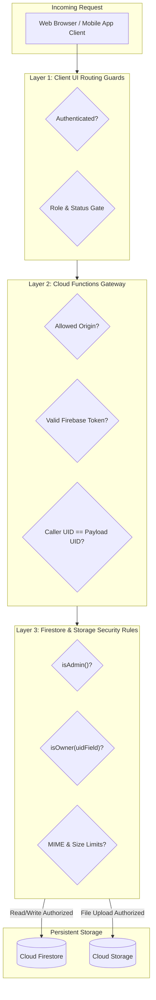

# Security Architecture & RBAC Specification

This document defines the multi-tenant security architecture, Role-Based Access Control (RBAC) model, Firestore and Cloud Storage security rules governance, and vulnerability remediation procedures for the Thaiseva ecosystem.

---

## 1. Threat Model & Defense-in-Depth Architecture

The Thaiseva ecosystem enforces a **three-tier security boundary**:
1. **Client-Side Navigation Guards (React Router v7):** Prevent unauthorized page rendering and redirect unprivileged sessions to login or approval notices.
2. **Serverless Execution Security (Cloud Functions v2):** Enforces Firebase ID token validation (`admin.auth().verifyIdToken()`), caller UID ownership assertions, App Check verification, and CORS origin whitelisting.
3. **Database & Storage Rules Gatekeeper (`firestore.rules` & `storage.rules`):** Unbypassable database-level security rules that inspect every raw document read, write, update, and delete against user claims and tenant identifiers.



---

## 2. Roles & Permissions (RBAC) Matrix

| Identity | Current privacy boundary |
|---|---|
| Admin | Single staff role; active account required. Privileged account actions require recent authentication. |
| Customer | Own profile/bookings/support thread; no shared customer directory. |
| Partner | Product-specific ownership/approval controls; separate offboarding. |
| Anonymous | Public listing information only. |

Storage was not changed; legacy allowances there require separate verification. Admin SDK/IAM access bypasses client rules. App Check must be verified endpoint by endpoint. Secret-storage tables below describe the target, not completed runtime migration.

---

## 3. Client-Side Route Protection (`src/routes/`)

Client-side navigation security is implemented in `src/routes/` and wraps route declarations:

```typescript
// Hierarchy of Route Guards in src/routes/
<PrivetRouter>           // Layer 1: Ensures auth.currentUser exists
  <AdminRoute>           // Layer 2: Requires active Admin role
    <HeadAdminRoute>     // Layer 3: Requires role === 'Admin' strictly
      <DeletionRequests />
      <SubAdmins />
    </HeadAdminRoute>
  </AdminRoute>
  <PartnerRoute>         // Layer 2: Requires role === 'Partner' AND status === 'Verified'
    <PartnerDashboard />
  </PartnerRoute>
</PrivetRouter>
```

> [!NOTE]
> Client route guards exist solely for user experience. True data protection is enforced at the database level by `firestore.rules` and `storage.rules`.

---

## 4. Firestore Security Rules Architecture (`firestore.rules`)

`firestore.rules` (867 lines) operates as a multi-product shared firewall governing travel, hotel, car, and restaurant paths.

### 4.1 Key Security Helper Functions
```javascript
// Validates active session
function isAuthenticated() {
  return request.auth != null;
}

// Non-crashing role lookup (handles missing user profile gracefully)
function userRole() {
  return exists(/databases/$(database)/documents/users/$(request.auth.uid))
    ? get(/databases/$(database)/documents/users/$(request.auth.uid)).data.get('role', '')
    : (
      exists(/databases/$(database)/documents/Users/$(request.auth.uid))
        ? get(/databases/$(database)/documents/Users/$(request.auth.uid)).data.get('role', '')
        : ''
    );
}

// Multi-tenant ownership verification across diverse entity shapes
function isOwner(userIdField) {
  return isAuthenticated() && (
    resource == null ||
    resource.data[userIdField] == request.auth.uid ||
    resource.data.userId == request.auth.uid ||
    resource.data.hotelUid == request.auth.uid ||
    resource.data.providerUid == request.auth.uid ||
    resource.data.restaurantUid == request.auth.uid
  );
}

// Safe self-update preventing privilege escalation
function isSafeUserSelfUpdate(userId) {
  return request.auth.uid == userId &&
    request.resource.data.get('role', resource.data.get('role', '')) == resource.data.get('role', '') &&
    request.resource.data.get('status', resource.data.get('status', '')) == resource.data.get('status', '') &&
    request.resource.data.get('isSuspended', resource.data.get('isSuspended', false)) == resource.data.get('isSuspended', false);
}
```

### 4.2 Multi-Tenant Data Isolation Guarantees
- **Hotel Scoping (`HotelDB/{hotelId}`):** Partners cannot update or delete rooms belonging to competitor hotels. The rule checks `resource.data.hotelUid == request.auth.uid`.
- **Order Scoping (`hotelBookingData`, `car_bookings`):** Partners can query only bookings where their UID is bound to the document. Global queries without tenant filters return `PERMISSION_DENIED`.

---

## 5. Cloud Storage Security Rules Architecture (`storage.rules`)

Cloud Storage security rules protect property photo galleries, customer voice recordings, and partner license proofs:

### 5.1 Storage Rules Matrix

| Storage Bucket Path | Read Permission | Write Permission | Max Size | MIME Filter |
|---|---|---|:---:|:---:|
| `/site-media/{allPaths=**}` | Public (`true`) | Super Admin only | 50 MB | Any (Video/Image) |
| `/hotelImages/{allPaths=**}` | Public (`true`) | Admin only | 15 MB | `image/*` |
| `/partners/{partnerId}/{allPaths=**}` | Public (`true`) | Admin OR Partner (`uid == partnerId`) | 15 MB | Any |
| `/users/{userId}/{allPaths=**}` | Admin OR Owner | Owner only (`uid == userId`) | 15 MB | Any |
| `/applications/{appId}/{allPaths=**}` | Admin only | Public (Onboarding uploads) | 15 MB | `image/*`, `application/pdf` |
| `/chat/{userId}/{allPaths=**}` | Authenticated | Sender only (`uid == userId`) | 20 MB | Any (Audio/Image) |
| Catch-All `/{allPaths=**}` | Public (`true`) | Admin only | 25 MB | Any |

---

## 6. Security Audit Findings & High-Priority Vulnerabilities

An exhaustive code audit revealed three critical vulnerabilities that must be remediated in the next sprint:

### ⚠️ Vulnerability 1: Hardcoded Super-Admin Bypasses
- **Locations:**
  - `firestore.rules` (lines 45–48)
  - `storage.rules` (lines 16–20 and 39)
  - `functions/src/accountDeletion.ts` (lines 5–8)
  ```javascript
  request.auth.token.email in [
    "admin@gmail.com",
    "thaiseva_admin@gmail.com"
  ]
  ```
- **Risk Severity:** 🔴 **CRITICAL**. An attacker gaining control of these email addresses or exploiting identity provider verification bugs gains root access to the entire database and storage buckets.
- **Remediation Plan:**
  1. Remove all hardcoded email addresses from `firestore.rules`, `storage.rules`, and Cloud Functions.
  2. Implement cryptographically signed **Firebase Custom Claims**:
     ```javascript
     // scripts/grantAdminClaim.js
     const admin = require("firebase-admin");
     admin.initializeApp();
     admin.auth().setCustomUserClaims(targetUid, { admin: true });
     ```
  3. Replace the `isAdmin()` helper in security rules with:
     ```javascript
     function isAdmin() {
       return isAuthenticated() && request.auth.token.admin == true;
     }
     ```

---

### ⚠️ Vulnerability 2: Client-Side Secret Key Exposure
- **Location:** `src/services/DataEncrypter.js` (lines 5–8)
  ```javascript
  const secretKey = CryptoJS.enc.Hex.parse(import.meta.env.VITE_SECRET_KEY || "");
  const iv = CryptoJS.enc.Hex.parse(import.meta.env.VITE_IV_KEY || "");
  ```
- **Risk Severity:** 🔴 **CRITICAL**. Environment variables prefixed with `VITE_` are embedded in plaintext inside public production JavaScript bundles. The AES key and IV can be extracted via browser developer tools to decrypt partner banking details.
- **Remediation Plan:**
  1. Deprecate client-side encryption immediately.
  2. Transmit all partner KYC and banking records over HTTPS/TLS directly to a Cloud Functions endpoint.
  3. Encrypt sensitive payout numbers on the server side using **Google Cloud Secret Manager** or Cloud KMS before saving to Firestore.

---

### ⚠️ Vulnerability 3: Public Anonymous Upload on `/applications/`
- **Location:** `storage.rules` (lines 120–124)
- **Risk Severity:** 🟡 **MEDIUM**. Storage allows unauthenticated writes up to 15MB for partner application files. Malicious actors could exhaust storage quotas or upload malicious PDFs.
- **Remediation Plan:**
  1. Enforce Firebase App Check on public upload paths.
  2. Integrate a Cloud Storage trigger to validate file headers and execute anti-malware scanning before files are visible to staff.

---

## 7. Secrets & Key Management Standard Operating Procedure

All operational secrets are strictly segregated into environment tiers:

| Secret Name | Intended Tier | Storage Location | Forbidden Location |
|---|---|---|---|
| `STRIPE_SECRET_KEY` | Backend Only | Google Secret Manager | Client `.env` / Git Repository |
| `STRIPE_WEBHOOK_SECRET` | Backend Only | Google Secret Manager | Client `.env` / Git Repository |
| `ZOHO_MAIL_API_KEY` | Backend Only | Google Secret Manager | Client `.env` / Git Repository |
| `OTP_HASH_KEY` | Backend Only | Google Secret Manager | Client `.env` / Git Repository |
| `VITE_FIREBASE_API_KEY` | Public Frontend | Frontend `.env` | (Public by design in Firebase) |
| `VITE_GOOGLE_MAPS_API_KEY` | Restricted Frontend | Frontend `.env` | Unrestricted Cloud Console Keys |
