# Thaiseva: Detailed Technical Data Protection and Data Flow Report

**Controller:** THAI SEVA TRAVEL & SERVICES CO., LTD.

**Company registration:** 0105567071964

**Tour business licence:** 14/04712

**Privacy and support contact:** support@thaiseva.com

**Document reference:** TS-PDPA-TECH-2026-10-21

**Version:** 2.0, detailed Markdown edition

**Prepared:** 21 October 2026

**Production metadata evidence:** 21 October 2026, 17:20 UTC

**Audience:** company management, technical reviewers and government/regulatory reviewers

## Document purpose and reading guide

This report explains what personal information Thaiseva uses, why it is needed, where it moves, who can access it, how technical controls protect it and how retention/deletion is handled. It expands the earlier four-page technical summary with implementation detail and flow diagrams.

The statement supported by the reviewed evidence is:

> Thaiseva has implemented and tested technical safeguards for the reviewed website, Admin/partner panels, food/restaurant panels and connected Firebase backend. These safeguards restrict access, separate public information from private records, protect service connections, control sensitive uploads and support purpose-based retention and reviewed deletion.

This is a point-in-time technical report. It is not PDPC approval, independent certification, proof that every historical incident has been assessed or a guarantee of absolute security. Company legal/governance duties remain visible in Section 21 rather than being represented as completed engineering work.

Diagrams show logical information flows. A line does not mean unlimited access, a separate physical server for every box or that all providers use the same country. Controls apply at the boundaries described below.

### Evidence labels

| Label | Meaning |
| --- | --- |
| Production verified | A recorded read-only check of deployed rules, service settings, responses or file metadata |
| Source reviewed | Behavior supported by the available implementation; this alone does not prove every live business scenario succeeded |
| Test verified | Automated regression/emulator tests or a recorded browser check passed for the described scope |
| Operating procedure | A documented action that authorized company staff must perform |
| Company evidence pending | Contracts, staffing, business/legal decisions or operational demonstrations not established by code |

### Contents

1. [System scope and architecture](#1-system-scope-and-architecture)
2. [Information inventory and purposes](#2-information-inventory-and-purposes)
3. [Storage and processing countries](#3-storage-and-processing-countries)
4. [Authentication and authorization boundaries](#4-authentication-and-authorization-boundaries)
5. [Account creation and email verification flow](#5-account-creation-and-email-verification-flow)
6. [Travel booking and payment flow](#6-travel-booking-and-payment-flow)
7. [Food order and delivery flow](#7-food-order-and-delivery-flow)
8. [Identity and verification document flow](#8-identity-and-verification-document-flow)
9. [Support conversation and attachment flow](#9-support-conversation-and-attachment-flow)
10. [Optional analytics and withdrawal flow](#10-optional-analytics-and-withdrawal-flow)
11. [Public data and provider sharing](#11-public-data-and-provider-sharing)
12. [Encryption, application security and secrets](#12-encryption-application-security-and-secrets)
13. [Retention rules and scheduler decisions](#13-retention-rules-and-scheduler-decisions)
14. [Legacy file decisions and expiry flow](#14-legacy-file-decisions-and-expiry-flow)
15. [Privacy requests, exports and erasure](#15-privacy-requests-exports-and-erasure)
16. [Backups, recovery and restoration](#16-backups-recovery-and-restoration)
17. [Logs, incidents and operational accountability](#17-logs-incidents-and-operational-accountability)
18. [Repository, release and evidence hygiene](#18-repository-release-and-evidence-hygiene)
19. [Recorded technical verification](#19-recorded-technical-verification)
20. [Control-to-risk mapping](#20-control-to-risk-mapping)
21. [Remaining company evidence and technical limits](#21-remaining-company-evidence-and-technical-limits)
22. [Supporting references and company review](#22-supporting-references-and-company-review)

## 1. System scope and architecture

### 1.1 Applications covered

| Component | Function | Boundary |
| --- | --- | --- |
| Customer website | Public catalog, accounts, bookings, contact forms, consent and account-deletion route | The available website source and recorded production checks |
| Travel Admin and partner panels | Bookings, partner/hotel administration, support, exports, invoices and website configuration | Reviewed privileged handlers, shared rules and panel workflows |
| Food master/restaurant panels | Restaurant onboarding, menus, orders, partner support, rider coordination and settlement | Reviewed food authorization, tenant isolation, APIs and tests |
| Firebase backend | Authentication, database, object storage, functions, secrets and logging | Recorded configuration and selected endpoint/rule verification |
| Connected mobile application | Customer journeys using the shared services | Mobile checking was owner-confirmed; no independent mobile source audit is claimed |
| External providers | Payments, email, maps, messaging, notifications and optional analytics | Integrations were identified; provider terms/country evidence remain separate |

### 1.2 Overall information flow

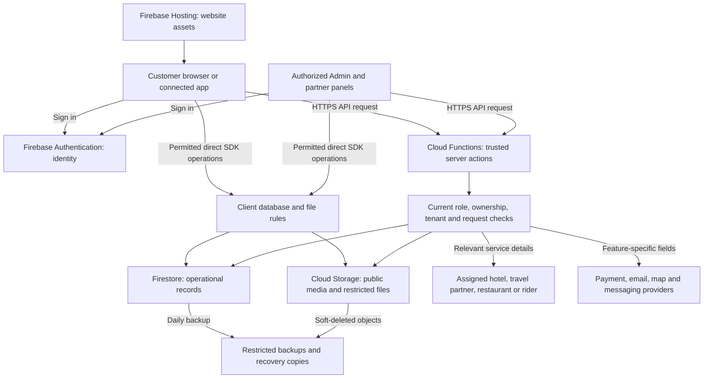

Public page delivery does not make the database public. A visitor may receive public listing content while being denied private profiles, verification files, support messages and unrelated orders.

There are two separate data-access paths: direct client SDK access and trusted server access. Their controls are explained in Section 4.

## 2. Information inventory and purposes

### 2.1 Data categories

| Category | Typical information | Why it is used | Main recipients/access |
| --- | --- | --- | --- |
| Account and profile | Name, email, phone, account ID, nationality, date of birth and optional profile photo | Account setup, verification, website email-signup age eligibility and service contact | Account holder, identity provider and authorized operators |
| Travel/hotel bookings | Guest/contact information, travel/stay dates, party size, requested arrangements, booking references and necessary pickup/destination | Arrange the requested service, coordinate fulfilment and resolve booking issues | Relevant hotel/travel/transport provider and necessary operations |
| Food orders/delivery | Items, quantities, amount, customer contact, delivery address/location, instructions and optional delivery photo | Prepare the order, deliver it and handle order support | Relevant restaurant, assigned delivery workflow and authorized operations |
| Partner applications | Owner/business contacts, business/licence details, requested identity evidence and partnership status | Assess applications and administer verified partnerships | Authorized verification/operations staff |
| Bank/settlement details | Required payout details, settlement references, amounts and finance records | Pay the appropriate provider and reconcile obligations | Restricted finance/verification roles and relevant payment services |
| Payment records | Amount, currency, checkout/payment identifiers, booking/order reference and verification status | Confirm payment, settlement and manual refund review | Stripe and authorized payment/operations handlers |
| Support | Messages, attachments, conversation/category metadata and account/booking references | Answer requests and resolve service problems | Conversation participants and authorized support |
| Security/technical data | Session/request metadata, IP where collected, audit actions and device/push tokens | Authenticate, limit misuse, deliver notifications and investigate problems | Relevant backend services and authorized operators |
| Optional analytics | Consented page-use events and browser/device information | Understand website usage after a valid optional choice | Configured analytics service and authorized analysts |
| Catalog/media | Business display fields, menus, banners, listing images and supplied public content | Display the service catalog and marketing content | Intended audience under the relevant publication rules |

A customer should not send passwords, full payment-card numbers or CVVs through support. The reviewed checkout flow sends card entry to Stripe; application payment records use references, amounts and status. This does not assert that a free-text message or historical upload could never contain inappropriate information.

### 2.2 Purpose and processing-basis baseline

The owner adopted an operational purpose/basis baseline on 21 October. The fuller assessment is maintained in the [data policy](PDPA_DATA_POLICY_2026-10-21.md).

| Activity | Operational basis selected | Important limit |
| --- | --- | --- |
| Requested accounts, bookings, food fulfilment and service support | Requested pre-contract steps or service contract | Collect what is needed for that service, rather than treating every field as optional consent |
| Proportionate security, abuse prevention and general enquiry handling | Documented legitimate interests where appropriate | Necessity, access limits and balancing must remain justified |
| Optional website analytics | Consent | Rejecting analytics does not prevent ordinary account/booking use |
| Accounting/statutory records | Applicable identified legal obligation, where established | Finance must identify the record class, trigger and period; a generic five-year rule is insufficient |
| Partner verification | Necessary partnership steps/contract; a specific legal duty only if identified | Required document categories and any sensitive-data exception require actual company justification |
| Recovery and limited remediation records | Security/continuity and documented remediation purposes | Recovery copies and historical exports are not permission for indefinite reuse |

This table records the adopted operational baseline, not a legal opinion that every possible category or historical use is lawful. Device permission for location is also distinct from the processing basis for the service.

## 3. Storage and processing countries

### 3.1 Recorded production settings

| System | Location/setting at verification | Information involved |
| --- | --- | --- |
| Firebase Authentication | United States, according to Firebase service documentation | Sign-in and identity-service information |
| Firestore operational database | asia-east2, Hong Kong | Profiles, bookings, orders, support metadata and review/audit records |
| Scheduled Firestore backups | asia-east2, Hong Kong; daily, seven-day retention | Recovery copies of database contents |
| Primary Cloud Storage bucket | us-central1, Iowa, United States; regional bucket | Uploaded files, private documents and public media |
| Cloud Functions | 77 in asia-east2, 45 in asia-southeast1, 9 in us-central1 | Request/event processing in Hong Kong, Singapore and Iowa respectively |
| Firebase Hosting | Global delivery infrastructure | Website/panel assets and associated request/service metadata |
| Cloud Logging buckets | Global location; 30-day default and 400-day required retention | Platform/application operational and audit log data |
| Other integrated providers | Provider-managed processing; complete country register not established here | Feature-specific payment, email, maps, notification, messaging or analytics data |

The function counts describe the recorded inventory of 131 active functions, not a per-request routing guarantee. A request may involve a backend function, database, object store and provider in different places.

### 3.2 What the location statement means

Thaiseva data is not hosted only in Thailand. The selected Firestore region does not also select the country used by Authentication, uploaded files, global services or other providers.

Local cloud-region configuration is one part of the technical description. Executed provider terms, subprocessors, transfer mechanisms, company assessments and exact external-provider countries remain company evidence requirements.

Provider documentation supporting Authentication location and general Firebase handling is linked in Section 22. These provider statements are distinct from settings directly read from Thaiseva's project.

## 4. Authentication and authorization boundaries

### 4.1 Two independent access paths

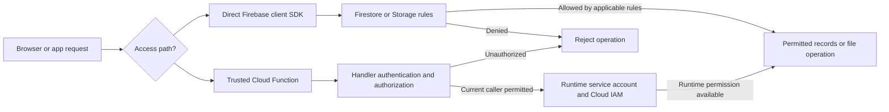

Firestore/Storage rules protect direct client operations. The trusted Admin SDK bypasses those client rules. Consequently, backend handler authorization and cloud IAM are separate controls; an allow/deny rule alone does not secure every server action.

CORS and route guards also do not replace authorization. CORS concerns browser origins; route guards concern panel navigation. The server must still determine whether the caller can perform the requested action.

### 4.2 Reviewed authorization checks

Reviewed privileged handlers validate the signed-in caller, current account status and applicable permissions. The food resolver reads the current Auth account and profile rather than trusting an old token to establish the caller's present role or restaurant.

Relevant checks include:

- Disabled Auth accounts and suspended profiles are refused by the reviewed current-account checks.
- Authentication time is compared with the account's token-valid-after time.
- Current protected claims/roles determine privileged access in the reviewed handlers.
- Ownership, restaurant/tenant scope or rider assignment is checked where the workflow requires it.
- Removing a role must not leave the old token as sufficient authority for protected backend actions.
- Private-file path validation prevents a caller from selecting arbitrary storage content.
- Privileged requests cannot rely solely on a user-supplied account, owner or restaurant ID.

### 4.3 Access expectations and limits

| Actor | Reviewed permitted purpose | Boundary |
| --- | --- | --- |
| Visitor | Public pages, permitted catalog content and dedicated public conditions | No general entitlement to raw customer, support or verification data |
| Customer | Own supported account, booking/order and support operations | Ownership checks apply; knowing another record ID is not permission |
| Restaurant owner | Applicable restaurant/menu/order and partner-support operations | Current food role and restaurant scope apply |
| Assigned rider/provider | Details needed for the assigned fulfilment workflow | Assignment/ownership restrictions apply to the relevant interface |
| Authorized Admin/food master | Operational review and permitted privileged actions | Current role/account checks apply; cloud administration remains a separate IAM surface |
| Runtime service account | Backend operations its cloud permissions allow | Admin SDK access must be constrained by handler code and IAM |
| Company privacy/finance operator | Verified request handling and justified retention decisions | Staff assignment, training, MFA/IAM review and evidence remain company work |

This is a scope explanation, not a claim that a complete manual test of every role on every route has been executed.

## 5. Account creation and email verification flow

### 5.1 Website email-signup journey

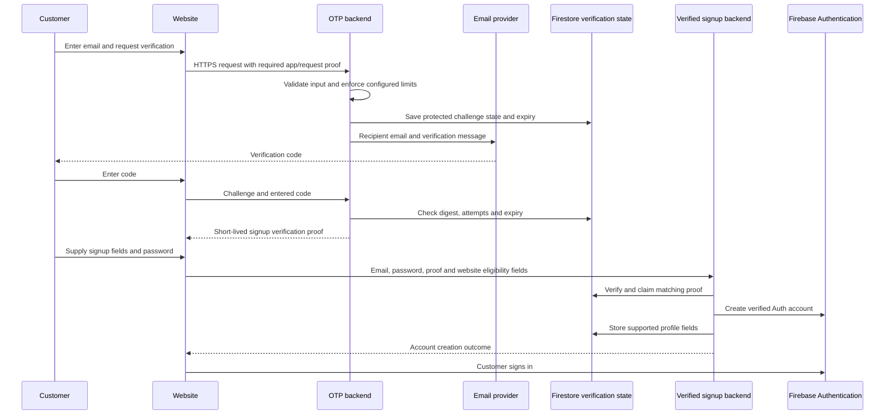

### 5.2 Data and controls

The reviewed OTP core generates a six-digit code with a cryptographic random generator. It uses an HMAC-SHA256 digest in challenge/proof handling rather than retaining a readable code as the verification secret. Delivery necessarily sends the code in the email message to the selected provider and customer.

Source policy values include a five-minute code lifetime, a 60-second resend cooldown, a fifteen-minute limiting window and bounded sends/attempts. The successful verification proof is short-lived, with a ten-minute expiry in the reviewed OTP handler. These are distinct from eventual deletion of expired challenge records.

The verified-signup handler checks that the proof matches the normalized email and is not expired. It claims a stable account ID so a retry can complete the same signup rather than creating an unrelated second account. The website signup implementation also checks nationality/date-of-birth eligibility input. Do not assume a different login provider supplies identical fields or follows an identical journey.

The account password is submitted over the signup/sign-in connection and used to create/verify the Firebase Auth account. This flow is not a claim that passwords never pass through a backend in memory, and it is not a complete historical credential-storage assessment.

### 5.3 Important boundaries

App Check applies where configured, not automatically to every endpoint in the project. OTP delivery, sign-in and profile storage may involve different services/countries. The challenge expiry protects verification validity; it does not prove immediate deletion of every provider log or email copy.

## 6. Travel booking and payment flow

### 6.1 Logical booking-to-confirmation journey

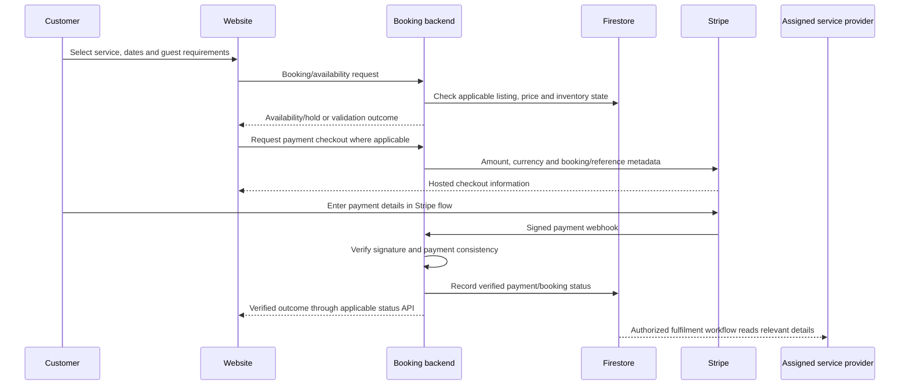

This diagram combines the logical steps used by the reviewed booking/payment interfaces. Individual hotel/tour/manual flows can differ in hold and acceptance order; it is not a claim that one endpoint performs every step.

### 6.2 What moves

The customer provides service selection, guest/contact details, dates, party size and necessary arrangements. Backend/payment processing uses the expected amount/currency and booking reference. Stripe receives the fields required by its checkout flow; application business records use payment references and status.

The relevant provider uses the information needed to arrange the booked service. A hotel booking does not create blanket access to unrelated support conversations, bank documents or other customers' records.

### 6.3 Security controls and refund handling

Backend validation and payment verification are the authority for the reviewed flows. A customer-controlled success URL or browser status is not proof of payment. Endpoint-specific webhook signing secrets must remain correctly bound.

Thaiseva's published refund process is manually reviewed through support. The report does not assert an automatic Stripe refund API or that successful negative endpoint tests prove a real payment/refund has been completed.

## 7. Food order and delivery flow

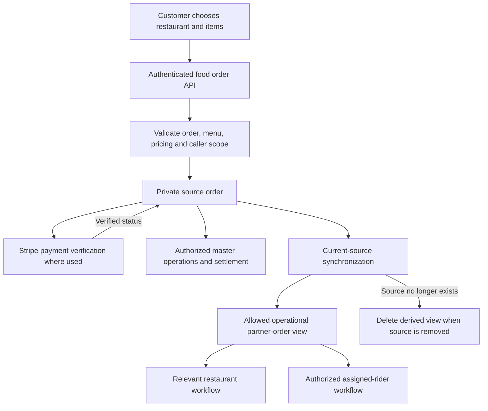

### 7.1 Minimization in the partner view

The reviewed partner-order projection keeps fulfilment fields such as customer name/contact, delivery address/instructions, items, order amount/status and assignment information. It does not indiscriminately copy the source record.

The projection implementation intentionally excludes source customer account identifiers, email and Stripe identifiers from the partner view. This is not anonymity: names, phone numbers and addresses remain personal information even when unnecessary internal/payment fields are omitted.

The synchronization transaction reads the current source record before writing a view. If the source has been deleted, it removes the derived view. This reduces the risk that a delayed event republishes an obsolete record.

### 7.2 Payment and delivery boundaries

Food payment verification checks the applicable Stripe payment data against the expected order amount/currency/reference. Restaurant and rider access remain subject to the relevant role, tenant and assignment checks. Public restaurant discovery/menu data is separate from private orders and verification evidence.

## 8. Identity and verification document flow

### 8.1 Reviewed identity upload and preview

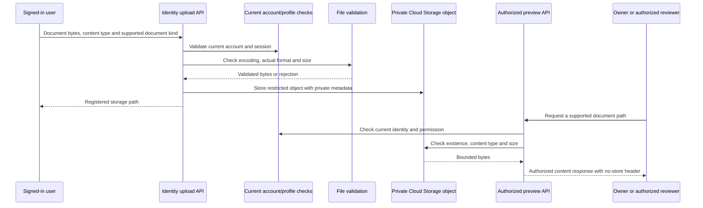

### 8.2 Validation and access

The reviewed identity API accepts the supported passport/licence kinds and allows JPEG, PNG, WebP or PDF. The shared validator checks actual format signatures, encoding and an eight-MiB bound; a filename or claimed MIME type alone is insufficient.

The generated object path is scoped to the authenticated user. Objects are stored as private identity documents without creating permanent Firebase download-token links in this path. The preview handler checks the supported path, current caller status, ownership or Admin permission and bounded file metadata/content.

The response contains authorized file content rather than proving that access is controlled by an ordinary public URL. The no-store response discourages browser/proxy caching; it does not make it impossible for an authorized recipient to save or photograph the content.

The returned preview metadata includes a short validity hint. Once bytes are delivered, it is not a remotely revocable copy or a guarantee of automatic deletion from the recipient's device.

### 8.3 Partner application documents

Partner application files have their own supported path and role/ownership handling. Do not assume the identity-upload API's exact formats, limits or owner rules describe every application upload endpoint. The shared protection principle is private verification storage, restricted reviewer access and separation from public catalog images.

## 9. Support conversation and attachment flow

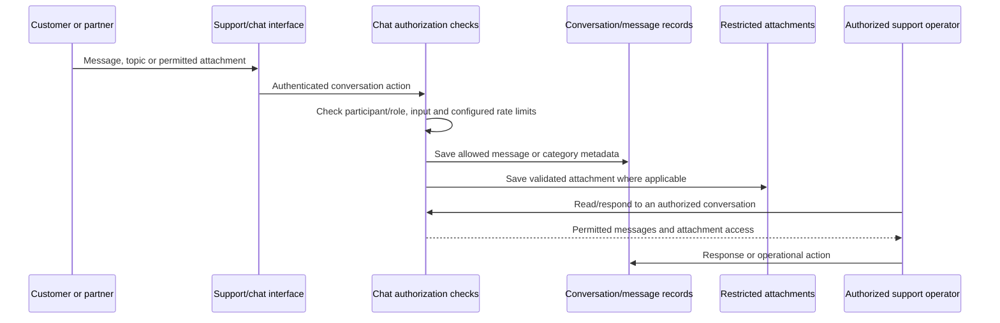

Conversation topic/category entries describe the service requested; they do not grant permissions. Category history is not a substitute for role checks. Reviewed support flows separate customer/conversation ownership from arbitrary record selection.

Attachments may contain sensitive material supplied by a user. Required handling is to keep them in the restricted workflow, avoid copying their content into public tickets/reports and review unnecessary identity/payment material rather than treating all uploads as public images.

Supported dated messages are subject to the implemented retention rules. Some newer support collections are handled through scoped account erasure and separate review rather than being included in every legacy message-scheduler branch. Section 13 identifies the scheduler scope; this document does not promise one universal automatic two-year purge for every attachment or chat representation.

Holds can affect message/attachment erasure. The reviewed account-erasure code checks relevant held conversations/orders/bookings and can preserve attachments while recording the unresolved review.

## 10. Optional analytics and withdrawal flow

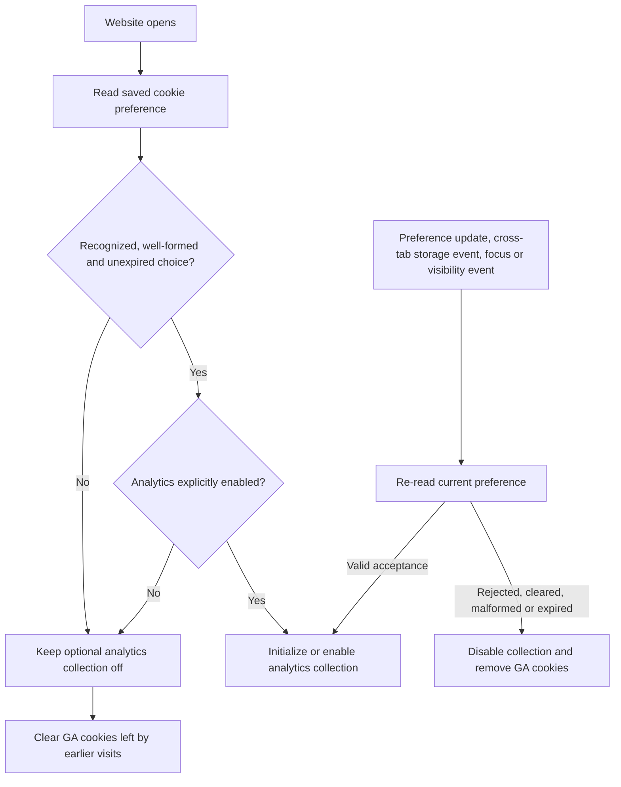

### 10.1 Implemented consent behavior

The consent parser requires necessary storage to be enabled, explicit boolean optional choices, a recognized policy version and a valid update time. It rejects malformed values, unknown versions, future timestamps and choices older than the configured 180-day maximum.

Optional collection starts only after a valid analytics choice. Withdrawal disables analytics collection and removes GA cookies at host/parent-domain scopes while leaving necessary cookies alone. The implementation responds to the current-tab preference event and cross-tab storage changes, with focus/visibility refreshes.

A recorded live-browser check showed analytics cookies removed and a necessary test cookie preserved. Eight consent regression tests passed.

### 10.2 What withdrawal does not establish

Withdrawal stops future optional collection in the reviewed website integration. It does not erase earlier analytics-provider records, control another device's independent browser preference or prove provider-specific retention/anonymization settings. Those need their own service configuration and company/vendor evidence.

## 11. Public data and provider sharing

### 11.1 Public information is an explicit subset

| Data surface | Reviewed information released | Access boundary |
| --- | --- | --- |
| Public self-drive conditions projection | Dedicated conditions text/string list | Public reads on the dedicated projection; no client writes |
| Minimized partner directory | Registered Business, City and Country | Current rules require authentication, despite the projection's public-oriented name |
| Restaurant catalog | Allowed listing/menu fields | Discovery interface; checked responses exclude private verification/bank fields |
| Partner order view | Allowed operational fulfilment fields | Applicable authorized roles, not general public access |
| Website banners/catalog images | Intentionally published content | Public by design; private documents are not banner assets |
| Raw customer/self-drive submissions | Customer-specific submitted information | Ownership/Admin restrictions; a mixed collection is not safely published as a whole |

Partner and conditions sync handlers read the current source inside a transaction. Private source fields are not automatically included in a display object. The partner directory deliberately omits arbitrary URLs, identity documents and additional personal contacts.

### 11.2 Feature-specific provider transfers

| Recipient | Data used by the feature | Boundary |
| --- | --- | --- |
| Assigned hotel/travel/transport provider | Necessary guest/contact, dates and arrangements | Relevant service assignment; no blanket database access |
| Relevant restaurant/rider | Items, contact, address/instructions and delivery state | Tenant/ownership/assignment scope and minimized operational view where implemented |
| Stripe | Amount, currency, booking/order reference and required checkout contact/metadata | Stripe card entry; backend verification and endpoint-specific signature checks |
| Zoho email | Recipient and OTP/email content for the selected integration | Backend credential/configured endpoint; provider copies require separate retention evidence |
| Gmail SMTP | Recipient and service-message content when used | Backend credentials and authorized service messaging |
| Google Maps | Submitted address/place or coordinates | Only for the selected feature; actual provider-country/terms evidence remains separate |
| Firebase Cloud Messaging | Device token and notification payload | Tokens/payloads can be personal data; do not assume every notification is free of private context |
| WhatsApp | Destination number and message/context when invoked | External provider and recipient become part of the flow |
| Google Analytics | Optional usage/device events after valid consent | Website consent gating; provider settings/copies are separate |

This inventory does not prove every integration sent a real message during testing. Engineering checks did not send customer emails, messages, payments or regulator notifications to manufacture evidence.

### 11.3 Practical minimization examples

A restaurant may need items and delivery contact, without needing the customer's Auth identifier or Stripe payment-intent identifier. A directory may need business name, city and country, without needing owner identity or bank documents.

## 12. Encryption, application security and secrets

### 12.1 Encryption and limits

Reviewed website/Firebase connections use HTTPS. Identity, database and object services provide encryption at rest under provider documentation. The inspected object bucket had no customer-managed default encryption key configured; no customer-managed-key or end-to-end-encryption claim is made.

Authorized application/cloud operators can still obtain readable information through permitted operations. Encryption does not replace access controls, recipient limitation or safe export handling.

Format-signature validation is not malware scanning. No independently verified universal malware scanner, DLP deployment, penetration-test certificate or staff-MFA configuration is established by this report.

### 12.2 Runtime secrets flow

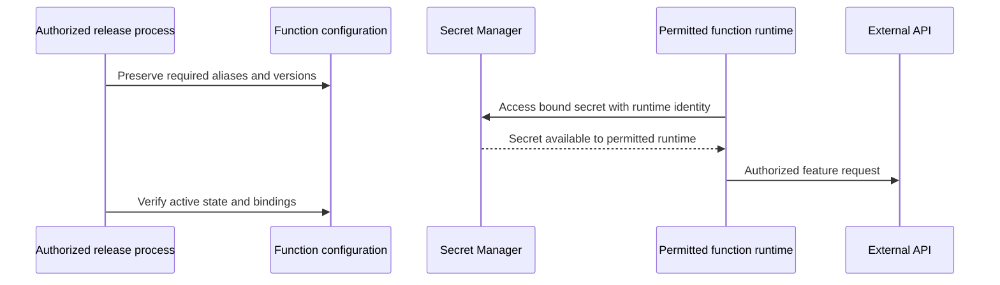

The recorded inventory found zero nonempty credential-named runtime/build fields in the checked 131 functions. All 18 recorded backend updates preserved runtime configuration and required secret bindings, including distinct Stripe webhook bindings.

That naming/configuration check does not prove no historical archive, local file, log or differently named field ever held credentials. Historical exposure and rotation decisions remain separate incident work.

### 12.3 Browser and content safeguards

Hosting security headers reduce browser injection/framing risks. Website builds generate CSP hashes. These complement validation; they do not establish that every HTML sink has been independently audited.

Admin blog HTML is sanitized before editor loading and saving, in addition to sanitized previews. Browser checks preserved formatting while removing tested scripts, event handlers and executable links.

The recorded Quill advisory has no published patched version in the checked advisory. Sanitization is a compensating control, not an upstream patch or a completely clean dependency audit.

### 12.4 Different controls address different risks

Reviewed endpoints apply input validation, current-caller checks, rate limits and App Check where configured. App Check does not authorize access to another tenant. A valid webhook signature does not replace matching the payment to the expected order. Browser route guards and CORS do not replace server authorization.

## 13. Retention rules and scheduler decisions

### 13.1 Category schedule

| Information | Implemented schedule/review rule | Boundary |
| --- | --- | --- |
| Account/profile | Active service; supported erasure removes login/profile/scoped uploads | Related business records, held content and provider copies require review |
| Supported enquiries | 90 days from reliable timestamp | Missing dates or holds prevent blind deletion |
| Supported messages | Two years in implemented branches | Not every chat/attachment representation is covered by every scheduler branch |
| Completed-trip locations | 90 days from reliable completion | Named transport collections; holds override |
| Dated terminal service records | Five years after both creation and current terminal outcome | Active records, missing dates, child collections, holds and accounting mapping affect eligibility |
| Accounting-linked records | Explicit mapped retention deadline before applicable disposal | Finance approves classes/triggers; invoice collections are not universally deleted by this job |
| Partner verification | Application/partnership end triggers necessity/offboarding review | Obligations, disputes and applicable duties must be recorded |
| Scoped legacy retained files | Finite per-object expiry and scoped native lifecycle | Native holds can block deletion; preview deadline also applies |
| Database backups | Daily; seven-day retention | Live erasure does not immediately rewrite every backup |
| Soft-deleted files | Seven-day recovery | Restricted recovery, not ordinary reuse |
| Ordinary/required logs | 30 / 400 days in checked buckets | Separately preserved incident evidence needs a justified review |
| Providers/downloaded exports | Copy/provider-specific handling | Not erased merely by the application scheduler |

Five years is an ordinary service-record threshold, not a universal accounting deadline. Actual accounting/VAT triggers may differ from booking creation/completion. Finance mapping remains necessary; see the [data policy](PDPA_DATA_POLICY_2026-10-21.md).

### 13.2 Booking decision flow

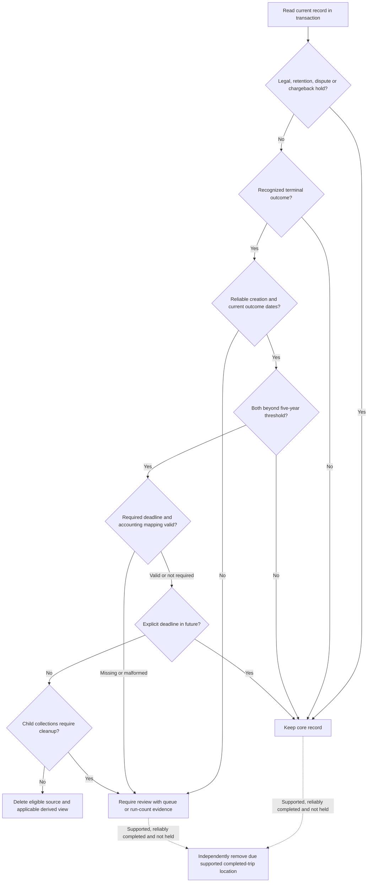

The location branch represents independent minimization while a core transaction remains retained/reviewed. It does not remove locations from held records or records without reliable completed status.

The code uses the date for the current outcome, not an obsolete earlier outcome. It recognizes legalHold, retentionHold, disputeOpen and chargebackOpen flags.

At disposal age, recognized accounting markers without a valid mapped deadline require review. Current markers include invoiceId, invoiceNumber, customerInvoiceId, taxInvoice, taxInvoiceNumber and accountingRecord. This is a guard, not complete semantic discovery of every financial record.

### 13.3 Scheduler scope and operation

| Group | Collections in reviewed maintenance list |
| --- | --- |
| Travel/service | hotelBookingData, travelBookingDetails, car_bookings, self_driving_bookings, vanBookings, bookings |
| Food/service | orders, foodOrders, dineInBookings |
| Conversations | foodCustomerSupportChats, foodRestaurantChats, foodCustomerChats, T2TWorldChatRoom, chats |
| Messages/enquiries/requests | messages, ContactMessages, DeletionRequests |

Configured location minimization applies to car_bookings, self_driving_bookings and vanBookings. It removes the configured pickup/drop/coordinate/route/location-history fields when the completion condition is met.

Source configuration schedules daily work at 03:00 Asia/Bangkok. Work uses bounded pages and persistent cursors, so eligibility does not imply every record is processed at that exact minute. A privileged preview returns dry-run counts and records a run summary; it is not completed deletion.

Review evidence differs by branch. Missing lifecycle/accounting-deadline cases create restricted review records in the applicable branch. If child collections prevent deletion, the current code preserves the parent and increments the run's review-required count; that branch does not automatically create the same per-record queue case. Operators must inspect both run summaries and review cases. An empty case queue is not a complete inventory of every possible retention exception.

The latest run summary read during closeout recorded 379 scans, zero failures and zero deletions under policy version 2026-10-13. The newly deployed 2026-10-21 policy was regression-tested and release-verified. That older run does not prove the new policy had already completed a production cycle.

V2 support data, exports, provider copies, partner offboarding and backups require their dedicated paths/reviews. The job is not a universal eraser.

## 14. Legacy file decisions and expiry flow

### 14.1 Completed decisions

The original population contained 213 objects. Twenty-six supported public objects remained unchanged; 187 restricted legacy cases received reviewed dispositions.

| Disposition | Count | Purpose/expiry |
| --- | --- | --- |
| Unnecessary objects removed live | 52 | Restricted recovery copies reach recorded hard-delete times on 28 October 2026 |
| Catalog/design assets in the 185-file batch | 132 | Private; expiry 21 October 2027 |
| Planning image in that batch | 1 | Private; expiry 21 October 2028 |
| Separately referenced promotion artwork | 1 | Current notification reference verified; private, expiry 21 October 2027 |
| Separately referenced support attachment | 1 | Dated conversation reference verified; private, expiry 17 October 2028 |
| Total restricted cases resolved | 187 | 52 removed live objects and 135 private finite-expiry objects |

The two referenced cases were additional to the 185-file content batch. Both were visually inspected and checked against current references before closing their cases. Checks included reference/content assessment, hashes/generations and relevant holds within the documented scope. Restricted per-file evidence remained separate. Inspection downloads were removed after hash verification.

### 14.2 Retained-object enforcement

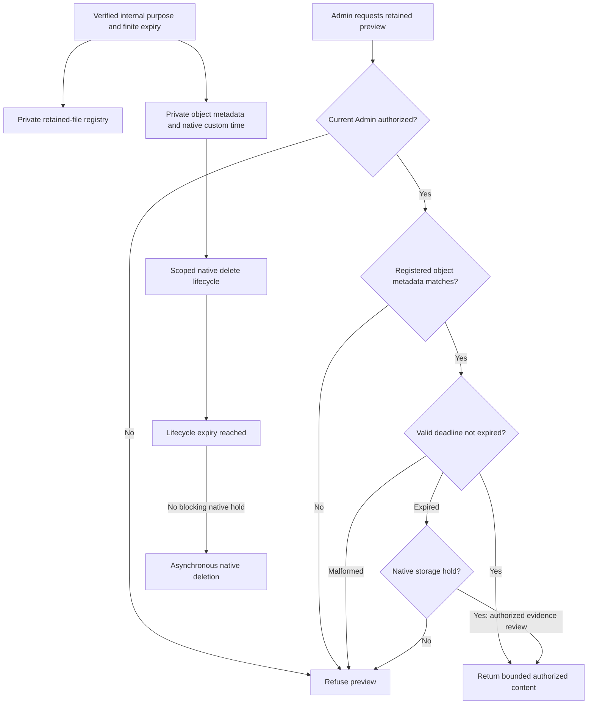

The scoped rule matched 135 intended retained objects and no unrelated objects. Full-name scope and suffix checks prevented prefix-only collisions.

Preview-time expiry closes the interval before asynchronous deletion. It is not a future deletion receipt. Missing deadlines on older registry records keep legacy behavior; configured malformed deadlines fail closed. A native hold permits authorized evidence review, not public access.

A Firestore/custom-metadata hold alone does not necessarily block native storage lifecycle. Operators must also apply the necessary native storage hold and record its purpose/review.

### 14.3 Meaning of resolved

Resolved means the purpose/access/disposal decision and stated actions were recorded and verified. It does not mean all retained content was deleted, future expiry already happened or historical exposure duties were assessed.

The queue snapshot had zero pending retention-review cases; four other missing-date cases were also resolved. No live privacy-erasure jobs were present. An empty queue is not a staffed rights-request demonstration.

## 15. Privacy requests, exports and erasure

### 15.1 Intake and decision flow

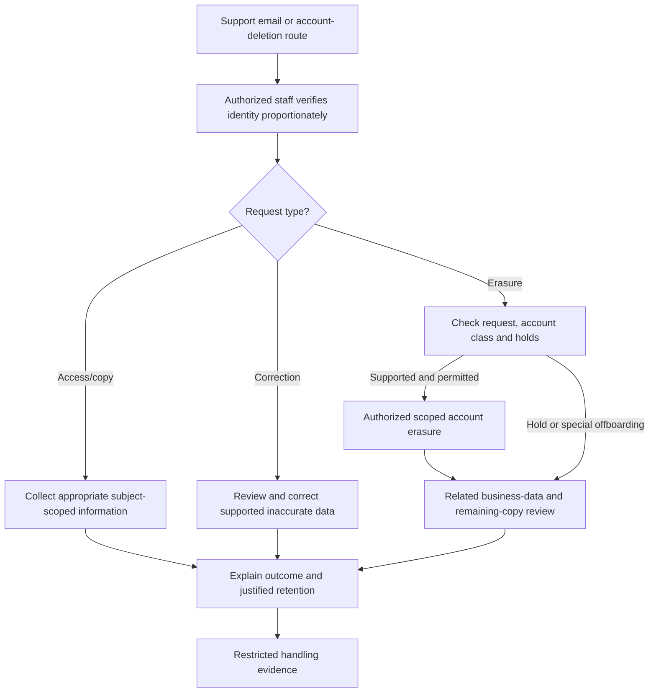

This combines implemented tools with required staff decisions. It is not a completed real request, an automated legal decision or proof every right is fully self-service.

### 15.2 Account erasure implementation

The reviewed Admin path checks current authority and a matching pending request/target. Ordinary customer erasure refuses protected staff/partner classes requiring separate offboarding. Request/profile and related-content holds affect destructive work.

For supported customers, the implementation removes the Auth login, scoped profile/operational records, push-device tokens and supported user uploads, subject to hold checks. Some support material is preserved where attachment/record checks require it.

A job can remain PENDING_RECORD_REVIEW with profile/upload/operational erasure flags, preserved paths, hold indicators and remaining business/copy categories. Its seven-day review due date is an internal follow-up marker, not a guarantee all copies disappear after seven days.

A deletion request may say Erasure Pending after login removal. Do not report complete global erasure while bookings, orders, shared messages, legacy uploads, logs, exports or backups still require decisions.

### 15.3 Export tool: exact scope

The reviewed exportCustomerData handler is an Admin bulk operational export, not an automatically subject-scoped rights-request export.

It requires current super-Admin authorization, pages through profiles, skips identified Admin/Sub Admin roles and returns an explicit selection: name, phone, email, address/location, profile-photo reference and creation timestamp. It applies export-text handling and an output-count bound. An audit event is written before release; a logging failure blocks return of personal information.

Staff must not send this bulk output to one requester. A rights response needs subject scoping, identity verification and review for third-party information. The tool is neither a complete portable export of all subject records nor evidence that every request can be fulfilled automatically.

### 15.4 Downloaded copies

Database rules cannot retract an operator's downloaded file. The company must control recipient access, transfer, local retention, onward sharing and disposal, with evidence where required. Provider and recovery copies remain separate surfaces.

## 16. Backups, recovery and restoration

### 16.1 Recorded configuration

| Control | Verified state |
| --- | --- |
| Database backup | Daily, seven-day retention |
| Backup readiness/region | Six READY backups; Hong Kong, asia-east2 |
| Point-in-time recovery | Disabled |
| Database deletion protection | Disabled |
| Primary file region | Iowa, us-central1 |
| File soft deletion | Seven days |
| Object versioning | Disabled |
| Automatic cross-region replica/separate export bucket | Not established by this check |

A database backup is not an independent backup of every uploaded file. Soft deletion is temporary recovery of deleted objects, not enabled object versioning.

### 16.2 Required restoration procedure

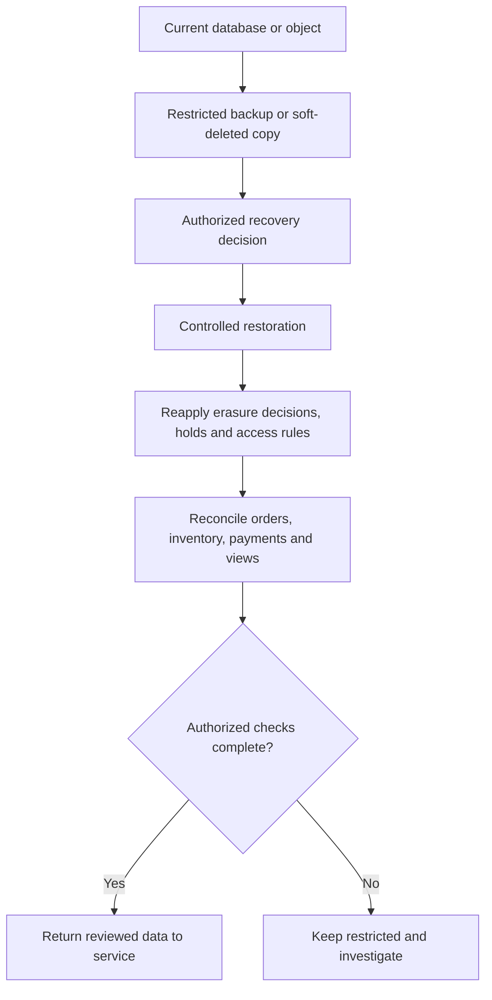

This is an operating procedure. Metadata proves configured settings and READY state, not full disaster-recovery certification. An older restore can reintroduce deleted profiles, old permissions or stale views. Authorized operators must reconcile those before ordinary use.

### 16.3 Provider deletion differs from configured backups

Provider retention need not match Thaiseva's seven-day schedule. Firebase documents an Authentication deletion window of up to 180 days across its live/backup systems. Do not claim all identity-provider copies disappear within seven days merely because database backups use that period.

## 17. Logs, incidents and operational accountability

### 17.1 What the records support

The checked Cloud Logging buckets retain ordinary logs for 30 days and required platform audit logs for 400 days. Application audit events record selected sensitive actions, including customer exports and erasure starts. Retention run/review records support follow-up on supported cleanup and exceptions.

Records can help identify actor, action, time and outcome. They do not prove every file read is logged, logs are tamper-proof against every administrator or all possible alerting has been configured/tested.

Logs/debug captures can contain personal information and configuration details. Do not place unredacted captures in public tickets or a government submission.

### 17.2 Incident handling is a required company procedure

For suspected unauthorized access, the company must record awareness time, assign an owner, contain access, preserve necessary restricted evidence, assess information/recipients and decide applicable notification/remediation duties with responsible advisers.

Engineering can restrict access, revoke links, patch checks and provide technical facts. The company must still assess historical access, risk, notifications and follow-up. This report does not conclude that no reportable incident occurred.

Required evidence should identify the incident, awareness time, owner, affected categories/scope, access facts, containment, risk/notification decision and closure. Avoid attaching raw identity documents or credentials to public summaries.

## 18. Repository, release and evidence hygiene

### 18.1 Completed project cleanup

The cleanup removed 273 clutter files from the application folders, including 80 outdated/redundant Markdown files. Recoverable copies were moved outside the source repositories into an archive restricted to the current operator, SYSTEM and local Administrators. Archive hashes were verified.

A further 7,470 generated website dependency/cache files were removed from Git tracking. Local dependencies remain ignored for development; manifests and lockfiles remain installation inputs.

Application logic, runtime configuration, rules, required service-content Markdown and the original published business licence were preserved. A source documentation comment and current guides/indexes were updated.

This is not proof that sensitive content vanished from Git history, older clones or provider archives. Removing tracked dependencies is source hygiene, not proof all dependency advisories were patched.

### 18.2 Release controls

The recorded backend release updated three Admin privacy functions and fifteen functions in the older website dependency family. Runtime configuration/secret bindings were preserved and active state read back.

Hosting builds/releases covered the website, travel/Admin and food panels. Canonical shared Firestore/Storage rules are managed separately rather than replaced independently by an unrelated panel release.

### 18.3 Evidence sharing

This report contains no customer record IDs, document images, bearer tokens, secret values or raw customer exports. Restricted per-record evidence remains separate.

For external review, use sanitized rule/version comparisons, test summaries, denial outcomes, configuration summaries and disposition counts. Authorize access to raw evidence proportionately and redact customer details where appropriate.

## 19. Recorded technical verification

### 19.1 Production checks

| Evidence ID | Check | Recorded result | What it does not prove |
| --- | --- | --- | --- |
| E01 | Rule comparison | Live Firestore/Storage rules matched canonical source | Every possible role/record combination was manually tested |
| E02 | Sensitive API anonymous requests | Checked identity upload/preview, export, staff creation and legacy finalizer denied unsigned callers | A successful authorized business transaction |
| E03 | Private submission | Checked anonymous submission read denied | Complete census of historical URLs |
| E04 | Original private links | All 17 protected originals remained present/protected | Earlier recipients deleted downloaded copies |
| E05 | Display projections | 13 minimized partner projections and one conditions projection passed allowlist checks | Anonymous access to the authenticated directory or anonymity of personal data |
| E06 | Restaurant catalog | Checked response omitted identified private verification/bank fields | Every field in every other API was audited |
| E07 | Runtime inventory | 131 functions ACTIVE; zero nonempty credential-named runtime/build fields | No differently named or historical credential copy exists |
| E08 | Backend updates | All 18 preserved runtime configuration and secret bindings | Every provider received a real production event |
| E09 | Legacy decisions | 187 cases resolved; 52 removed live objects; 135 private finite-expiry objects | Future expiry already happened |
| E10 | Scoped lifecycle | 135 intended retained-object matches, no unrelated matches | Future-object deletion receipts |
| E11 | Review queue | Zero pending cases in the snapshot | No future/undiscovered case needs review |
| E12 | Recovery metadata | Daily seven-day backup and seven-day soft deletion; PITR/versioning disabled | Recovery from every failure or no longer-lived provider copies |
| E13 | Consent browser check | GA cookies removed; necessary test cookie preserved | Prior analytics-provider records were erased |
| E14 | Repository cleanup | Archive hashes, retained Markdown links and required assets verified | All historical clones/logs/exports purged |

### 19.2 Recorded tests and builds

| Group | Result |
| --- | --- |
| Admin backend | 51 tests passed |
| Website backend | 46 tests passed |
| Food regression | 154 tests passed; deployment lint/backend syntax/build checks passed |
| Website consent | Eight tests passed |
| Admin access/banner/support helpers | Six tests passed |
| Shared Firestore/Storage suite | 26 tests passed in recorded shared-rule validation |
| Browser sanitization | Tested scripts, event handlers and executable links removed; formatting preserved |
| Hosting | Website, travel/Admin and food builds/releases succeeded |

These are scoped suite results, not a passed manual-case count, penetration-test certification or legal approval.

### 19.3 Dependency boundaries

The six recorded production lockfile audits found no high/critical findings. Five package scopes had no findings; Admin frontend retained the low-severity Quill advisory with compensating sanitization.

Development/build-tool dependencies and GitHub advisory results were not cleared by that finding. They can contain additional high/moderate issues and change separately. A clean production subset does not establish a vulnerability-free repository/service.

### 19.4 Sanitized evidence index

The filenames below identify supporting summaries. They are not a direction to publish raw internal folders.

| Summary | Use |
| --- | --- |
| government-technical-metadata-2026-10-21.json | Regions, backup/log settings and function counts |
| technical-closeout-live-2026-10-21.json | Rule matches, denials, protected links, projection/catalog checks and runtime state |
| technical-closeout-queue-summary.json | Review counts and last recorded scheduler result |
| dependency-runtime-closeout-2026-10-21.json | Source-only dependency updates and configuration preservation |
| technical-closeout-runtime-admin-2026-10-21.json | Admin privacy-function update outcomes |
| referenced-legacy-purpose-closeout.json | Two additional purpose/expiry decisions and scoped lifecycle count |
| LEGACY_FINAL_DISPOSITION_2026-10-21.json | Sanitized disposition results for the 185-file batch |
| PROJECT_CLEANUP_2026-10-21 verification summaries | Archive hashes, retained links/assets and generated-file untracking |

Dates refer to recorded checks. Editing this report does not rerun every production test or renew evidence timestamps.

## 20. Control-to-risk mapping

| Risk | Reviewed technical response | Remaining boundary |
| --- | --- | --- |
| Anonymous private-document access | Restricted rules, current-account checks, authorized previews | Historical downloads/unknown links need evidence |
| Removed role using old token | Current Auth/profile and revocation checks in reviewed handlers | Cloud IAM and full staff lifecycle need governance |
| Cross-restaurant/order access | Tenant, ownership and assignment checks; controlled views | Continued regression/offboarding review |
| Private fields leaking into display objects | Explicit allowlists and current-source sync | Review new fields/publication workflows |
| Fake/incorrect payment status | Backend signature/payment checks and order matching | Provider configuration and controlled real/sandbox event evidence |
| Invalid/oversized attachment | Signature/size checks, private storage, bounded preview | No universal malware scanner is asserted |
| Tracking after withdrawal | Consent parsing, collection disable and GA-cookie removal | Provider historical data and other devices |
| Early destruction of financial evidence | Deadline/accounting-mapping review guard and holds | Finance classification/triggers |
| Excess location retention | Supported completed-trip minimization | Reliable lifecycle dates, collection scope and holds |
| Expired file preview before native deletion | Preview-time deadline rejection | Already delivered bytes are not remotely revocable |
| Native lifecycle bypassing application hold | Explicit native-hold procedure alongside application flags | Operators must reconcile both mechanisms |
| Erased data returning after restore | Restricted restore/reconciliation procedure | Staff demonstration and copy-disposal evidence |
| Credentials in ordinary deployment variables | Secret Manager bindings and readback | Historical/differently named copies and rotation decisions |
| Browser content injection | Sanitization and security headers | Open library/tooling advisories and further security review |
| Overstating compliance | Dated evidence, scope and pending company requirements | Responsible company/regulatory decisions |

## 21. Remaining company evidence and technical limits

### 21.1 Excluded company items

| Item | Required evidence |
| --- | --- |
| Vendors/overseas transfers | Provider roles, terms, subprocessors, countries, transfer mechanism/assessment and retention/deletion evidence |
| Demonstrated rights handling | Named staff/backup, verified intake/identity, correctly scoped response and recorded outcomes/exceptions |
| Historical incidents | Actual exposure facts, risk/notification decision and remediation evidence |
| Staff governance | IAM/account inventory, appropriate MFA evidence, least privilege, training, offboarding and owners |
| DPO applicability | Company assessment and appointments/evidence if required |

A secure endpoint, privacy page or this report does not complete those items.

### 21.2 Other follow-up and limits

Finance must map actual accounting/tax classes and deadlines. External exports, older clones, provider copies and restore evidence are separate work. The editor advisory is mitigated but unpatched; development-tool issues remain for controlled updates.

Deletion protection, PITR and object versioning were disabled in the recorded configuration. Whether extra recovery controls should be added requires an architecture/operational decision considering cost and retention consequences; they are not silently assumed enabled.

Negative tests and source review do not prove absence of every vulnerability. Mobile checking was owner-confirmed. Active services do not prove every real booking, provider delivery or refund succeeded.

### 21.3 Safe external statement

> The reviewed Thaiseva services use authenticated and role-scoped access, restricted private-file handling, encrypted cloud connections/storage, controlled provider integrations and dated retention/review mechanisms. Recorded tests and production checks support those safeguards within the documented scope. Company legal, vendor, staff, request-handling and incident evidence must accompany this report for an overall PDPA assessment.

Do not replace that with "PDPA approved", "no breaches", "all data stays in Thailand", "all copies delete immediately", "all staff have verified MFA", "all dependencies are patched" or "nobody can access user data".

## 22. Supporting references and company review

### 22.1 Implementation references

| Subject | Reference |
| --- | --- |
| Purpose/basis baseline | [Data policy](PDPA_DATA_POLICY_2026-10-21.md) |
| Rights, holds and incidents | [Operating procedures](PDPA_OPERATING_PROCEDURES.md) |
| Release verification | [Technical closeout](PDPA_TECHNICAL_CLOSEOUT_2026-10-21.md) |
| Access boundaries | [Access controls](SECURITY_AND_RBAC.md) |
| Privileged export/current Admin | [privilegedAccounts.ts](../../functions/src/privilegedAccounts.ts) |
| Identity upload/preview | [identityMedia.ts](../../functions/src/identityMedia.ts) |
| Retained preview | [retainedMedia.ts](../../functions/src/retainedMedia.ts) |
| File validation | [customerChatCore.ts](../../functions/src/customerChatCore.ts) |
| Public projections | [publicPrivacyViews.ts](../../functions/src/publicPrivacyViews.ts) |
| Retention decisions | [retentionPolicy.ts](../../functions/src/retentionPolicy.ts) |
| Maintenance/scheduler | [retentionMaintenance.ts](../../functions/src/retentionMaintenance.ts) |
| Account erasure | [accountDeletion.ts](../../functions/src/accountDeletion.ts) |
| OTP | [Core](../../functions/src/otp/core.ts), [API contract](../../documentation/EMAIL_OTP_API.md) |
| Food current-account checks | [Auth source](https://github.com/Thaiseva-Org/thaiseva-food-portal/blob/main/functions/src/lib/auth.js) |
| Food minimized view | [Partner-order source](https://github.com/Thaiseva-Org/thaiseva-food-portal/blob/main/functions/src/lib/partnerOrderViews.js) |
| Website consent | [Parser](https://github.com/Thaiseva-Org/Thaiseva-Website/blob/main/src/lib/cookie-consent.js), [collection integration](https://github.com/Thaiseva-Org/Thaiseva-Website/blob/main/src/components/firebase.js) |

### 22.2 Official/provider and advisory references

- [Firebase privacy, service location, encryption and retention](https://firebase.google.com/support/privacy): provider-wide statements, separate from project configuration and company transfer evidence.
- [Google Cloud encryption at rest](https://docs.cloud.google.com/docs/security/encryption/default-encryption): provider encryption model.
- [Cloud Storage lifecycle](https://docs.cloud.google.com/storage/docs/lifecycle): expiry conditions, asynchronous handling and holds.
- [Firestore backups](https://docs.cloud.google.com/firestore/native/docs/backups): backup concepts/configuration.
- [Revenue Code Section 87/3](https://www.rd.go.th/5209.html): why actual accounting/VAT record and trigger mapping is necessary.
- [PDPA text hosted by MDES](https://www.mdes.go.th/law/detail/3577-Personal-Data-Protection-Act-B-E--2562--2019-): legal reference; English text is an unofficial translation.
- [Quill advisory GHSA-v3m3-f69x-jf25](https://github.com/advisories/GHSA-v3m3-f69x-jf25): tracked advisory and patch status.

### 22.3 Company review fields

| Field | Company completion |
| --- | --- |
| Technical representative/role | ____________________ |
| Management/privacy representative | ____________________ |
| Finance retention reference | ____________________ |
| Vendor/transfer register reference | ____________________ |
| Staff/request-handling evidence | ____________________ |
| Incident/DPO decision references | ____________________ |
| Review date/signature | ____________________ |
| Next scheduled review | ____________________ |

Blank fields are not signed or executed by this document.

### 22.4 Change history

| Version | Date | Change |
| --- | --- | --- |
| 1.0 | 21 October 2026 | Four-page technical summary with PDF/HTML |
| 2.0 | 21 October 2026 | Detailed Markdown with service/architecture flows, access boundaries, retention/erasure logic, evidence mapping and company limits |

The earlier PDF remains the version-1 summary. This Markdown is the detailed edition. Mermaid blocks render in compatible viewers; the surrounding steps/tables explain the same controls without a diagram renderer.
