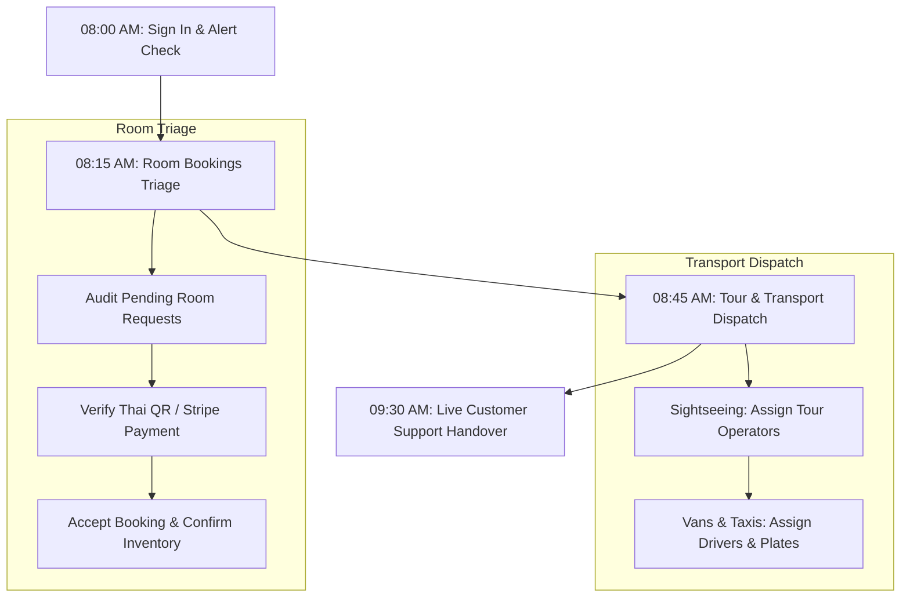

# 🌴 Thaiseva Admin Portal: Complete Administrator User Guide

**Document Version:** 3.1.0  
**Target Audience:** Platform Administrators, Sub-Administrators, Operational Managers, Product Trainers  
**Application Production URL:** [https://gothai-admin.web.app](https://gothai-admin.web.app)  
**Classification:** Official Operational Manual  

---

## 📑 Complete Interactive Table of Contents

- [1. Introduction](#1-introduction)
  - [1.1 Purpose of this User Guide](#11-purpose-of-this-user-guide)
  - [1.2 System Overview](#12-system-overview)
  - [1.3 Administrator Roles & Permission Levels](#13-administrator-roles--permission-levels)
- [2. Getting Started & Navigation](#2-getting-started--navigation)
  - [2.1 How to Access the Admin Panel](#21-how-to-access-the-admin-panel)
  - [2.2 How to Log In](#22-how-to-log-in)
  - [2.3 How to Reset a Forgotten Password](#23-how-to-reset-a-forgotten-password)
  - [2.4 Navigating the Admin Sidebar](#24-navigating-the-admin-sidebar)
  - [2.5 Header Bar & Notification Center](#25-header-bar--notification-center)
  - [2.6 How to Change Your Account Password](#26-how-to-change-your-account-password)
  - [2.7 How to Log Out Securely](#27-how-to-log-out-securely)
- [3. Dashboard Overview](#3-dashboard-overview)
  - [3.1 Promotional Dashboard Layout](#31-promotional-dashboard-layout)
  - [3.2 Real-Time Banner & Catalog Hub](#32-real-time-banner--catalog-hub)
  - [3.3 Daily Administrative Monitoring](#33-daily-administrative-monitoring)
- [4. User & Staff Management](#4-user--staff-management)
  - [4.1 How to Add a New Administrator / Sub-Admin](#41-how-to-add-a-new-administrator--sub-admin)
  - [4.2 How to Search and View Administrators](#42-how-to-search-and-view-administrators)
  - [4.3 How to Revoke or Delete an Administrator Account](#43-how-to-revoke-or-delete-an-administrator-account)
  - [4.4 How to View Registered Customer Accounts](#44-how-to-view-registered-customer-accounts)
  - [4.5 How to Export Customer Data to CSV](#45-how-to-export-customer-data-to-csv)
  - [4.6 How to Process Customer Account Deletion Requests (PDPA Compliance)](#46-how-to-process-customer-account-deletion-requests-pdpa-compliance)
- [5. Financial Analytics & Booking Records](#5-financial-analytics--booking-records)
  - [5.1 How to View Platform Revenue & Statistics](#51-how-to-view-platform-revenue--statistics)
  - [5.2 How to Filter Earnings by Date and Service Vertical](#52-how-to-filter-earnings-by-date-and-service-vertical)
  - [5.3 How to Export Financial Reports to Excel](#53-how-to-export-financial-reports-to-excel)
  - [5.4 How to Search Historical Booking Records](#54-how-to-search-historical-booking-records)
  - [5.5 How to Preview and Download Customer PDF Invoices/Vouchers](#55-how-to-preview-and-download-customer-pdf-invoicesvouchers)
  - [5.6 How to Export Cross-Vertical Booking Data to Excel](#56-how-to-export-cross-vertical-booking-data-to-excel)
- [6. Hotel & Lodging Management](#6-hotel--lodging-management)
  - [6.1 How to Add a New Hotel Property](#61-how-to-add-a-new-hotel-property)
  - [6.2 How to Edit Hotel Details, Amenities & Location Pin](#62-how-to-edit-hotel-details-amenities--location-pin)
  - [6.3 How to Set Hotel Commission Percentages](#63-how-to-set-hotel-commission-percentages)
  - [6.4 How to Toggle Hotel Visibility (Live vs. Draft)](#64-how-to-toggle-hotel-visibility-live-vs-draft)
  - [6.5 How to Add Room Categories to a Hotel](#65-how-to-add-room-categories-to-a-hotel)
  - [6.6 How to Edit Room Pricing, Capacity & Extra Bed Surcharges](#66-how-to-edit-room-pricing-capacity--extra-bed-surcharges)
  - [6.7 How to Manage Daily Room Availability & Block Dates](#67-how-to-manage-daily-room-availability--block-dates)
  - [6.8 How to Approve and Confirm a Pending Room Booking](#68-how-to-approve-and-confirm-a-pending-room-booking)
  - [6.9 How to Decline/Cancel a Room Booking and Restore Inventory](#69-how-to-declinecancel-a-room-booking-and-restore-inventory)
  - [6.10 How to Verify a Thai PromptPay QR or Stripe Payment](#610-how-to-verify-a-thai-promptpay-qr-or-stripe-payment)
- [7. Tours & Excursions Management](#7-tours--excursions-management)
  - [7.1 How to Add a New Sightseeing Tour Package](#71-how-to-add-a-new-sightseeing-tour-package)
  - [7.2 How to Edit Sightseeing Details & Daily Participant Limits](#72-how-to-edit-sightseeing-details--daily-participant-limits)
  - [7.3 How to Configure Global Daily Tour Capacity Limits](#73-how-to-configure-global-daily-tour-capacity-limits)
  - [7.4 How to Review and Confirm Pending Tour Bookings](#74-how-to-review-and-confirm-pending-tour-bookings)
  - [7.5 How to Assign a Local Tour Operator to a Booking](#75-how-to-assign-a-local-tour-operator-to-a-booking)
  - [7.6 How to Manage Onsite Cash Payment Bookings](#76-how-to-manage-onsite-cash-payment-bookings)
- [8. Transport Fleet & Ride Bookings](#8-transport-fleet--ride-bookings)
  - [8.1 How to Register a Transport Partner Company](#81-how-to-register-a-transport-partner-company)
  - [8.2 How to Register a Certified Driver](#82-how-to-register-a-certified-driver)
  - [8.3 How to Register a Fleet Vehicle](#83-how-to-register-a-fleet-vehicle)
  - [8.4 How to Archive or Remove a Transport Resource](#84-how-to-archive-or-remove-a-transport-resource)
  - [8.5 How to Review and Dispatch a Van Booking](#85-how-to-review-and-dispatch-a-van-booking)
  - [8.6 How to Review and Dispatch a Taxi Sedan Booking](#86-how-to-review-and-dispatch-a-taxi-sedan-booking)
  - [8.7 How to Review and Approve a Self-Drive Rental (License Verification)](#87-how-to-review-and-approve-a-self-drive-rental-license-verification)
  - [8.8 How to Record Rental Damage Deposits and Returns](#88-how-to-record-rental-damage-deposits-and-returns)
- [9. Customer Support & Real-Time Communication](#9-customer-support--real-time-communication)
  - [9.1 How to Navigate the Live Customer Support Inbox](#91-how-to-navigate-the-live-customer-support-inbox)
  - [9.2 How to Send Messages, Images, Documents & Voice Notes](#92-how-to-send-messages-images-documents--voice-notes)
  - [9.3 How to Attach and Inspect Customer Bookings Inside Live Chat](#93-how-to-attach-and-inspect-customer-bookings-inside-live-chat)
  - [9.4 How to Manage Hotel Support Chat](#94-how-to-manage-hotel-support-chat)
  - [9.5 How to Manage Local Partner Support Chat](#95-how-to-manage-local-partner-support-chat)
- [10. Local Partners & Service Requirements](#10-local-partners--service-requirements)
  - [10.1 How to Review and Verify Local Partner Applications (KYC)](#101-how-to-review-and-verify-local-partner-applications-kyc)
  - [10.2 How to Add a Local Partner Directly](#102-how-to-add-a-local-partner-directly)
  - [10.3 How to Review and Manage Local Service Requirements](#103-how-to-review-and-manage-local-service-requirements)
- [11. Attractions & Local Hotspots](#11-attractions--local-hotspots)
  - [11.1 How to Add a New Attraction, Shopping Mall or Beach Club](#111-how-to-add-a-new-attraction-shopping-mall-or-beach-club)
  - [11.2 How to Filter Attractions by Category and City](#112-how-to-filter-attractions-by-category-and-city)
  - [11.3 How to Create and Manage Attraction Categories](#113-how-to-create-and-manage-attraction-categories)
  - [11.4 How to Edit or Remove an Attraction](#114-how-to-edit-or-remove-an-attraction)
- [12. Website Configuration & Marketing](#12-website-configuration--marketing)
  - [12.1 How to Broadcast a Push Notification Announcement](#121-how-to-broadcast-a-push-notification-announcement)
  - [12.2 How to Add and Reorder Homepage Offer Banners (Popup Slider)](#122-how-to-add-and-reorder-homepage-offer-banners-popup-slider)
  - [12.3 How to Update Marketing Statistics Counters (About Us Page)](#123-how-to-update-marketing-statistics-counters-about-us-page)
  - [12.4 How to Replace Website Imagery and Media Asset Slots](#124-how-to-replace-website-imagery-and-media-asset-slots)
  - [12.5 How to Write and Publish a Blog Article (Rich Text & SEO)](#125-how-to-write-and-publish-a-blog-article-rich-text--seo)
  - [12.6 How to Add and Manage Frequently Asked Questions (FAQs)](#126-how-to-add-and-manage-frequently-asked-questions-faqs)
  - [12.7 How to Add and Order Customer Testimonials](#127-how-to-add-and-order-customer-testimonials)
  - [12.8 How to Review and Archive Inbound Contact Messages](#128-how-to-review-and-archive-inbound-contact-messages)
- [13. Daily Administrative Workflows (Standard Operating Procedures)](#13-daily-administrative-workflows-standard-operating-procedures)
  - [13.1 Morning Operational Shift Routine](#131-morning-operational-shift-routine)
  - [13.2 Midday Booking Triage & Vendor Dispatch](#132-midday-booking-triage--vendor-dispatch)
  - [13.3 Evening Closeout & Financial Reconciliation](#133-evening-closeout--financial-reconciliation)
- [14. Troubleshooting & Common Errors](#14-troubleshooting--common-errors)
  - [14.1 Login & Authentication Issues](#141-login--authentication-issues)
  - [14.2 Booking Confirmation & Inventory Holds](#142-booking-confirmation--inventory-holds)
  - [14.3 Payment Verification & Merchant Reconciliation](#143-payment-verification--merchant-reconciliation)
  - [14.4 Media Upload & Aspect Ratio Adjustments](#144-media-upload--aspect-ratio-adjustments)
  - [14.5 Chat Delivery & Real-Time Connectivity](#145-chat-delivery--real-time-connectivity)
- [15. Security, Compliance & Important Guidelines](#15-security-compliance--important-guidelines)
  - [15.1 Personal Data Protection Act (PDPA) Compliance](#151-personal-data-protection-act-pdpa-compliance)
  - [15.2 Financial Safeguards & Audit Logs](#152-financial-safeguards--audit-logs)
  - [15.3 Account Security & Session Management](#153-account-security--session-management)
- [16. Frequently Asked Questions (FAQs)](#16-frequently-asked-questions-faqs)
- [17. Quick Reference Master Table](#17-quick-reference-master-table)

---

# 1. Introduction

### 1.1 Purpose of this User Guide
The purpose of this guide is to empower administrators, customer support agents, and operations managers to confidently and independently operate the **Thaiseva Admin Portal**. It covers every operational task required for daily platform management—from booking confirmation and fleet dispatching to financial auditing, customer chat support, and marketing content management.

### 1.2 System Overview
The Thaiseva Admin Portal is a cloud-based operational hub serving five core business verticals across Thailand:
- **Hotels & Stays:** Property catalog, room inventory, live calendar holds, and instant booking triage.
- **Sightseeing Tours:** Excursion packages, speedboat trips, capacity caps, and local tour operator assignment.
- **Transfers & Fleet:** Private airport transfers, VIP vans, city taxis, driver rosters, and vehicle inventory.
- **Self-Drive Rentals:** Car and SUV rentals with digital driving license and passport verification.
- **Local Assistance & Concierge:** 24/7 omnichannel customer chat with direct booking attachment tools.
- **Website CMS:** Marketing banners, offer sliders, blogs, FAQs, testimonials, and dynamic statistics counters.

### 1.3 Administrator Roles & Permission Levels
- **Head Admin:** Complete system governance. Exclusive access to create, modify, and revoke Administrator and Sub-Admin accounts (`/dashboard/sub-admins`).
- **Administrator (Admin):** Full operational control over all booking queues, fleet management, financial analytics, website content, push notifications, and customer communications.
- **Sub-Admin:** Daily operations staff access to review bookings, assign drivers/operators, update room availability, and assist travelers via chat.
- **Partner (Hotels / Drivers / Local Partners):** Restricted interface scoped strictly to their own listings, room inventory, and incoming assignments.

---

# 2. Getting Started & Navigation

### 2.1 How to Access the Admin Panel
1. Open Google Chrome, Mozilla Firefox, Microsoft Edge, or Apple Safari on your workstation.
2. Enter the official production URL: `https://gothai-admin.web.app` (or your company staging link).
3. The secure login screen loads.

---

### 2.2 How to Log In
**Navigation:** `Browser → Portal URL → Login Screen`

1. In the **Email Address** field, enter your authorized corporate email address.
2. In the **Password** field, enter your password.
3. *(Optional)* Click the eye icon (`👁️`) on the right side of the password field to verify your input.
4. Click **Sign In**.
5. The system verifies your credentials and role access.

**Expected Result:** You are authenticated and redirected to `/dashboard`.

> [!NOTE]
> If your account lacks active administrator privileges, the system displays: *"This account does not have active administrator access. Contact support@thaiseva.com."*

---

### 2.3 How to Reset a Forgotten Password
**Navigation:** `Login Screen → Forgot password?`

1. On the login screen, click the **Forgot password?** link located below the password input.
2. The **Reset Administrator Password** modal dialog opens.
3. Enter your registered administrative email address.
4. Click **Send Reset Link**.
5. Open your corporate email inbox, locate the reset email, and click the verification link.
6. Enter a new, secure password (minimum 12 characters).
7. Return to the portal and log in with your updated credentials.

**Expected Result:** A confirmation message appears: *"Password reset email sent! Check your inbox."*

---

### 2.4 Navigating the Admin Sidebar
The left navigation sidebar is divided into clear functional groups:
- **Top Header:** Brand logo and current active role indicator badge (`Admin Dashboard` or `Subadmin Dashboard`).
- **Primary Section:** Dashboard, Account Settings, Manage Notifications, Statistics, Records, Users Data, Deletion Requests.
- **Website Config:** Offers, Site Statistics, Images & Media, Blogs, FAQs, Testimonials, Contact Us.
- **Hotel Related:** Hotels, Room Availability, Room Bookings.
- **Travel Related:** Sightseeing Packages, Sightseeing Bookings, Taxi & Van Management, Van Bookings, Car Bookings, Self Drive Bookings.
- **Local Assistance:** Customer Chat.
- **Attractions & Places:** Attractions & Places.

---

### 2.5 Header Bar & Notification Center
The top bar remains fixed at the top of the interface:
- **Mobile Menu Toggle (☰):** Opens the drawer on tablets and mobile screens.
- **Notification Bell Icon:** Features a live red badge showing unread reservations and alerts. Click the bell to open a quick-view panel of recent activity cards.
- **Staff Identity:** Displays your active staff name and email address.
- **Log Out Button:** Red outlined button to terminate your administrative session safely.

---

### 2.6 How to Change Your Account Password
**Navigation:** `Admin Panel → Account Settings` (`/dashboard/settings`)

1. Click **Account Settings** in the left sidebar.
2. Under the **Change Password** card, enter your active login password in **Current password**.
3. In **New password**, enter your desired password (minimum 12 characters).
4. In **Confirm new password**, re-enter your new password exactly.
5. Click **Change Password**.

**Expected Result:** A green alert displays: *"Your password has been changed successfully."*

---

### 2.7 How to Log Out Securely
**Navigation:** `Top Header Bar → Log Out`

1. In the top right corner of the header, click the **Log Out** button.
2. The portal securely terminates your session tokens and active database listeners.
3. You are redirected immediately to `/login`.

---

# 3. Dashboard Overview

### 3.1 Promotional Dashboard Layout
The main dashboard view at `/dashboard` serves as the central control console for the marketing, promotional, and catalog banners displayed on customer-facing mobile apps and websites.

### 3.2 Real-Time Banner & Catalog Hub
The dashboard aggregates live components:
- **Platform Logo & Active Service Categories:** Verifies active vertical categories.
- **Hero Home Banners:** Visual carousel of homepage marketing campaigns.
- **Today's Best Offers & Special Offers:** Live previews of curated daily promotions.
- **Sector Catalogs:** Previews of Hotel Banners, Travel Banners, and Food Banners.
- **Notification Announcement Banner:** Quick-action shortcut for dispatching urgent mobile announcements.

### 3.3 Daily Administrative Monitoring
At the beginning of each shift, administrators should:
1. Check the notification bell icon in the top header for unread customer bookings.
2. Confirm that hero banners reflect active seasonal marketing promotions.
3. Verify that all featured discount packages display valid, non-expired rates.

---

# 4. User & Staff Management

### 4.1 How to Add a New Administrator / Sub-Admin
**Navigation:** `Admin Panel → Administrators` (`/dashboard/sub-admins`) *(Head Admin Only)*

1. Log in with an authorized **Head Admin** account.
2. From the sidebar, select **Administrators**.
3. Click the **Add New Administrator** button.
4. Enter the staff member's **Full Name**.
5. Enter their corporate **Email Address**.
6. Enter an initial **Password** (minimum 12 characters).
7. Upload an avatar photo or corporate headshot.
8. Select the appropriate role (**Admin** for full access, or **SubAdmin** for operations-only access).
9. Click **Create Administrator**.

**Expected Result:** The privileged account is created and appears in the administrators list.  
**Note:** Ensure the correct role is selected before saving.

---

### 4.2 How to Search and View Administrators
**Navigation:** `Admin Panel → Administrators` (`/dashboard/sub-admins`)

1. Navigate to **Administrators**.
2. Locate the search bar at the top of the table.
3. Type the staff member's name or email address.
4. The table filters automatically to display matching records.

**Expected Result:** The target administrator profile card or row is displayed.

---

### 4.3 How to Revoke or Delete an Administrator Account
**Navigation:** `Admin Panel → Administrators` (`/dashboard/sub-admins`)

1. Navigate to **Administrators**.
2. Locate the staff member you wish to decommission.
3. Click the red **Delete / Revoke** (trash icon) button on their row.
4. When prompted with the confirmation dialog, confirm your administrative password or identity.
5. Click **Confirm Deletion**.

**Expected Result:** The staff member's credentials and access permissions are immediately revoked.  
**Warning:** This action permanently prevents the user from accessing the admin panel.

---

### 4.4 How to View Registered Customer Accounts
**Navigation:** `Admin Panel → Users Data` (`/dashboard/user-data`)

1. Click **Users Data** in the left sidebar.
2. The customer directory displays high-level metric cards (**Total Registered Users** and **New This Month**).
3. Browse the table to inspect Customer Profile Avatar, Full Name, Contact Phone, Email, Location, and Registered On timestamp.
4. Use the pagination controls at the bottom right to adjust rows per page (10, 25, 50).

**Expected Result:** The complete customer database is visible for administrative verification.

---

### 4.5 How to Export Customer Data to CSV
**Navigation:** `Admin Panel → Users Data → Export to CSV`

1. Navigate to **Users Data**.
2. In the top right corner, click the **Export to CSV** button.
3. If prompted by the security check, confirm your identity.
4. The system compiles the customer roster into a `.csv` file.

**Expected Result:** The customer file downloads immediately to your local computer.  
**Important Note:** Exported files contain Personally Identifiable Information (PII). Treat all exported customer files according to company data protection policies.

---

### 4.6 How to Process Customer Account Deletion Requests (PDPA Compliance)
**Navigation:** `Admin Panel → Deletion Requests` (`/dashboard/deletion-requests`)

1. Click **Deletion Requests** in the left sidebar.
2. Select the **Pending** tab.
3. Locate the customer's erasure request row.
4. Click the **Review Details** (eye icon) button.
5. In the details dialog, verify that the customer has no active, unfulfilled bookings or outstanding balances.
6. Click **Process Erasure**.
7. Confirm the SweetAlert2 popup warning: *"This action permanently removes the user identity from authentication."*

**Expected Result:** The customer's login account and personal data are deleted, the ticket moves to **Completed**, and required accounting snapshots are retained in anonymized format.

---

# 5. Financial Analytics & Booking Records

### 5.1 How to View Platform Revenue & Statistics
**Navigation:** `Admin Panel → Statistics` (`/dashboard/admin-statistics`)

1. Click **Statistics** in the left sidebar.
2. The page loads with real-time financial KPI cards:
   - **Total Gross Revenue:** Cumulative platform turnover in Thai Baht (THB).
   - **Period Average:** Average daily or monthly earnings.
   - **Total Bookings Completed:** Concluded reservation count.
   - **Top Performing Vertical:** Leading revenue sector.
3. Review the interactive earnings projection chart (switch between **Bar Chart** and **Line Chart** views).
4. Review the **Service Revenue Contributions** to assess percentage earnings across Cars, Self Drive, Sightseeing, Hotels, and Vans.

**Expected Result:** High-level platform financial intelligence is displayed in real time.

---

### 5.2 How to Filter Earnings by Date and Service Vertical
**Navigation:** `Admin Panel → Statistics`

1. Navigate to **Statistics**.
2. In the grouping dropdown, select **Daily** or **Monthly**.
3. In the **Start Date** field, select your beginning reporting date.
4. In the **End Date** field, select your ending reporting date.
5. In the **Category Filter** dropdown, select a specific vertical (e.g., **Hotels** or **Sightseeing**), or leave as **All Categories**.
6. The KPI cards, visual charts, and audit table update automatically.

**Expected Result:** The financial dashboard reflects the exact filtered date and vertical parameters.

---

### 5.3 How to Export Financial Reports to Excel
**Navigation:** `Admin Panel → Statistics → Export to Excel`

1. Navigate to **Statistics**.
2. Set your desired reporting date window.
3. Click the **Export to Excel** button in the upper right corner.
4. The system processes all individual transactions and compiles an analytical multi-sheet workbook.

**Expected Result:** An `.xlsx` spreadsheet downloads with a financial summary tab and separate sheets for each service vertical.

---

### 5.4 How to Search Historical Booking Records
**Navigation:** `Admin Panel → Records` (`/dashboard/bookings-record`)

1. Click **Records** in the left sidebar.
2. Select the target service category tab (**Sightseeing Bookings**, **Room Bookings**, **Taxi Bookings**, **Van Bookings**, or **Selfdrive Bookings**).
3. Set the **Start Date** and **End Date** filters (defaults to the trailing 7 days).
4. Locate the customer's reservation row in the table.

**Expected Result:** Historical booking records matching your date and category criteria appear in the table.

---

### 5.5 How to Preview and Download Customer PDF Invoices/Vouchers
**Navigation:** `Admin Panel → Records`

1. Navigate to **Records** and select the relevant category tab.
2. Locate the customer's reservation row.
3. Click the **View Voucher** (eye icon) button.
4. An in-browser modal renders the branded PDF voucher with official logos, guest names, dates, itemized costs, and payment confirmation.
5. Click **Download PDF** inside the modal (or click the cloud download icon in the table row).

**Expected Result:** The branded PDF voucher is downloaded directly to your workstation.

---

### 5.6 How to Export Cross-Vertical Booking Data to Excel
**Navigation:** `Admin Panel → Records → Download Excel`

1. Navigate to **Records**.
2. Select the date range you wish to audit.
3. Click the green **Download Excel** button.
4. The system aggregates all reservations across all categories into a consolidated spreadsheet.

**Expected Result:** A comprehensive Excel booking file downloads to your local machine.

---

# 6. Hotel & Lodging Management

### 6.1 How to Add a New Hotel Property
**Navigation:** `Admin Panel → Hotels → Add New Hotel` (`/dashboard/hotels/add`)

1. Click **Hotels** in the left sidebar.
2. Click the **Add New Hotel** button.
3. Enter the **Hotel Name** (official property name).
4. Enter the **Phone Number** and **Email Address** for front desk reservations.
5. Select the **City** (e.g., Bangkok, Phuket, Pattaya, Chiang Mai, Krabi, Koh Samui).
6. Enter the **Full Address** and postal code.
7. Select the **Star Rating** (1 to 5 stars).
8. Enter the agreed platform **Commission Rate (%)** (e.g., `15`).
9. Check all available **Amenities** (WiFi, Swimming Pool, Spa, Breakfast, Parking, Fitness Center, Beachfront).
10. Upload high-resolution property exterior and lobby photos.
11. Pin the exact location on the interactive Google Map.
12. Click **Save Hotel**.

**Expected Result:** The hotel is successfully added to the partner directory.

---

### 6.2 How to Edit Hotel Details, Amenities & Location Pin
**Navigation:** `Admin Panel → Hotels → Edit Hotel` (`/dashboard/hotels/edit/:hotelId`)

1. Navigate to **Hotels**.
2. Locate the hotel property card or row.
3. Click the **Edit** (pencil icon) button.
4. Modify property contact details, star rating, photos, or amenities.
5. Click **Update Hotel**.

**Expected Result:** The updated hotel profile reflects immediately across all booking platforms.

---

### 6.3 How to Set Hotel Commission Percentages
**Navigation:** `Admin Panel → Hotels → Set Commission`

1. Navigate to **Hotels**.
2. Locate the hotel property.
3. Click the **Commission** button (or open the hotel edit dialog).
4. In the **Commission (%)** field, enter the new contractual percentage.
5. Click **Save Commission**.

**Expected Result:** The new commission rate applies to all subsequent bookings for that property.

---

### 6.4 How to Toggle Hotel Visibility (Live vs. Draft)
**Navigation:** `Admin Panel → Hotels`

1. Navigate to **Hotels**.
2. Locate the hotel card or row.
3. Click the **Status** badge or toggle switch.
4. Select **Live** to make the property bookable by customers, or **Draft** to temporarily hide it from search results.

**Expected Result:** The property's public listing status changes immediately.

---

### 6.5 How to Add Room Categories to a Hotel
**Navigation:** `Admin Panel → Hotels → Manage Rooms` (`/dashboard/hotels/:hotelId/rooms`)

1. Navigate to **Hotels**.
2. Locate the target hotel and click **Manage Rooms** (meeting room icon).
3. Click the **Add Room Package** button.
4. Enter the **Package Name** (e.g., "Grand Deluxe Seaview King").
5. Specify the nightly **Base Price** in Thai Baht (THB).
6. Enter any promotional **Discount (%)** (enter `0` if none).
7. Enter the **Total Rooms** available in physical inventory (e.g., `10`).
8. Specify the maximum occupancy for **Adults** and **Children**.
9. If an extra rollaway bed is permitted, check **Has Extra Bed** and specify the nightly **Extra Bed Price**.
10. Select room amenities (Bathtub, Balcony, Sea View, Mini Bar) and upload room photos.
11. Click **Save Room Package**.

**Expected Result:** The room type is added and appears in the hotel's room catalog.

---

### 6.6 How to Edit Room Pricing, Capacity & Extra Bed Surcharges
**Navigation:** `Admin Panel → Hotels → Manage Rooms`

1. Navigate to **Hotels** and open **Manage Rooms** for the target hotel.
2. Locate the room type in the table and click **Edit**.
3. Update base prices, discount rates, room quantity, or extra bed pricing.
4. Click **Update Room Package**.

**Expected Result:** The updated pricing and capacity take effect immediately.

---

### 6.7 How to Manage Daily Room Availability & Block Dates
**Navigation:** `Admin Panel → Room Availability` (`/dashboard/hotel-room-availability`)

1. Click **Room Availability** in the left sidebar.
2. Locate the hotel property using the search bar.
3. Click **View Availability Calendar**.
4. Navigate to your target month.
5. Review the daily remaining room counts shown for each date.
6. To manually block rooms for private events or maintenance, select the target date and reduce the available room count to `0` (or the desired number).
7. Click **Update Availability**.

**Expected Result:** The calendar updates, preventing customer bookings on the blocked dates.

---

### 6.8 How to Approve and Confirm a Pending Room Booking
**Navigation:** `Admin Panel → Room Bookings` (`/dashboard/room-bookings`)

1. Click **Room Bookings** in the left sidebar.
2. On the **Pending Requests** tab, locate the reservation row.
3. Click **View Details** (eye icon).
4. Review the guest's name, room type, check-in and check-out dates, and payment status:
   - Ensure the payment badge indicates **Paid** (or verify the Thai QR / credit card receipt).
5. Click the green **Accept Booking** (checkmark icon) button.
6. The system executes atomic confirmation, locks the room inventory dates, updates status to **Confirmed**, and transmits a digital voucher to the guest.

**Expected Result:** The reservation moves to **Confirmed Bookings** and inventory is locked.

---

### 6.9 How to Decline/Cancel a Room Booking and Restore Inventory
**Navigation:** `Admin Panel → Room Bookings`

1. Navigate to **Room Bookings**.
2. Locate the reservation on the **Pending Requests** or **Confirmed Bookings** tab.
3. Click the red **Cancel / Reject** (cross icon) button.
4. When prompted with the confirmation modal, confirm the cancellation reason.
5. Click **Confirm Cancellation**.

**Expected Result:** The booking status updates to **Canceled**, and the reserved room dates are automatically returned to available inventory.

---

### 6.10 How to Verify a Thai PromptPay QR or Stripe Payment
**Navigation:** `Admin Panel → Room Bookings` (or `Sightseeing Bookings`)

1. Locate the booking displaying a blue or unverified payment badge.
2. Click the **Verify Payment** (shield icon) button.
3. Review the uploaded transaction receipt, reference number, and payment timestamp.
4. Cross-check the transaction reference with your merchant bank statement.
5. Click **Confirm Payment Verified**.

**Expected Result:** The payment status updates to **Paid (Verified)** with a green badge.

---

# 7. Tours & Excursions Management

### 7.1 How to Add a New Sightseeing Tour Package
**Navigation:** `Admin Panel → Sightseeing Packages → Add Sightseeing Package` (`/dashboard/travel-services/add`)

1. Click **Sightseeing Packages** in the left sidebar.
2. Click the **Add Sightseeing Package** button.
3. Enter the **Package Title** (e.g., "James Bond Island & Phang Nga Bay Speedboat Tour").
4. Specify the departure **Location** (e.g., "Phuket / Ao Po Grand Marina").
5. Enter the **Duration / Period** (e.g., "08:30 - 17:30 (Full Day)").
6. Enter the **Base Price** per adult in THB and any **Discount (%)**.
7. In the **Daily Booking Limit** field, set the maximum number of daily participants (e.g., `35`).
8. Enter tour **Highlights**, step-by-step **Itinerary**, and list all **Inclusions** (Lunch, Lifejackets, National Park Fees, Insurance).
9. Upload high-resolution tour photos.
10. Click **Save Package**.

**Expected Result:** The tour package publishes live to customer channels.

---

### 7.2 How to Edit Sightseeing Details & Daily Participant Limits
**Navigation:** `Admin Panel → Sightseeing Packages`

1. Navigate to **Sightseeing Packages**.
2. Locate the tour package and click the **Edit** (pencil icon) button.
3. Update pricing, duration, daily participant caps, or itinerary stops.
4. Click **Update Package**.

**Expected Result:** The updated package information publishes immediately.

---

### 7.3 How to Configure Global Daily Tour Capacity Limits
**Navigation:** `Admin Panel → Sightseeing Packages → Settings (Gear Icon)`

1. Navigate to **Sightseeing Packages**.
2. Click the **Settings** (gear icon) button in the upper toolbar.
3. The `SightseeingSettingsModal` dialog opens.
4. In the **Global Daily Capacity Limit** field, enter the default platform-wide booking threshold.
5. Click **Save Configuration**.

**Expected Result:** The default participant threshold applies to all tours lacking custom limits.

---

### 7.4 How to Review and Confirm Pending Tour Bookings
**Navigation:** `Admin Panel → Sightseeing Bookings` (`/dashboard/travel-bookings`)

1. Click **Sightseeing Bookings** in the left sidebar.
2. Select the **Pending Review** tab.
3. Locate the booking row and click **View Details**.
4. Verify the tour date, passenger count (adults and children), and hotel pickup address.
5. Verify payment status (ensure Thai QR or card payment is confirmed).
6. Proceed to assign a tour operator (see 7.5) and click **Confirm Booking**.

**Expected Result:** The booking status updates to **Confirmed** and a voucher is issued to the guest.

---

### 7.5 How to Assign a Local Tour Operator to a Booking
**Navigation:** `Admin Panel → Sightseeing Bookings`

1. While reviewing a pending tour booking, locate the **Provider Assignment** section.
2. In the **Provider Name** field, enter the contracted tour company (e.g., "Phuket Marine Tour Co.").
3. In the **Provider Phone** field, enter the operational dispatch phone number.
4. Click **Confirm & Assign Operator**.

**Expected Result:** The tour booking is confirmed with the local operator's contact details attached.

---

### 7.6 How to Manage Onsite Cash Payment Bookings
**Navigation:** `Admin Panel → Sightseeing Bookings → Onsite Payment Queue`

1. Navigate to **Sightseeing Bookings**.
2. Select the **Onsite Payment Queue** tab.
3. These bookings represent approved tours where travelers will pay cash upon arrival at the pier.
4. Once the operator confirms cash collection on the morning of the tour, click the **Verify Payment** button.
5. Select **Mark Cash Collected Onsite**.

**Expected Result:** The booking transitions from the onsite queue to **Confirmed & Paid**.

---

# 8. Transport Fleet & Ride Bookings

### 8.1 How to Register a Transport Partner Company
**Navigation:** `Admin Panel → Taxi & Van Management → Companies` (`/dashboard/vans`)

1. Click **Taxi & Van Management** in the left sidebar.
2. Select the **Companies** tab.
3. Click the **Add Company** button.
4. Enter the **Company Name** (e.g., "Bangkok VIP Limo Service").
5. Select the **Company Type** (Taxi, Van Fleet, or Both).
6. Enter the **Contact Person**, **Phone Number**, and **Email Address**.
7. Enter the government commercial registration number and business address.
8. Set status to **Active** and click **Save Company**.

**Expected Result:** The transport company is registered and available for driver and fleet affiliations.

---

### 8.2 How to Register a Certified Driver
**Navigation:** `Admin Panel → Taxi & Van Management → Drivers`

1. Navigate to **Taxi & Van Management** and select the **Drivers** tab.
2. Click **Add Driver**.
3. Enter the driver's **Full Name** and **Phone Number**.
4. In the **Company** dropdown, select their affiliated transport company.
5. Enter their government **Driver License Number** and **License Expiry Date**.
6. Set the **Availability Status** to **Available**.
7. Click **Save Driver**.

**Expected Result:** The driver appears in the active roster and can receive dispatch assignments.

---

### 8.3 How to Register a Fleet Vehicle
**Navigation:** `Admin Panel → Taxi & Van Management → Vehicles`

1. Navigate to **Taxi & Van Management** and select the **Vehicles** tab.
2. Click **Add Vehicle**.
3. Enter the **Vehicle Model** (e.g., "Toyota Commuter VIP 9-Seater").
4. Enter the **License Plate Number** (e.g., "1มข-4821 Bangkok").
5. Select the **Vehicle Class** (VIP Van, Sedan Taxi, SUV).
6. Specify the **Passenger Seating Capacity** and **Luggage Capacity**.
7. Select the affiliated **Transport Company**.
8. Enter the transport insurance policy number and expiration date.
9. Click **Save Vehicle**.

**Expected Result:** The vehicle is added to the active fleet inventory.

---

### 8.4 How to Archive or Remove a Transport Resource
**Navigation:** `Admin Panel → Taxi & Van Management`

1. Locate the Company, Driver, or Vehicle in the corresponding tab.
2. Click the **Archive** (box icon) button to soft-archive the resource (this hides it from future dispatch while preserving historical booking links).
3. If the resource was created by mistake and has zero historical bookings, click **Delete** (trash icon).

**Expected Result:** The resource is archived or permanently removed.

---

### 8.5 How to Review and Dispatch a Van Booking
**Navigation:** `Admin Panel → Van Bookings` (`/dashboard/van-bookings`)

1. Click **Van Bookings** in the left sidebar.
2. Select the **Pending** tab.
3. Locate the booking and click **Assign Resource**.
4. Review passenger arrival details (Flight Number, Pickup Terminal, Pickup Time, Passenger Count).
5. In the assignment dialog:
   - Select the **Transport Company**.
   - Select the assigned **Driver**.
   - Select the assigned **Vehicle**.
6. Click **Confirm Assignment**.

**Expected Result:** The booking status updates to **Confirmed**, and passenger pickup details are sent to the driver and traveler.

---

### 8.6 How to Review and Dispatch a Taxi Sedan Booking
**Navigation:** `Admin Panel → Car Bookings` (`/dashboard/car-bookings`)

1. Click **Car Bookings** in the left sidebar.
2. Follow the exact dispatch procedure outlined in [8.5](#85-how-to-review-and-dispatch-a-van-booking) to assign an available sedan driver and vehicle.

---

### 8.7 How to Review and Approve a Self-Drive Rental (License Verification)
**Navigation:** `Admin Panel → Self Drive Bookings` (`/dashboard/self-drive-bookings`)

1. Click **Self Drive Bookings** in the left sidebar.
2. Select the **Pending** tab and click **View Details**.
3. In the customer profile section, inspect the customer's uploaded **Driver's License** and **Passport** images for authenticity and validity.
4. Verify rental pickup date/time, return date/time, and vehicle category.
5. Ensure the rental fee is marked **Paid**.
6. Click **Confirm Booking**.

**Expected Result:** The rental reservation is confirmed and vehicle handover instructions are dispatched to the customer.

---

### 8.8 How to Record Rental Damage Deposits and Returns
**Navigation:** `Admin Panel → Self Drive Bookings`

1. When the customer picks up the rental car, click **Record Deposit** in the booking dialog and input the security deposit amount (e.g., `THB 5,000`).
2. Transition the status to **In Progress (Vehicle Handed Over)**.
3. Upon vehicle return, inspect the vehicle for damage. If clear, click **Refund Deposit** and transition status to **Completed**.

**Expected Result:** The security deposit lifecycle is documented and the booking is finalized.

---

# 9. Customer Support & Real-Time Communication

### 9.1 How to Navigate the Live Customer Support Inbox
**Navigation:** `Admin Panel → Customer Chat` (`/dashboard/customer-chat`)

1. Click **Customer Chat** in the left sidebar.
2. The customer support inbox loads with two panels:
   - **Left Panel (Threads):** Search bar and customer conversation list showing unread message badges.
   - **Right Panel (Conversation Timeline):** Active message history, read receipts, and response composer.
3. Use the filter tabs (**All**, **Open**, **Resolved/Closed**) to manage queue priority.

---

### 9.2 How to Send Messages, Images, Documents & Voice Notes
**Navigation:** `Admin Panel → Customer Chat`

1. Select a customer conversation thread.
2. In the message box at the bottom, type your response.
3. **To attach an image or PDF voucher:** Click the paperclip icon, select the file, and click upload.
4. **To send a voice clip:** Click the microphone icon, record your message, and click send.
5. Click the blue send icon (or press `Enter`) to deliver the message.

**Expected Result:** The customer receives the message in real time on their mobile app or web browser.

---

### 9.3 How to Attach and Inspect Customer Bookings Inside Live Chat
**Navigation:** `Admin Panel → Customer Chat`

1. Inside an active customer chat thread, click the **Attach / View Booking** button in the header bar.
2. Select the service vertical (**Hotels**, **Sightseeing**, **Cars**, or **Self Drive**).
3. Click the customer's booking reference number.
4. A card displaying full booking details (dates, service name, status, payment state) expands in a side drawer.
5. You can answer the traveler's questions with exact reservation data visible on screen.

---

### 9.4 How to Manage Hotel Support Chat
**Navigation:** `Admin Panel → Hotel Chat` (`/dashboard/hotel-chat`)

1. Click **Hotel Chat** in the left sidebar (under Hotel Related).
2. Select the hotel partner thread to communicate directly with front desk reservation staff regarding room blocks, special guest requests, or late check-in notices.

---

### 9.5 How to Manage Local Partner Support Chat
**Navigation:** `Admin Panel → Partner Chat` (`/dashboard/partner-chat`)

1. Click **Partner Chat** in the left sidebar.
2. Select the local partner thread to coordinate with local tour guides, translators, or concierge providers.

---

# 10. Local Partners & Service Requirements

### 10.1 How to Review and Verify Local Partner Applications (KYC)
**Navigation:** `Admin Panel → Local Partners` (`/dashboard/local-partners`)

1. Click **Local Partners** in the left sidebar.
2. Select the **Pending Requests** tab.
3. Click the **View Details** (eye icon) button on a partner application row.
4. Review the applicant's business profile, service category, uploaded national ID card, business license, and bank passbook.
5. To approve the partner, change the status dropdown to **Verified** and click **Save**.
6. If documentation is invalid or incomplete, select **Denied** and provide a reason.

**Expected Result:** Verified partners gain access to receive local service assignments.

---

### 10.2 How to Add a Local Partner Directly
**Navigation:** `Admin Panel → Local Partners → Add Partner`

1. Navigate to **Local Partners**.
2. Click the **Add Partner** button.
3. Enter the partner's **Full Name**, **Business Name**, **Phone Number**, **Email Address**, and **Service Category**.
4. Set status to **Verified** and click **Save Partner**.

**Expected Result:** The partner profile is registered in the system immediately.

---

### 10.3 How to Review and Manage Local Service Requirements
**Navigation:** `Admin Panel → Local Requirements` (`/dashboard/local-requirements`)

1. Click **Local Requirements** in the left sidebar.
2. Review special on-demand service requests submitted by travelers (translation, private escort, medical coordination, legal inquiries).
3. Click **View Details** to read the traveler's requested schedule.
4. Assign an authorized local partner and update the requirement status to **In Progress** or **Completed**.

---

# 11. Attractions & Local Hotspots

### 11.1 How to Add a New Attraction, Shopping Mall or Beach Club
**Navigation:** `Admin Panel → Attractions & Places → Add Attraction` (`/dashboard/attractions`)

1. Click **Attractions & Places** in the left sidebar.
2. Click the **Add Attraction** button.
3. In the modal dialog, fill in:
   - **Title / Name:** Official venue name (e.g., "Iconsiam Shopping Complex").
   - **Category:** Select from the category dropdown (Shopping Malls, Clubs & Nightlife, Cultural & Temples, Nature & Beaches).
   - **City:** Select destination city (Bangkok, Phuket, Pattaya, etc.).
   - **Full Address & Map Link:** Enter physical address and Google Maps pin link.
   - **Operating Hours:** Enter opening/closing schedule (e.g., "10:00 AM - 10:00 PM Daily").
   - **Entry Fee / Pricing:** Enter ticket pricing or write "Free Admission".
   - **Description & Highlights:** Key features and visitor tips.
   - **Photos:** Upload high-resolution images.
   - **Status Toggle:** Set to **Active**.
4. Click **Save Attraction**.

**Expected Result:** The attraction appears immediately in the directory and publishes to customer explore guides.

---

### 11.2 How to Filter Attractions by Category and City
**Navigation:** `Admin Panel → Attractions & Places`

1. Navigate to **Attractions & Places**.
2. Click any category tab (**Shopping Malls**, **Clubs & Nightlife**, etc.) to filter by category.
3. In the **City** dropdown, select a specific city (e.g., "Phuket") to isolate local attractions.

---

### 11.3 How to Create and Manage Attraction Categories
**Navigation:** `Admin Panel → Attractions & Places → Manage Categories`

1. Navigate to **Attractions & Places**.
2. Click the **Manage Categories** button.
3. To add a new category, enter the category name (e.g., "Floating Markets") and click **Add Category**.
4. To rename or remove an existing category, use the edit and delete icons next to the category item.

---

### 11.4 How to Edit or Remove an Attraction
**Navigation:** `Admin Panel → Attractions & Places`

1. Locate the attraction card.
2. Click **Edit** to modify description, operating hours, or photos.
3. Click **Delete** (trash icon) to remove the attraction from the guide.

---

# 12. Website Configuration & Marketing

### 12.1 How to Broadcast a Push Notification Announcement
**Navigation:** `Admin Panel → Manage Notifications` (`/dashboard/notifications`)

1. Click **Manage Notifications** in the left sidebar.
2. In the **Title** field, enter your headline.
3. In the **Message** field, enter the full text body.
4. Click **Choose File** to upload a promotional graphic.
5. In the cropper window, use the zoom and rotate controls, then click **Crop & Save**.
6. *(Optional)* Toggle **Set Expiry Date** to ON and specify expiration time.
7. Click **Preview** to inspect the mobile preview.
8. Click **Send Notification**.

**Expected Result:** The notification broadcasts to all customer devices and appears under **Live Notifications**.

---

### 12.2 How to Add and Reorder Homepage Offer Banners (Popup Slider)
**Navigation:** `Admin Panel → Offers` (`/dashboard/website-config/offers`)

1. Click **Offers** in the left sidebar.
2. Ensure the **Show banner popup on website** switch is ON.
3. Click **Add New Banner**.
4. Drop an image (JPG, PNG, WebP up to 8 MB) onto the upload box.
5. Enter an optional **Title** and **Description**.
6. Enter an **Action Link** (e.g., `/tours` or an HTTPS URL).
7. Ensure **Visible in popup slider** is checked.
8. Click **Save banner**.
9. **To reorder banners:** Click **Move Left** or **Move Right** on any banner card to adjust its display sequence.

**Expected Result:** The banner publishes live to the website offer slider.

---

### 12.3 How to Update Marketing Statistics Counters (About Us Page)
**Navigation:** `Admin Panel → Site Statistics` (`/dashboard/website-config/site-statistics`)

1. Click **Site Statistics** in the left sidebar.
2. Modify the text counters:
   - **Happy Travelers:** e.g., "15,000+"
   - **Verified Hotels:** e.g., "500+"
   - **Curated Tours:** e.g., "120+"
   - **Local Partners:** e.g., "250+"
3. Ensure the active status toggle is set to **Active**.
4. Click **Save Site Statistics**.

**Expected Result:** The public About Us page updates immediately with the new counter numbers.

---

### 12.4 How to Replace Website Imagery and Media Asset Slots
**Navigation:** `Admin Panel → Images & Media` (`/dashboard/website-config/media`)

1. Click **Images & Media** in the left sidebar.
2. Select the category tab (**Hero Banners**, **Services**, **Home**, **About**, or **QR Codes**).
3. Locate the slot card you wish to update.
4. Click **Upload Image**.
5. Select your image, adjust the automatic crop boundary, and click **Crop & Upload**.
6. Verify that the card indicates **Live**.

---

### 12.5 How to Write and Publish a Blog Article (Rich Text & SEO)
**Navigation:** `Admin Panel → Blogs → Add New Blog` (`/dashboard/website-config/blogs`)

1. Click **Blogs** in the left sidebar.
2. Click **Add New Blog**.
3. Enter the **Title** (the URL slug will generate automatically).
4. Select the **Category** (Travel, Culture, Food, Tips, Guides).
5. Enter your **Author** name.
6. Upload a high-resolution cover image.
7. Enter a brief summary in **Excerpt**.
8. In the **Content** rich text editor, write your article using formatting tools (headings, bold, bullet points, links).
9. In the SEO fields, enter the **Meta Title** and **Meta Description**.
10. Set status to **Published**.
11. Click **Save Blog**.

**Expected Result:** The article publishes live to the website blog section.

---

### 12.6 How to Add and Manage Frequently Asked Questions (FAQs)
**Navigation:** `Admin Panel → FAQs → Add New FAQ` (`/dashboard/website-config/faqs`)

1. Click **FAQs** in the left sidebar.
2. Click **Add New FAQ**.
3. Select the **Category** (**general**, **booking**, or **payment**).
4. Enter the **Question** (e.g., "What is the cancellation policy for island speedboat tours?").
5. Enter the **Answer** explaining the policy.
6. Click **Save FAQ**.

**Expected Result:** The FAQ appears in the interactive accordion and publishes to the website help center.

---

### 12.7 How to Add and Order Customer Testimonials
**Navigation:** `Admin Panel → Testimonials → Add New Testimonial` (`/dashboard/website-config/testimonials`)

1. Click **Testimonials** in the left sidebar.
2. Click **Add New Testimonial**.
3. Enter the traveler's **Name** and **Role/Country** (e.g., "David K., Australia").
4. Select the **Star Rating** (e.g., 5 Stars).
5. Enter the review text in the **Testimonial** field.
6. Upload an avatar photo.
7. Specify the **Display Order** number (e.g., `1`).
8. Click **Save Testimonial**.

**Expected Result:** The testimonial is published to the public homepage slider.

---

### 12.8 How to Review and Archive Inbound Contact Messages
**Navigation:** `Admin Panel → Contact Us` (`/dashboard/website-config/contact-us`)

1. Click **Contact Us** in the left sidebar.
2. In the **New** tab, locate an unread message and click **View** (eye icon).
3. Read the message body and copy the customer's email address to reply via your support email client.
4. Click **Archive Message** to move the inquiry to the Archived folder.

**Expected Result:** The inquiry is marked handled and archived from the active inbox.

---

# 13. Daily Administrative Workflows (Standard Operating Procedures)

### 13.1 Morning Operational Shift Routine

1. **08:00 AM — Sign In & Notifications Audit:**
   - Log into `/dashboard`.
   - Click the notification bell to inspect overnight booking alerts.
2. **08:15 AM — Hotel Room Triage:**
   - Open `Room Bookings → Pending Requests`.
   - Verify payment states and accept pending reservations to lock hotel room inventory.
3. **08:45 AM — Transport & Tour Operator Dispatch:**
   - Open `Sightseeing Bookings → Pending Review` and assign tour operators to upcoming excursions.
   - Open `Van Bookings` and `Car Bookings` for today's airport pickups; confirm driver assignments and vehicle license plates.
4. **09:30 AM — Customer Support Handover:**
   - Open `Customer Chat` and answer open traveler threads.

---

### 13.2 Midday Booking Triage & Vendor Dispatch
1. Monitor incoming booking queues continuously.
2. Coordinate with transport drivers via phone or WhatsApp for any flight arrival delays.
3. Check `Room Availability` to monitor high-demand hotel dates.

---

### 13.3 Evening Closeout & Financial Reconciliation
1. Open `Statistics` (`/dashboard/admin-statistics`).
2. Verify daily gross revenue against merchant payment gateway statements.
3. Open `Records` (`/dashboard/bookings-record`), select today's date, and mark completed bookings as payment clear.
4. Review `Deletion Requests` to ensure no customer privacy requests remain unresolved past policy thresholds.
5. Click **Log Out** in the top header to end your administrative session safely.

---

# 14. Troubleshooting & Common Errors

### 14.1 Login & Authentication Issues
- **Error:** *"This account does not have active administrator access"* on login.
- **Cause:** Account role is not set to Admin or account was suspended.
- **Resolution:** Double check email spelling. Contact Head Admin to verify account role in the database.
- **Escalation:** Escalate to Head Admin or technical support if role was verified but login fails.

### 14.2 Booking Confirmation & Inventory Holds
- **Error:** Room booking cannot be accepted (error notice).
- **Cause:** Target room category has 0 available rooms on requested dates.
- **Resolution:** Open `Room Availability` for that hotel. Check if inventory is sold out. Coordinate with hotel front desk to verify if extra rooms can be released.
- **Escalation:** If inventory displays available but acceptance fails, notify technical support.

### 14.3 Payment Verification & Merchant Reconciliation
- **Error:** Payment slip uploaded by customer is unclear or unreadable.
- **Cause:** Low-resolution image or corrupted screenshot from traveler mobile banking.
- **Resolution:** Open `Customer Chat`, select traveler thread, and request a clear re-upload of the bank transfer slip.

### 14.4 Media Upload & Aspect Ratio Adjustments
- **Error:** Image upload fails in Offers or Media Slots.
- **Cause:** File size exceeds 8 MB or format is unsupported.
- **Resolution:** Ensure file is a valid JPG, PNG, or WebP. Compress image below 8 MB. Ensure image file is not corrupted.

### 14.5 Chat Delivery & Real-Time Connectivity
- **Error:** Customer chat messages fail to send or update.
- **Cause:** Temporary network interruption or listener timeout.
- **Resolution:** Check your internet connection. Hard-refresh browser (`Ctrl+F5` or `Cmd+Shift+R`). Re-select the customer thread.

---

# 15. Security, Compliance & Important Guidelines

### 15.1 Personal Data Protection Act (PDPA) Compliance
- All customer phone numbers, passport scans, driver's licenses, and chat attachments are protected under Thai PDPA regulations.
- Never export customer records to unencrypted personal USB drives or transmit PII over personal messaging apps.
- Customer account deletion requests must be completed within 30 days of receipt via `/dashboard/deletion-requests`.

### 15.2 Financial Safeguards & Audit Logs
- Always verify high-value Thai PromptPay QR bank transfer slips against your merchant banking terminal prior to confirming bookings.
- Double-check commission percentage numbers before saving hotel contracts. Commission adjustments alter payout totals immediately.

### 15.3 Account Security & Session Management
- Use a unique, strong password containing at least 12 characters.
- Never share administrative credentials between team members. Each operator must have their own designated Admin or Sub-Admin account.
- Always click **Log Out** when stepping away from your workstation.

---

# 16. Frequently Asked Questions (FAQs)

**Q1: How do I know when a new customer reservation arrives?**  
*A:* The notification bell in the top header displays a live red counter badge. In addition, the navigation sidebar displays numeric badges next to Room Bookings, Sightseeing Bookings, and Customer Chat.

**Q2: What is the difference between an Admin and a Sub-Admin?**  
*A:* Admins have full authority across all modules, financial statistics, and website configurations. Sub-Admins have access to daily booking triages, fleet dispatch, and customer support, but cannot create or delete administrator accounts.

**Q3: Can I restore a room booking after clicking Reject/Cancel?**  
*A:* Rejecting a booking automatically returns the held room inventory to the hotel calendar. If the customer wishes to re-book, they must submit a new reservation.

**Q4: How do I assign a private van company to an airport pickup?**  
*A:* Navigate to `Van Bookings`, locate the booking, click `Assign Resource`, and select the contracted transport company, driver, and vehicle from the dropdown menus.

**Q5: How do offer popup banners work on the website?**  
*A:* When the "Show banner popup on website" switch is ON in `/dashboard/website-config/offers`, visitors will see the active offer banners in a popup carousel once per browsing session.

---

# 17. Quick Reference Master Table

| Task | Navigation Path | Action Required |
|---|---|---|
| **Change Your Password** | `Admin Panel → Account Settings` | Enter current password, type new 12-char password, click Change Password |
| **Broadcast Push Notification** | `Admin Panel → Manage Notifications` | Enter title & message, crop photo, set optional expiry, click Send |
| **View Revenue & Analytics** | `Admin Panel → Statistics` | Select Daily/Monthly, set date range, review KPIs and charts |
| **Export Financial Excel** | `Admin Panel → Statistics` | Set reporting dates, click Export to Excel button |
| **Generate Customer PDF Voucher** | `Admin Panel → Records` | Select category, click eye icon on booking row, click Download PDF |
| **Export Customer Directory** | `Admin Panel → Users Data` | Click Export to CSV button in top right corner |
| **Process Account Erasure** | `Admin Panel → Deletion Requests` | Select Pending tab, click Review Details, click Process Erasure |
| **Add New Administrator** | `Admin Panel → Administrators` *(Head Admin)* | Click Add Administrator, fill name/email/role, click Create |
| **Onboard a New Hotel** | `Admin Panel → Hotels` | Click Add New Hotel, complete property profile & photos, click Save |
| **Add Room Type to Hotel** | `Admin Panel → Hotels → Manage Rooms` | Click Add Room Package, input rack rate, capacity & photos, click Save |
| **Check Hotel Room Capacity** | `Admin Panel → Room Availability` | Search hotel, click View Availability Calendar |
| **Accept Pending Room Booking** | `Admin Panel → Room Bookings` | On Pending tab, click eye icon, verify payment, click Accept Booking |
| **Create Sightseeing Tour** | `Admin Panel → Sightseeing Packages` | Click Add Sightseeing Package, complete itinerary & limits, click Save |
| **Assign Tour Operator** | `Admin Panel → Sightseeing Bookings` | On Pending tab, view details, enter Provider Name & Phone, click Confirm |
| **Add Driver to Fleet** | `Admin Panel → Taxi & Van Management` | Select Drivers tab, click Add Driver, fill details & license, click Save |
| **Dispatch Van Transfer** | `Admin Panel → Van Bookings` | Select booking on Pending tab, click Assign Resource, choose driver/vehicle |
| **Chat with Traveler** | `Admin Panel → Customer Chat` | Select traveler thread, type message or attach booking voucher, click send |
| **Add New Attraction / Hotspot** | `Admin Panel → Attractions & Places` | Click Add Attraction, enter title/city/hours/fee/photos, click Save |
| **Update Homepage Offer Banner** | `Admin Panel → Offers` | Click Add New Banner, drop image, set optional link, click Save banner |
| **Update About Us Counters** | `Admin Panel → Site Statistics` | Adjust numbers for travelers/hotels/tours, click Save Site Statistics |
| **Replace Website Hero Image** | `Admin Panel → Images & Media` | Select Hero Banners tab, locate slot, click Upload Image, crop & save |
| **Publish Travel Blog Post** | `Admin Panel → Blogs` | Click Add New Blog, write article in rich editor, set Published, click Save |
| **Add Website FAQ** | `Admin Panel → FAQs` | Click Add New FAQ, enter question & answer, choose category, click Save |
| **Archive Inbound Inquiry** | `Admin Panel → Contact Us` | Click eye icon to read message, respond via email, click Archive Message |
| **Secure Logout** | `Top Header Bar` | Click red Log Out button |
