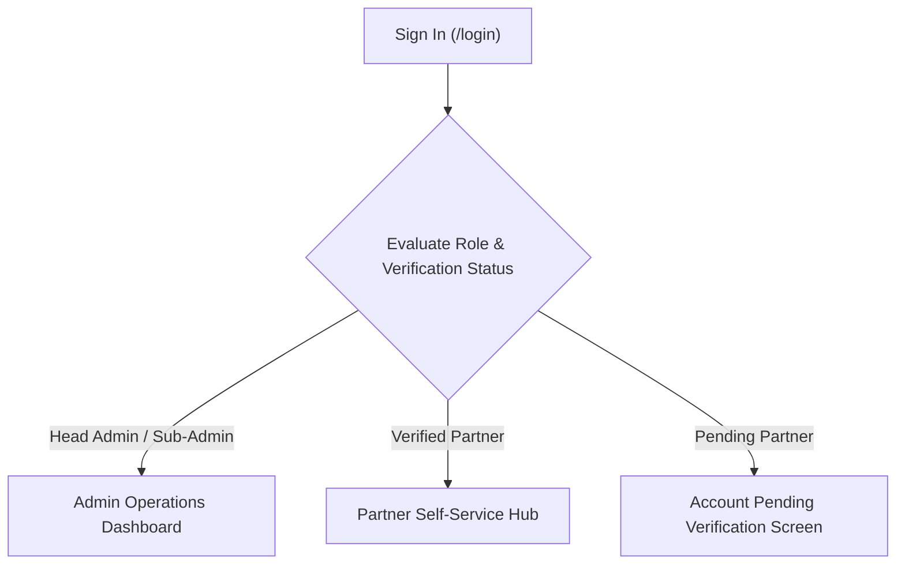
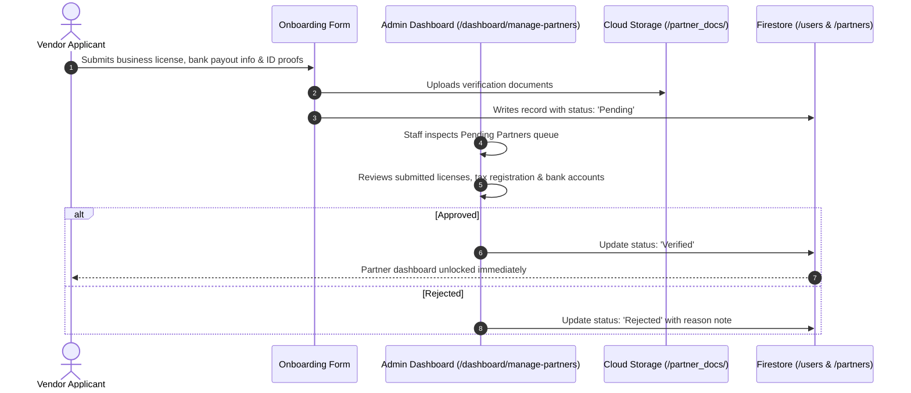

# Admin & Partner Operations Manual

Welcome to the operational manual for the **Thaiseva Admin Portal and Partner Dashboard**. This manual provides comprehensive, step-by-step procedures for daily operations, catalog governance, booking lifecycles, billing, and compliance management.

---

## 1. Access, Navigation & Dashboard Global Layout

Users sign in via `/login` using their registered email and password (or passwordless Email OTP). The interface dynamically personalizes navigation options based on assigned permissions:

### Global Interface Elements
- **Dynamic Sidebar Navigation:** Located on the left. On mobile or tablet devices, use the hamburger menu button in the top header.
- **Top Header Bar:** Displays current page breadcrumbs, quick global search filter, notification bell alerts, and user profile avatar for account settings and logout.
- **Role-Based Views:**
  - **Head Admin:** Complete platform governance, sub-admin management, financial summaries, and account deletion approvals.
  - **Sub-Admin:** Daily operations, partner document vetting, booking management, and customer support chat.
  - **Verified Partners:** Strictly scoped to their own listings, room calendars, assigned trips, and payout statements.
- **Session Lifecycle & Persistence:**
  - Client-side inactivity auto-logout timers have been permanently removed. Administrative and operator sessions persist continuously across active shifts without forced timeouts. Session security is governed by standard Firebase Auth token lifecycles and HTTPS transport.

---

## 2. Administrator Operational Procedures

### 2.1 General Operations & Analytics

#### Platform Statistics & Revenue Analytics (`/dashboard/admin-statistics`)
- Displays real-time Gross Merchandise Value (GMV), total completed orders, active partner counts, and monthly user growth charts.
- **Exporting Financial Records:** Click **Export to Excel** at the top right to download full spreadsheet manifests compiled via `exportAdminStatisticsExcel.js` for accounting audits.

#### User Directory (`/dashboard/user-data`)
- Browse all registered consumer mobile app users.
- Inspect user profile details, contact emails, registration dates, and linked bookings.

#### Promotional Coupons Management (`/dashboard/coupons`)
- Create promotional discount codes for marketing campaigns.
- Configure coupon code, discount type (**Percentage** or **Fixed THB**), minimum cart spend, and expiration date.
- Uses `voucher-code-generator` for bulk campaign code creation.

#### Push Notifications Dispatch (`/dashboard/manage-notifications`)
- Broadcast announcements and operational alerts to consumer mobile apps or partner dashboards.
- Filter audience by user role (e.g., *All Travelers*, *All Hotel Partners*, *All Drivers*).

#### Sub-Admin Governance (`/dashboard/sub-admins`) *(Head Admin Only)*
- Provision new operational staff accounts.
- Assign granular operational scopes or revoke access for departed personnel.

---

### 2.2 Partner Onboarding & Credential Verification

When a business applies to become a Thaiseva partner, their account is placed into `Pending` status:

1. Navigate to **General Partners → Manage Partners** or **Local Assistance → Local Partners**.
2. Filter table by **Status: Pending**.
3. Click **Review** on the target application to inspect business registration documents, TAT tourism licenses, driver's licenses, and bank account details.
4. If documents satisfy legal standards, click **Verify Partner**. The partner gains instant access to their self-service tools.

#### Direct Partner Registration Modal (`/dashboard/local-partners`)
Platform operators can onboard partners directly from the admin interface without navigating to the public onboarding page:
1. Navigate to **Local Assistance → Local Partners** (`/dashboard/local-partners`).
2. Click **Add New Partner** in the search and action bar.
3. An inline popup `<Dialog>` opens directly over the current page:
   - **Initial Status Switch:** Select whether the partner is created as **Verified (Active)** immediately or placed in **Pending Review**.
   - **Credential & KYC Entry:** Enter credentials, contact profile, interactive Google Map location coordinates, service categories/sub-services, and payout banking information.
   - **Isolated Admin Auth Session:** Employs an isolated secondary Firebase Auth app instance under the hood, ensuring the logged-in administrator's active session is never invalidated or logged out.
   - **Real-Time Data Refresh:** On successful submission, the dialog closes automatically, and the Local Partners table and summary cards refresh immediately.
4. **Partner Filter Tabs & Notification Badges:**
   - Filter directly between **⏳ Pending Requests**, **✅ Verified Partners**, and **❌ Denied**.
   - Interactive metric cards reflect total, pending, verified, and denied counts.
   - A live badge counter is displayed in the sidebar navigation next to **Local Partners** reflecting pending partner registration requests awaiting attention.

---

### 2.3 Accommodation & Room Availability Management

#### Hotel Listings Directory (`/dashboard/hotels`)
- Add new hotel properties or update existing profiles (name, star rating, address, GPS coordinates, property amenities, and photo galleries).
- Configure room types under the hotel profile (rack rates, discounted rates, maximum guest capacity, bed configurations).
- **Active & Inactive Listing Visibility Toggles (12 October 2026):**
  - **Table & Card Switches:** Every hotel entry features an inline switch and a status badge (**Active** in green, **Inactive** in slate) in both Table view and Grid Card view.
  - **Image Thumbnail Badge:** Card listings display a prominent overlay chip indicating active or inactive catalog visibility.
  - **Summary Metrics Banner:** Displays real-time counts for **Total Hotels**, **Active Hotels**, and **Inactive Hotels**.
  - **Status Filter Controls:** Use the toggle button bar (`All (N)`, `Active (N)`, `Inactive (N)`) to filter the directory instantly alongside search queries and pagination.
  - **Creation & Edit Visibility:** The hotel creation and update form preserves visibility (`isActive` boolean and `status` string). New properties default to **Active**.
  - **Optimistic Updates & Rollback:** Toggling a switch updates the UI instantly and disables the switch during save to prevent double-clicks. If Firestore fails, the previous state is restored with an error notification.
  - **Multi-Session Synchronization:** Live Firestore listeners reflect status changes made by other administrative staff immediately without refreshing the page.

#### Room Services (`/dashboard/room-services`) & Hotel Rooms Manager (`/dashboard/hotels/:hotelId/rooms`)
- **Direct Room Visibility Toggles:** Toggle individual room package availability directly from the room management table.
- **Dual-Store Synchronization:** Updating a room's status atomically updates both `hotelPackageDetails/{id}` and `HotelDB/{hotelUid}/rooms/{id}` via `writeBatch`.
- **Room Status Modal & Forms:** Room creation, edit forms, and the room status modal maintain visibility flags, defaulting newly created rooms to **Active**. Removing a room from the hotel form deletes both records.
- **Immediate Public Exclusion:** Inactive rooms are filtered out of public hotel room selectors, price calculations, and checkout APIs in real time.

#### Room Availability Calendar Overrides (`/dashboard/hotel-room-availability`)
Hoteliers manage their own inventory, but platform administrators can intervene during offline emergencies:
1. Select the target hotel property from the dropdown.
2. Locate the specific room type and date cell on the availability calendar.
3. Click the date to view **Total Inventory**, **Locked Holds**, and **Confirmed Bookings**.
4. Select **Manual Lock / Block Dates** to take rooms offline.
5. Click **Release Orphaned Holds** if a customer's abandoned checkout hold failed to expire automatically.

---

### 2.4 Travel, Sightseeing & Transport Management

#### Sightseeing & Tour Packages (`/dashboard/sightseeing-packages`)
- Manage guided tours, adventure excursions, and multi-day packages.
- Define day-by-day itineraries, inclusions (e.g., lunch, speedboat, entry tickets), exclusions, and pricing structures (`pricePerAdult`, `pricePerChild`, `extraAdult`).
- Link partner hotels or add manual hotel accommodations with built-in image uploading and validation.
- **Active & Inactive Tour Visibility Toggles (12 October 2026):**
  - **Table & Card Controls:** Manage catalog visibility directly with status switches and status chips in both table rows and card views.
  - **Metrics & Filter Bar:** View live metrics (**Total Packages**, **Active Packages**, **Inactive Packages**) and filter by status (`All`, `Active`, `Inactive`).
  - **Dual Collection Atomic Sync:** Toggling a package atomically synchronizes `sightseeingPackages/{id}` and `sightseeingPackagesDetails/{id}` in a single batch write.
  - **Public Gating:** Inactive tours are immediately hidden from public tour catalogs, detail pages, and search indices. Checkout attempts for inactive packages are blocked with HTTP 409 `LISTING_INACTIVE`.
- **Streamlined Configuration:** The package creation form has been streamlined: obsolete partner package types, early bird discount matrices, transport logistics, and redundant person fields were deprecated to accelerate listing creation.
- **Deferred Payment Safety:** In package booking checkouts, deferred payments strictly require explicit package confirmation prior to payment completion.

#### Transport & Fleet Operations (`/dashboard/taxi-van-management`)
- Register fleet vehicles (`transportVehicles`), license plates, and seat capacities.
- Assign verified drivers to specific vehicles.
- Review incoming ride requests (`car_bookings`) across car, van, airport taxi, and self-drive rentals.
- Set quoted prices for custom passenger routes before dispatching trips to drivers.

---

### 2.5 Dynamic Billing & Invoicing Engine (`/dashboard/invoices`)

The portal includes an integrated PDF billing engine powered by `@react-pdf/renderer` and `jspdf-autotable`:
1. Navigate to **Invoices / Billing**.
2. Select the partner company and specify the billing cycle (e.g., Bi-weekly or Monthly).
3. The system aggregates all completed orders, calculating:
   - **Gross Merchandise Value (GMV)**
   - **Platform Commission Deductions**
   - **Net Payout Payable to Partner**
4. Click **Preview Invoice** to inspect the live client-side PDF document.
5. Click **Generate & Issue PDF** to record the invoice in `partner_invoices` and export an official statement.

---

### 2.6 Account Deletion Compliance (`/dashboard/deletion-requests`)

To comply with the Thailand Personal Data Protection Act (PDPA):
1. Navigate to **General Operations → Deletion Requests**.
2. Review pending requests. The **Days Remaining** column tracks the application 30-day waiting period (not a statutory grace period).
3. Requests with 0 or negative days remaining appear in the **Due** tab.
4. Click **Approve & Delete Login Account**.
5. Confirm the warning dialog. The system invokes `deleteUserFunction`, removing the login and scoped operational data, setting `Erasure Pending` and queuing remaining records for Admin review. Do not tell the customer all copies are erased until that review is complete.

---

## 3. Partner Self-Service Procedures

### 3.1 Hotel Partners
- **Managing Added Rooms:** Configure room types, upload high-resolution photos, list room amenities (WiFi, Bathtub, Balcony), and set nightly rack rates.
- **Room Availability Calendar:** The most critical daily tool. Partners must click and block dates whenever their hotel is booked offline by phone or walk-in guests to prevent overbooking on Thaiseva.
- **Today's Arrivals Manifest:** Real-time list of guests checking in today, displaying guest names, check-in/out dates, and payment settlement flags.

### 3.2 Transport & Driver Partners
- **Assigned Rides:** View scheduled pickups, flight numbers, passenger headcounts, luggage counts, and drop-off destinations.
- **Trip Status Updates:** Update ride status to **En Route**, **Picked Up**, or **Completed** so dispatch operators and passengers track trip progress in real-time.

### 3.3 Multi-Channel Support Messaging
- Access live support directly from the top navigation bar.
- Dedicated channels exist for **Customer Support**, **Driver Support**, **Hotel Support**, and **Local Partner Support**.
- **Voice Audio Notes:** Click the microphone icon to record and send voice messages directly to Thaiseva operations staff for rapid communication while on the road.

---

## 4. Operational Best Practices & Troubleshooting

- **Double Booking Prevention:** Hotel partners must update their Room Availability calendar at least once daily. Thaiseva is not liable for double-bookings caused by out-of-date partner calendars.
- **Browser Caching:** The portal uses real-time Firestore listeners (`onSnapshot`). If data tables appear stalled due to localized network drops, perform a hard refresh (`Ctrl + Shift + R` or `Cmd + Shift + R`).
- **Partner KYC Enforcement:** Never verify a partner without verifying their government-issued ID and commercial bank payout documentation.
