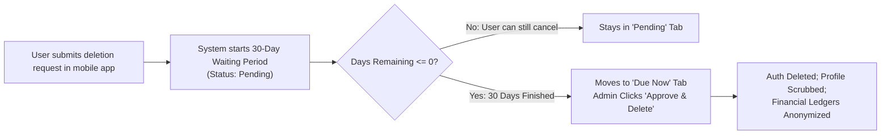
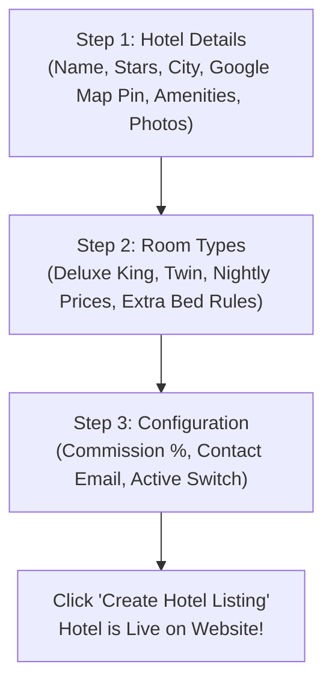
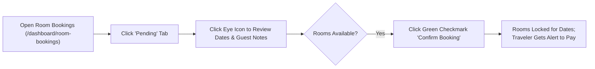
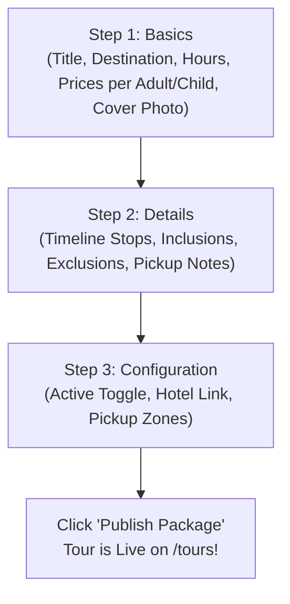
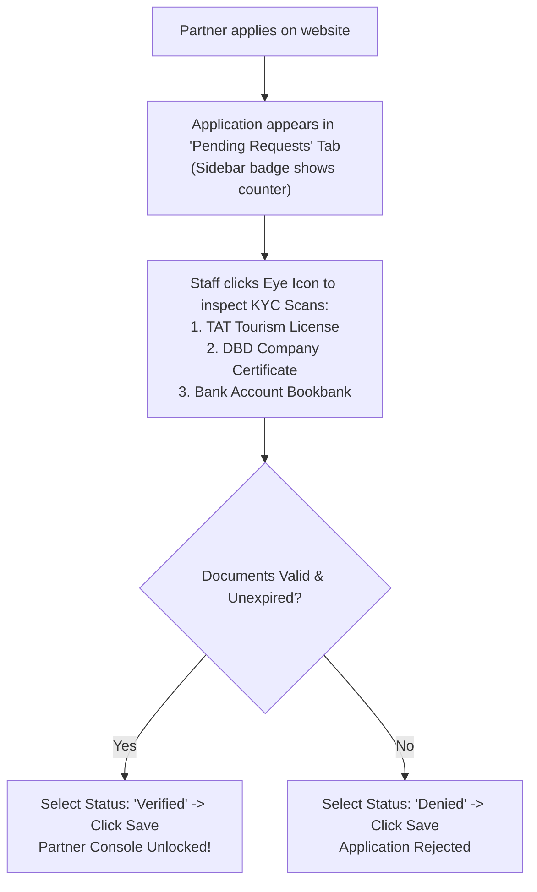

# 🌴 Thaiseva Admin Portal: Complete Step-by-Step Action Manual
**The Ultimate Practical "How-To" Operations Guide Covering Every Action in the Admin Panel**  
*Version 3.2.0 | Digital Core Enterprise Edition | Updated October 2026*

---

## 🎨 Theme, Badges & Quick Action Legend

Every action in this manual is designed for instant understanding with zero guesswork:

| Badge / Icon | Meaning | Example |
| :--- | :--- | :--- |
| **`[STEP 1]`** | **Trigger Action** | Click a specific button, tab, or menu item |
| **`[STEP 2]`** | **Data Entry & Selection** | Type in fields, upload photos, or toggle switches |
| **`[STEP 3]`** | **Verification & Save** | Review the popup confirmation and click Save/Confirm |
| 🟢 **Green** | **Active / Confirmed / Paid** | Everything is live, settled, or verified |
| 🟡 **Yellow** | **Pending / Action Needed** | Requires review or action by staff/admin |
| 🔴 **Red** | **Declined / Canceled / Blocked** | Rejected, out of stock, or archived |
| 🔵 **Blue** | **In Progress / Unverified** | Bank slip uploaded or dispatch in transit |
| 🧭 **What is on Screen?** | **Visual Breakdown** | Exact buttons, tables, toggles, and inputs |
| 💡 **Quick Tip** | **Staff Pro-Tip** | Time-saving shortcuts and best practices |
| ⚠️ **Warning** | **Caution Alert** | How to prevent errors and inventory loss |

---

## 📑 Complete Action Directory (30 Modules)

### 🔐 Part I: Access, Governance & Staff Setup
1. [How to Sign In & Navigate the Global Dashboard](#1-how-to-sign-in--navigate-the-global-dashboard)
2. [How to Manage Your Account Settings & Password](#2-how-to-manage-your-account-settings--password)
3. [How to Add, Edit & Decommission Sub-Admin Staff Accounts](#3-how-to-add-edit--decommission-sub-admin-staff-accounts)
4. [How to Inspect Registered Users & Booking Histories](#4-how-to-inspect-registered-users--booking-histories)
5. [How to Process Account Deletion Requests (PDPA 30-Day Rule)](#5-how-to-process-account-deletion-requests-pdpa-30-day-rule)

### 🏨 Part II: Hotel Accommodation Management
6. [How to Add a New Hotel (3-Step Wizard)](#6-how-to-add-a-new-hotel-3-step-wizard)
7. [How to Edit Hotel Profiles, Amenities & Photos](#7-how-to-edit-hotel-profiles-amenities--photos)
8. [How to Toggle Hotel Active/Inactive Visibility Instantly](#8-how-to-toggle-hotel-activeinactive-visibility-instantly)
9. [How to Add Room Categories to a Hotel](#9-how-to-add-room-categories-to-a-hotel)
10. [How to Edit Room Pricing, Beds & Extra Bed Options](#10-how-to-edit-room-pricing-beds--extra-bed-options)
11. [How Room Availability Works (The Simple Math Formula)](#11-how-room-availability-works-the-simple-math-formula)
12. [How Room Availability Updates (Auto Holds vs. Manual Overrides)](#12-how-room-availability-updates-auto-holds-vs-manual-overrides)
13. [How to Manually Block Dates on the Room Availability Calendar](#13-how-to-manually-block-dates-on-the-room-availability-calendar)
14. [How to Add Extra Room Stock for Holidays & Peak Dates](#14-how-to-add-extra-room-stock-for-holidays--peak-dates)
15. [How to Release Stuck / Orphaned 10-Minute Checkout Holds](#15-how-to-release-stuck--orphaned-10-minute-checkout-holds)

### 📋 Part III: Customer Order Triage (Hotels & Tours)
16. [How to Approve (Confirm) a Pending Hotel Room Booking](#16-how-to-approve-confirm-a-pending-hotel-room-booking)
17. [How to Decline a Hotel Room Booking](#17-how-to-decline-a-hotel-room-booking)
18. [How to Verify a Thai PromptPay QR Payment (Shield Icon)](#18-how-to-verify-a-thai-promptpay-qr-payment-shield-icon)
19. [How to Use Bulk Actions on Hotel Bookings](#19-how-to-use-bulk-actions-on-hotel-bookings)
20. [How to Safely Delete Canceled Bookings without Locking Inventory](#20-how-to-safely-delete-canceled-bookings-without-locking-inventory)
21. [How to Switch Between List View & Calendar (Gantt) View](#21-how-to-switch-between-list-view--calendar-gantt-view)
22. [How to Approve or Decline a Tour Package Booking](#22-how-to-approve-or-decline-a-tour-package-booking)
23. [How the 2-Day Preparation Rule & Daily Capacity Work](#23-how-the-2-day-preparation-rule--daily-capacity-work)

### 🌴 Part IV: Sightseeing Packages & Excursions
24. [How to Add a New Sightseeing Tour Package (3-Step Wizard)](#24-how-to-add-a-new-sightseeing-tour-package-3-step-wizard)
25. [How to Edit, Toggle Visibility & Delete Tour Packages](#25-how-to-edit-toggle-visibility--delete-tour-packages)
26. [How to Adjust the Global Daily Tour Capacity Limit](#26-how-to-adjust-the-global-daily-tour-capacity-limit)

### 🚐 Part V: Transport Fleet & Driver Dispatch
27. [How to Register Fleet Vehicles (Vans, Sedans, Rentals)](#27-how-to-register-fleet-vehicles-vans-sedans-rentals)
28. [How to Dispatch & Assign Drivers to Airport Pickups & Rides](#28-how-to-dispatch--assign-drivers-to-airport-pickups--rides)
29. [How to Review Self-Drive Car Rental Bookings](#29-how-to-review-self-drive-car-rental-bookings)

### 🤝 Part VI: Partner Management, Chat & Announcements
30. [How to Onboard & Verify a New Partner (KYC Document Review)](#30-how-to-onboard--verify-a-new-partner-kyc-document-review)
31. [How to Add a Partner Directly with the Inline Popup Dialog](#31-how-to-add-a-partner-directly-with-the-inline-popup-dialog)
32. [How to Live Chat with Travelers & Hotel Front Desks](#32-how-to-live-chat-with-travelers--hotel-front-desks)
33. [How to Broadcast a Push Notification with Cropped Photo & Expiry](#33-how-to-broadcast-a-push-notification-with-cropped-photo--expiry)
34. [How to Manage Prime Locations (Shops & Nightlife Clubs)](#34-how-to-manage-prime-locations-shops--nightlife-clubs)
35. [How to Manage Website Content (Blogs, FAQs, Reviews & Inquiries)](#35-how-to-manage-website-content-blogs-faqs-reviews--inquiries)
36. [How to View Platform Earnings & Export Financial Reports to Excel](#36-how-to-view-platform-earnings--export-financial-reports-to-excel)

---

## Part I: Access, Governance & Staff Setup

### 1. How to Sign In & Navigate the Global Dashboard

#### 🎯 Purpose
Log in to your authorized operational console and find your tools fast.

#### 📋 Step-by-Step Procedure
- **`[STEP 1]` Open Login Screen**: Navigate to `/login`.
- **`[STEP 2]` Type Credentials**: Enter your work **Email** and **Password**. Click the eye icon if you need to double-check spelling.
- **`[STEP 3]` Click "Sign In"**: The button will spin briefly, verify your security token, and open your tailored dashboard:
  - **Admins & Sub-Admins**: Land on the master operational dashboard.
  - **Hotel Partners**: Land directly on their room inventory and today's arrivals manifest.

#### 🧭 What is on the Screen?
- **Left Sidebar**: Your main control panel organized into clean groups:
  - 🏠 *General Operations*: Dashboard, Settings, Notifications, Statistics, Records, Users, Deletion Requests.
  - 🏨 *Hotel Related*: Hotels, Room Availability, Room Bookings.
  - 🌴 *Travel & Transport*: Sightseeing Packages, Tour Bookings, Vans, Car Bookings, Self-Drive.
  - 🤝 *Partners*: Local Partners (with a live badge for pending requests).
  - 💬 *Communication*: Customer Chat, Hotel Chat, Partner Chat.
  - ⚙️ *Website Config*: Site Statistics, Media, Blogs, FAQs, Reviews, Contact Us.
- **Top Header Bar**:
  - 🔍 **Quick Search**: Filters rows in the active table instantly.
  - 🔔 **Notification Bell**: Shows unread alerts and booking requests.
  - 👤 **Avatar Profile**: Click to open Account Settings or Log Out.

> [!NOTE]
> **Continuous Sessions:** The portal does not use inactivity timers. Your session will not kick you out in the middle of a shift.

---

### 2. How to Manage Your Account Settings & Password

#### 🎯 Purpose
Update your staff display name, email, or change your account password.

#### 📋 Step-by-Step Procedure
- **`[STEP 1]`**: Click your **Avatar** in the top right corner $\rightarrow$ Click **"Account Settings"** (or click `/dashboard/settings` in the sidebar).
- **`[STEP 2]`**: 
  - To update profile: Edit **Full Name** and **Phone Number**.
  - To change password: Enter **Current Password**, followed by your **New Password** (minimum 8 characters).
- **`[STEP 3]`**: Click **"Save Changes"**. A green toast confirms update.

---

### 3. How to Add, Edit & Decommission Sub-Admin Staff Accounts

#### 🎯 Purpose
*(Head Administrator Only)* Provision logins for new operational staff, set their permissions, or revoke access when someone leaves.

#### 📋 Step-by-Step Procedure: Adding a Sub-Admin
- **`[STEP 1]`**: In the sidebar, click **Sub-Admins** (`/dashboard/sub-admins`).
- **`[STEP 2]`**: Click the blue **"+ Add New Sub-Admin"** button in the header.
- **`[STEP 3]`**: In the popup dialog, fill in:
  - **Full Name**: (e.g., *"Somchai Prasert"*).
  - **Company Email**: (e.g., *"somchai@thaiseva.com"*).
  - **Temporary Password**: (min 8 chars, 1 uppercase, 1 number).
  - **Scopes**: Check the authorized duties (`Bookings`, `Catalog`, `Partners`, `Support`).
- **`[STEP 4]`**: Click **"Create Account"**.

#### 🧭 What is on the Screen?
- **Sub-Admins Table**: Displays staff avatar, name, email, created date, and action icons.
- **Delete Staff Icon (`DeleteButton`)**: Click the red trash icon to immediately revoke a departed staff member's login token.

> [!IMPORTANT]
> The creation form uses an isolated background auth session. The Head Admin's active login is never disconnected when creating new accounts.

---

### 4. How to Inspect Registered Users & Booking Histories

#### 🎯 Purpose
Look up consumer travelers, check their contact details, and review their past reservations.

#### 📋 Step-by-Step Procedure
- **`[STEP 1]`**: In the sidebar, click **Users Data** (`/dashboard/user-data`).
- **`[STEP 2]`**: Type the traveler's name, email, or phone number in the search bar.
- **`[STEP 3]`**: Click **View Profile** (`ViewDetailsIcon`) on the user row.

#### 🧭 What is on the Screen?
- User avatar, registered email, mobile phone with country dial code.
- Joined date and account verification status.
- Linked booking records table showing all past hotel stays and sightseeing excursions.

---

### 5. How to Process Account Deletion Requests (PDPA 30-Day Rule)

#### 🎯 Purpose
Comply with Thailand's Personal Data Protection Act (PDPA Section 33) and Google Play / Apple Store rules when a user asks to delete their account.



#### 📋 Step-by-Step Procedure
- **`[STEP 1]`**: In the sidebar, click **Deletion Requests** (`/dashboard/deletion-requests`).
- **`[STEP 2]`**: Click the **"Due Now"** tab. This filters requests where the 30-day waiting period has elapsed (`daysRemaining <= 0`).
- **`[STEP 3]`**: On the target user row, click the red button: **"Approve & Delete Login Account"**.
- **`[STEP 4]`**: In the warning modal, click **"Confirm Permanent Deletion"**.

#### 🧭 What is on the Screen?
- **Tabs**: `All`, `Pending` (active grace period), `Due Now` (action required), `Completed`, `Cancelled`.
- **Days Remaining Column**: Shows exact days left in the 30-day window.

> [!CAUTION]
> Approving a deletion permanently destroys the customer's Firebase Auth login and scrubs their profile. Booking financial ledgers are kept in anonymized form for official accounting audits.

---

## Part II: Hotel Accommodation Management

### 6. How to Add a New Hotel (3-Step Wizard)

#### 🎯 Purpose
Publish a brand-new hotel property so travelers can discover it and book rooms on `thaiseva.com` and the mobile app.



#### 📋 Step-by-Step Procedure
- **`[STEP 1]` Open Wizard**: In the sidebar, click **Hotels** (`/dashboard/hotels`) $\rightarrow$ Click **"+ Add Hotel"** (top right).
- **`[STEP 2]` Step 1: Hotel Details**:
  - Enter **Hotel Name** (e.g., *"Centara Grand Beach Resort"*).
  - Enter **Thai Name** *(Optional)*.
  - Click **Star Rating** (`1` to `5` stars).
  - Choose **City / Province** (Bangkok, Phuket, Chiang Mai, Pattaya, Krabi, Koh Samui).
  - Type **Address**, then drag the red pin on the Google Map to lock the GPS location.
  - Click verified **Amenity Chips** (🏊 Pool, 📶 WiFi, 🏋️ Gym, 🍳 Restaurant, 🧖‍♀️ Spa, 🅿️ Parking).
  - Click the upload box to upload 1 horizontal cover photo + 3 to 10 gallery photos.
  - Click **"Next: Room Types"**.
- **`[STEP 3]` Step 2: Room Types**:
  - Click **"+ Add Room Category"**.
  - Enter **Room Title** (e.g., *"Deluxe Ocean View King"*).
  - Select **Bed Configuration** (1 King Bed, 2 Twin Beds, 1 Queen Bed).
  - Enter **Base Price (THB)** (e.g., `3,500`).
  - Set **Max Occupancy**: Adults = `2`, Children = `1`.
  - If rollaway beds fit: Toggle **"Allow Extra Bed"** and enter extra bed fee (e.g., `800` THB).
  - Upload room photo $\rightarrow$ Click **"Save Room"**. *(Repeat for more rooms)*.
  - Click **"Next: Configuration"**.
- **`[STEP 4]` Step 3: Configuration & Publish**:
  - Set **Commission Rate** (standard is `15`% or `20`%).
  - Enter front desk email and telephone.
  - Make sure the status toggle is set to 🟢 **Active**.
  - Click **"Create Hotel Listing"**.

#### 🧭 What is on the Screen?
- Animated progress bar showing `1. Hotel Details` $\rightarrow$ `2. Room Types` $\rightarrow$ `3. Configuration`.
- Interactive Google Map with autocomplete search.

---

### 7. How to Edit Hotel Profiles, Amenities & Photos

#### 🎯 Purpose
Update an existing hotel's photos, change phone numbers, or adjust amenities.

#### 📋 Step-by-Step Procedure
- **`[STEP 1]`**: In **Hotels** (`/dashboard/hotels`), locate the hotel row.
- **`[STEP 2]`**: Click the **Edit Pencil Icon** (`MdEdit`).
- **`[STEP 3]`**: The 3-step wizard opens pre-filled with the current data. Make your edits.
- **`[STEP 4]`**: Click **"Update Hotel"** on Step 3.

---

### 8. How to Toggle Hotel Active/Inactive Visibility Instantly

#### 🎯 Purpose
Take a hotel offline temporarily (e.g., for seasonal closure or contract renewal) without deleting it.

#### 📋 Step-by-Step Procedure
- **`[STEP 1]`**: Go to **Hotels** (`/dashboard/hotels`).
- **`[STEP 2]`**: Locate the hotel in the table or card grid.
- **`[STEP 3]`**: Click the **Active / Inactive Toggle Switch**.
  - 🟢 **Active**: The hotel is online and bookable.
  - ⚪ **Inactive**: The hotel is hidden from public search immediately.

#### 🧭 What is on the Screen?
- **Filter Bar**: Click `All (N)`, `Active (N)`, or `Inactive (N)` to filter the list.
- **Summary Cards**: Displays live counts for Total, Active, and Inactive hotels.

> [!NOTE]
> The switch uses optimistic UI updates. It updates instantly on screen while saving to Firestore in the background.

---

### 9. How to Add Room Categories to a Hotel

#### 🎯 Purpose
Add a new room category (e.g., adding a *"Family 2-Bedroom Villa"*) to a hotel.

#### 📋 Step-by-Step Procedure
- **`[STEP 1]`**: In **Hotels** (`/dashboard/hotels`), find your hotel and click the **Rooms Icon** (`MdMeetingRoom` - door icon).
- **`[STEP 2]`**: You are now on `/dashboard/hotels/:hotelId/rooms`. Click **"+ Add Room"**.
- **`[STEP 3]`**: Fill in Room Name, Bed Type, Base Price THB, Max Guests, and Amenities.
- **`[STEP 4]`**: Click **"Save Room"**. The room becomes live on the website immediately!

---

### 10. How to Edit Room Pricing, Beds & Extra Bed Options

#### 🎯 Purpose
Adjust room prices for high season, change bed types, or enable extra rollaway beds.

#### 📋 Step-by-Step Procedure
- **`[STEP 1]`**: Go to the hotel's room list (`/dashboard/hotels/:hotelId/rooms`).
- **`[STEP 2]`**: Click the **Edit Icon** on the target room card.
- **`[STEP 3]`**: Update **Base Price (THB)** or toggle **Allow Extra Bed**.
- **`[STEP 4]`**: Click **"Save Changes"**. Dual-store synchronization updates both the room and package collections automatically.

---

### 11. How Room Availability Works (The Simple Math Formula)

#### 🎯 Purpose
Understand how the platform calculates whether rooms can be booked instantly.

#### 🧮 The Simple Math Formula

$$\text{Remaining Rooms} = \text{Base Inventory} + \text{Extra Added} - \text{Blocked} - \text{Confirmed Bookings} - \text{Active Holds}$$

#### Real-Life Example for Saturday Night:
- **Base Inventory**: 10 Superior Rooms.
- **Extra Added**: 0.
- **Blocked**: 1 room (plumbing leak).
- **Confirmed Bookings**: 4 guests already checked in/booked.
- **Active 10-Minute Hold**: 1 guest currently entering their credit card number on the website.

$$\text{Remaining Rooms} = 10 + 0 - 1 - 4 - 1 = \mathbf{4\text{ Rooms Available}}$$

#### 🎨 Color Codes on the Availability Grid:
- 🟢 **Green (3+ rooms)**: Healthy inventory. Customers book and pay instantly.
- 🟡 **Yellow (1 to 2 rooms)**: Low stock warning badge shown on consumer site.
- 🔴 **Red (0 rooms)**: **Sold Out**. Customers cannot pay instantly; they can only send a booking inquiry.
- ⚪ **Gray Striped**: Dates closed or blocked by staff.

---

### 12. How Room Availability Updates (Auto Holds vs. Manual Overrides)

#### 🎯 Purpose
Know what updates automatically and when staff need to intervene.

#### A. What the System Does Automatically:
1. When a traveler enters checkout, the system places a **10-minute soft hold** on the room (remaining count drops by 1).
2. If the traveler pays via Stripe, the hold turns into a permanent booking.
3. If the traveler closes their tab or the 10-minute timer runs out, the room **automatically returns to the available inventory pool (+1)**.

#### B. What Staff Controls Manually:
1. Staff can click dates on the calendar to take rooms offline.
2. Staff can add extra inventory for holiday periods.
3. Staff can clear stuck holds with one click.

---

### 13. How to Manually Block Dates on the Room Availability Calendar

#### 🎯 Purpose
Close dates when a hotel is fully booked offline (e.g. from walk-in guests or private weddings).

#### 📋 Step-by-Step Procedure
- **`[STEP 1]`**: In the sidebar, click **Room Availability** (`/dashboard/hotel-room-availability`).
- **`[STEP 2]`**: Select your hotel from the dropdown and navigate to the target month.
- **`[STEP 3]`**: Click the target date cell on the calendar (or drag across multiple dates).
- **`[STEP 4]`**: In the popup dialog, choose **"Block Out Rooms"**.
- **`[STEP 5]`**: Enter how many rooms to block (or check *"Block Entire Category"*), add a quick reason note (e.g., *"Offline front desk booking"*), and click **"Confirm Override"**.

#### 🧭 What is on the Screen?
- The calendar cells turn gray with a padlock icon. Storefront checkouts for those dates are disabled immediately.

---

### 14. How to Add Extra Room Stock for Holidays & Peak Dates

#### 🎯 Purpose
Increase daily room allocation when a hotel grants additional inventory during peak travel seasons.

#### 📋 Step-by-Step Procedure
- **`[STEP 1]`**: Go to **Room Availability** (`/dashboard/hotel-room-availability`) $\rightarrow$ Select hotel.
- **`[STEP 2]`**: Click the target holiday dates on the calendar.
- **`[STEP 3]`**: In the popup dialog, select **"Add Extra Rooms"**.
- **`[STEP 4]`**: Enter `+5` (or desired amount) $\rightarrow$ Click **"Confirm"**.
- *Result*: The available room count increments immediately!

---

### 15. How to Release Stuck / Orphaned 10-Minute Checkout Holds

#### 🎯 Purpose
Free up rooms when a customer's browser crashes or network drops during card entry, leaving an expired hold.

#### 📋 Step-by-Step Procedure
- **`[STEP 1]`**: In **Room Availability** (`/dashboard/hotel-room-availability`), look at the top action header.
- **`[STEP 2]`**: Click the button: **"Release Orphaned Holds"**.
- **`[STEP 3]`**: Review the identified expired hold IDs in the modal $\rightarrow$ Click **"Release All Expired Holds"**.
- *Result*: The holds delete, and the rooms return to the available pool instantly.

---

## Part III: Customer Order Triage (Hotels & Tours)

### 16. How to Approve (Confirm) a Pending Hotel Room Booking

#### 🎯 Purpose
Confirm room availability with the hotel front desk and approve an incoming on-request reservation.



#### 📋 Step-by-Step Procedure
- **`[STEP 1]`**: In the sidebar, click **Room Bookings** (`/dashboard/room-bookings`).
- **`[STEP 2]`**: Ensure the **Pending** tab (`Tab 0`) is selected.
- **`[STEP 3]`**: Click the **Eye Icon** (`MdVisibility`) to inspect guest name, room count, check-in dates, and special requests.
- **`[STEP 4]`**: In the Actions column, click the **Green Checkmark** button (`DoneRoundedIcon`).
- **`[STEP 5]`**: In the confirmation popup, click **"OK"**.

#### 🧭 What Happens Automatically?
- Rooms are deducted from inventory for those stay dates.
- Booking status changes to **Accepted**.
- Booking moves to the **Waiting for Payment** tab.
- Customer receives an instant phone notification: *"Your room request was accepted! Please complete payment to confirm your booking."*

---

### 17. How to Decline a Hotel Room Booking

#### 🎯 Purpose
Reject a booking request when the hotel is completely full.

#### 📋 Step-by-Step Procedure
- **`[STEP 1]`**: Go to **Room Bookings** (`/dashboard/room-bookings`) $\rightarrow$ Click **Pending** tab.
- **`[STEP 2]`**: On the target booking row, click the **Red 'X' Button** (`CloseRoundedIcon`).
- **`[STEP 3]`**: In the prompt, click **"OK"**.
- *Result*: Status changes to **Canceled**; the customer receives an alert that rooms were unavailable.

---

### 18. How to Verify a Thai PromptPay QR Payment (Shield Icon)

#### 🎯 Purpose
Verify that Thai Baht funds were received in the company bank account before issuing a confirmed voucher.

```mermaid
sequenceDiagram
    autonumber
    actor Traveler as Traveler
    participant Bank as Bank Statement
    actor Staff as Admin Staff (/dashboard/room-bookings)

    Traveler->>Bank: Transfers Baht via Mobile Banking QR
    Traveler->>Staff: Booking displays "PAYMENT PENDING VERIFICATION"
    Staff->>Bank: Verifies exact Baht amount & time in company bank app
    Staff->>Staff: Clicks Shield Icon ("Verify Payment")
    Staff-->>Traveler: Status updates to "VERIFIED"; Green voucher issued!
```

#### 📋 Step-by-Step Procedure
- **`[STEP 1]`**: In **Room Bookings** or **Sightseeing Bookings**, locate bookings with the blue badge: **`PAYMENT PENDING VERIFICATION`**.
- **`[STEP 2]`**: Click the **Eye Icon** to check the **Amount (THB)** and transfer time.
- **`[STEP 3]`**: Open your company bank account app/portal and verify the transfer arrived.
- **`[STEP 4]`**: On the booking row, click the **Shield Icon** (`VerifyPaymentIconButton`).
- **`[STEP 5]`**: Confirm the prompt: *"Verify payment for this booking?"* $\rightarrow$ Click **"OK"**.

#### 🧭 What Happens Instantly?
- Payment status updates to **`VERIFIED`**.
- `isPaymentDone` becomes `true`.
- The booking moves to the **Paid & Accepted** tab.
- Platform revenue stats update automatically.
- Traveler's digital voucher displays a green verified badge.

---

### 19. How to Use Bulk Actions on Hotel Bookings

#### 🎯 Purpose
Approve or decline multiple room requests at once during busy morning shifts.

#### 📋 Step-by-Step Procedure
- **`[STEP 1]`**: In **Room Bookings**, check the square checkboxes on the left of multiple rows.
- **`[STEP 2]`**: A blue **Bulk Action Bar** appears at the top of the table showing *"[N] Selected"*.
- **`[STEP 3]`**: 
  - Click **"Approve Selected"** to batch-confirm all checked requests.
  - Click **"Decline Selected"** to batch-reject all checked requests.

---

### 20. How to Safely Delete Canceled Bookings without Locking Inventory

#### 🎯 Purpose
Clean up old canceled bookings from the database safely.

#### 📋 Step-by-Step Procedure
- **`[STEP 1]`**: In **Room Bookings**, switch to the **Declined** tab (`Tab 3`).
- **`[STEP 2]`**: Click the **Trash Icon** (`DeleteForeverIcon`) on the canceled row.
- **`[STEP 3]`**: Confirm the deletion modal.
- *Safety Guarantee*: The system automatically checks `inventoryReleased`. If inventory was still locked, it releases the rooms before deleting the document.

---

### 21. How to Switch Between List View & Calendar (Gantt) View

#### 🎯 Purpose
View hotel bookings on a visual timeline chart to see check-ins and check-outs across dates.

#### 📋 Step-by-Step Procedure
- **`[STEP 1]`**: At the top of `/dashboard/room-bookings`, find the view toggle buttons:
  - Click **"List View"** for the standard table.
  - Click **"Calendar View"** for the visual Gantt timeline.
- **`[STEP 2]`**: In Calendar View, use the **Filter Hotel** dropdown to isolate one hotel, and pick a start date.
- **`[STEP 3]`**: Colored booking bars show guest names, stay durations, and room counts across 14 consecutive days.

---

### 22. How to Approve or Decline a Tour Package Booking

#### 🎯 Purpose
Verify tour guide and speedboat seats, check hotel pickup locations, and confirm excursion bookings.

#### 📋 Step-by-Step Procedure
- **`[STEP 1]`**: In the sidebar, click **Sightseeing Bookings** (`/dashboard/travel-bookings`).
- **`[STEP 2]`**: The screen defaults to the **Pending Review** tab (`Tab 1`).
- **`[STEP 3]`**: Click the **Eye Icon** to check the passenger count (adults/children) and pickup hotel.
- **`[STEP 4]`**: 
  - To Approve: Click the **Green Checkmark** (`DoneRoundedIcon`) $\rightarrow$ Click **OK**.
  - To Decline: Click the **Red 'X'** (`CloseRoundedIcon`) $\rightarrow$ Click **OK**.

---

### 23. How the 2-Day Preparation Rule & Daily Capacity Work

#### 🎯 Purpose
Understand why some tour bookings require staff approval while others allow instant checkout.

#### ⏳ The 2-Day Rule Explained:
- **Tours for Tomorrow or Day 2**: Customer pays **0 THB upfront**. It is submitted as a **Free Request**. Staff must confirm guide and boat seats before taking payment.
- **Tours for Day 3 Onward**: Customer can pay right away with credit card or PromptPay QR.
- **Daily Capacity Limit**: If 20 bookings already exist for a date, all extra bookings automatically switch to the Request Flow.

---

## Part IV: Sightseeing Packages & Excursions

### 24. How to Add a New Sightseeing Tour Package (3-Step Wizard)

#### 🎯 Purpose
Publish a new tour or guided excursion on `https://thaiseva.com/tours`.



#### 📋 Step-by-Step Procedure
- **`[STEP 1]` Open Wizard**: In the sidebar, click **Sightseeing Packages** (`/dashboard/travel-services`) $\rightarrow$ Click **"+ Add Sightseeing Package"**.
- **`[STEP 2]` Step 1: Basics**:
  - Enter **Package Title** (e.g., *"Phi Phi & Maya Bay Speedboat Tour with Buffet Lunch"*).
  - Select **Destination** (Bangkok, Phuket, Krabi, Chiang Mai, etc.).
  - Select **Duration** (`Full Day` or `Half Day`) and **Departure Time** (e.g., `07:30 AM`).
  - Enter **Adult Price (THB)** (e.g., `2,400`) and **Child Price (THB)** (e.g., `1,600`).
  - Upload horizontal cover photo $\rightarrow$ Click **"Next: Details"**.
- **`[STEP 3]` Step 2: Details & Itinerary**:
  - Add timeline stops (07:30 pickup, 09:00 pier departure, 12:30 lunch, 16:30 return).
  - Add **Inclusions** (Guide, Lunch, Park Fees, Snorkel gear, Insurance).
  - Add **Exclusions** (Alcohol, Personal tips).
  - Add **What to Bring** (Sunscreen, Swimwear, Towel).
  - Click **"Next: Configuration"**.
- **`[STEP 4]` Step 3: Configuration & Publish**:
  - Enter free **Pickup Zones** (e.g., *"Free pickup in Patong, Kata, and Karon"*).
  - Ensure status switch is 🟢 **Active**.
  - Click **"Publish Package"**.

---

### 25. How to Edit, Toggle Visibility & Delete Tour Packages

#### 🎯 Purpose
Update tour prices, pause tours during monsoons, or archive old itineraries.

#### 📋 Step-by-Step Procedure
- **To Toggle Online / Offline**: In `/dashboard/travel-services`, click the **Active / Inactive Switch** on the tour row. It updates atomically across both package collections.
- **To Edit Tour**: Click the **Edit Pencil Icon** $\rightarrow$ modify stops or prices $\rightarrow$ Click **Save**.
- **To Delete**: Click the **Trash Icon** $\rightarrow$ confirm deletion.

---

### 26. How to Adjust the Global Daily Tour Capacity Limit

#### 🎯 Purpose
Change the daily booking ceiling (e.g. increase from 20 to 30 during high season).

#### 📋 Step-by-Step Procedure
- **`[STEP 1]`**: Go to **Sightseeing Packages** (`/dashboard/travel-services`).
- **`[STEP 2]`**: Click the gear icon / **"Daily Capacity Settings"** button in the header.
- **`[STEP 3]`**: Change the numerical limit (e.g. set to `25`) $\rightarrow$ Click **"Save Configuration"**.

---

## Part V: Transport Fleet & Driver Dispatch

### 27. How to Register Fleet Vehicles (Vans, Sedans, Rentals)

#### 🎯 Purpose
Add company transport assets (VIP vans, sedans, self-drive rental cars) to the dispatch system.

#### 📋 Step-by-Step Procedure
- **`[STEP 1]`**: In the sidebar, click **Taxi & Van Management** (`/dashboard/vans`).
- **`[STEP 2]`**: Click **"+ Add New Vehicle"**.
- **`[STEP 3]`**: Fill in:
  - **Vehicle Model**: (e.g., *"Toyota Commuter VIP 9-Seater"*).
  - **License Plate**: Thai registered commercial plate number.
  - **Seat Capacity**: (e.g., `9` passengers + luggage).
  - **Assigned Driver**: Select driver partner from dropdown.
  - **Operating Province**: (e.g., *Suvarnabhumi BKK*, *Phuket HKT*).
- **`[STEP 4]`**: Click **"Save Vehicle"**.

---

### 28. How to Dispatch & Assign Drivers to Airport Pickups & Rides

#### 🎯 Purpose
Assign a vehicle and driver to travelers who booked airport transfers.

#### 📋 Step-by-Step Procedure
- **`[STEP 1]`**: In the sidebar, click **Van Bookings** (`/dashboard/van-bookings`) or **Car Bookings** (`/dashboard/car-bookings`).
- **`[STEP 2]`**: Click on a new ride to inspect Flight Number, Pickup Airport, Hotel Destination, and Headcount.
- **`[STEP 3]`**: Click **"Assign Vehicle & Driver"** $\rightarrow$ select available vehicle and driver $\rightarrow$ Click **"Confirm Dispatch"**.
- *Result*: The driver gets the manifest on their mobile app; the customer receives an alert with driver phone and license plate.

---

### 29. How to Review Self-Drive Car Rental Bookings

#### 🎯 Purpose
Confirm car rental bookings where travelers drive the vehicle themselves.

#### 📋 Step-by-Step Procedure
- **`[STEP 1]`**: In the sidebar, click **Self Drive Bookings** (`/dashboard/self-drive-bookings`).
- **`[STEP 2]`**: Click **View Details** to inspect rental duration and uploaded International Driving Permit / Passport copies.
- **`[STEP 3]`**: Click **Confirm Rental** to reserve the vehicle for handover at the airport counter.

---

## Part VI: Partner Management, Chat & Announcements

### 30. How to Onboard & Verify a New Partner (KYC Document Review)

#### 🎯 Purpose
Review supplier applications and legal licenses before they are authorized to sell on Thaiseva.



#### 📋 Step-by-Step Procedure
- **`[STEP 1]`**: In the sidebar, click **Local Partners** (`/dashboard/local-partners`).
- **`[STEP 2]`**: Click the **"⏳ Pending Requests"** tab.
- **`[STEP 3]`**: Click the **Eye Icon** (`ViewDetailsIcon`) on the applicant row.
- **`[STEP 4]`**: In the **KYC Review Dialog**, inspect:
  - 📄 **TAT Tourism License**: Check license number and expiration date.
  - 🏢 **DBD Company Registration**: Verify registered legal entity.
  - 💳 **Bank Book (Bookbank)**: Name must match company or owner.
- **`[STEP 5]`**: In the Status dropdown, select **"Verified"** (to approve) or **"Denied"** (to reject) $\rightarrow$ Click **"Save Changes"**.

---

### 31. How to Add a Partner Directly with the Inline Popup Dialog

#### 🎯 Purpose
Register a partner immediately while talking to them at your Bangkok office without logging out.

#### 📋 Step-by-Step Procedure
- **`[STEP 1]`**: In **Local Partners** (`/dashboard/local-partners`), click **"+ Add New Partner"** in the top action bar.
- **`[STEP 2]`**: In the popup dialog:
  - Select **Initial Status**: choose **Verified (Active)** for instant activation.
  - Enter Business Name, Owner Name, Email, Phone, and Category (Hotel, Guide, Transport).
  - Pin their operating location on the Google Map.
  - Enter bank payout details.
- **`[STEP 3]`**: Click **"Submit Partner Registration"**. The modal saves and closes automatically without refreshing the page!

---

### 32. How to Live Chat with Travelers & Hotel Front Desks

#### 🎯 Purpose
Answer traveler questions in real time or coordinate check-in with hotel front desks.

#### 📋 Step-by-Step Procedure
- **`[STEP 1]`**: Click **Customer Chat** (`/dashboard/customer-chat`) or **Hotel Chat** (`/dashboard/hotel-chat`).
- **`[STEP 2]`**: Threads with unread messages show a red counter badge. Click a conversation thread.
- **`[STEP 3]`**: Type your response in the bottom text box. Use the paperclip icon if you need to attach a photo.
- **`[STEP 4]`**: Press `Enter` or click **Send**. The customer sees your reply instantly in their app.

---

### 33. How to Broadcast a Push Notification with Cropped Photo & Expiry

#### 🎯 Purpose
Send promotional flash sales, weather advisories, or announcements to travelers' phones.

#### 📋 Step-by-Step Procedure
- **`[STEP 1]`**: In the sidebar, click **Manage Notifications** (`/dashboard/notifications`).
- **`[STEP 2]`**: Type **Title** (max 60 chars) and **Message Body** (max 240 chars).
- **`[STEP 3]` Add Photo** *(Optional)*:
  - Click **Upload Image** (JPG or PNG).
  - Use the interactive cropper slider to zoom and center the photo nicely.
- **`[STEP 4]` Set Expiry** *(Optional)*:
  - Toggle **"Set Expiry Date"** ON and pick the campaign end date.
- **`[STEP 5]`**: Click **"Preview"** to check the simulated phone display $\rightarrow$ Click **"Send Broadcast"**.

---

### 34. How to Manage Prime Locations (Shops & Nightlife Clubs)

#### 🎯 Purpose
Add recommended shopping centers and nightlife venues to the traveler city guide.

#### 📋 Step-by-Step Procedure
- **`[STEP 1]`**: In the sidebar, click **Shops** (`/dashboard/shopping-malls`) or **Clubs** (`/dashboard/clubs`).
- **`[STEP 2]`**: Click **"+ Add Shopping Mall"** or **"+ Add Club"**.
- **`[STEP 3]`**: Enter Venue Name, Operating Hours, City, Address, Description, and upload photos.
- **`[STEP 4]`**: Click **"Save Listing"**.

---

### 35. How to Manage Website Content (Blogs, FAQs, Reviews & Inquiries)

#### 🎯 Purpose
Control marketing and customer service content on `https://thaiseva.com`.

#### 📋 Step-by-Step Procedure
- **Blogs (`/dashboard/website-config/blogs`)**: Click **"+ Add Blog"** to write travel guides with rich text and cover photos.
- **FAQs (`/dashboard/website-config/faqs`)**: Click **"+ Add FAQ"** to add questions and answers categorized by topic.
- **Testimonials (`/dashboard/website-config/testimonials`)**: Review traveler reviews and click the toggle switch to display them on the homepage.
- **Contact Inquiries (`/dashboard/website-config/contact-us`)**: Read messages submitted via the public contact form and click **"Mark Resolved"**.
- **Images & Media (`/dashboard/website-config/media`)**: Update homepage hero background photos, banners, and logos.
- **Site Statistics (`/dashboard/website-config/site-statistics`)**: Update homepage social proof counters (e.g. *10,000+ Happy Travelers*).

---

### 36. How to View Platform Earnings & Export Financial Reports to Excel

#### 🎯 Purpose
Track platform revenue across the 5 business verticals and download `.xlsx` workbooks for accounting.

#### 📋 Step-by-Step Procedure
- **`[STEP 1]`**: In the sidebar, click **Statistics** (`/dashboard/admin-statistics`).
- **`[STEP 2]`**: Select a date range using the **Start Date** and **End Date** filters.
- **`[STEP 3]` Review Numbers**: Inspect summary cards:
  - 💰 **Total Gross Revenue (GMV)**
  - 🏨 **Hotel Accommodations**
  - 🌴 **Sightseeing Excursions**
  - 🚐 **Private Vans**
  - 🚗 **Sedan Taxis**
  - 🔑 **Self-Drive Rentals**
- **`[STEP 4]` Download Excel**: Click the green **"Export to Excel"** button (`DownloadIcon`). A multi-sheet spreadsheet (`Thaiseva_Financial_Audit.xlsx`) downloads immediately to your computer.

---

## 📞 Operational Hotline & Emergency Contacts

- **Bangkok 24/7 Operations Desk**: `+66 88 779 2897`
- **WhatsApp Concierge**: Official Thaiseva Business Channel
- **Engineering Helpdesk**: For platform downtime or database sync issues.

---
*End of the Official Thaiseva Admin Operations Manual (v3.2.0)*
