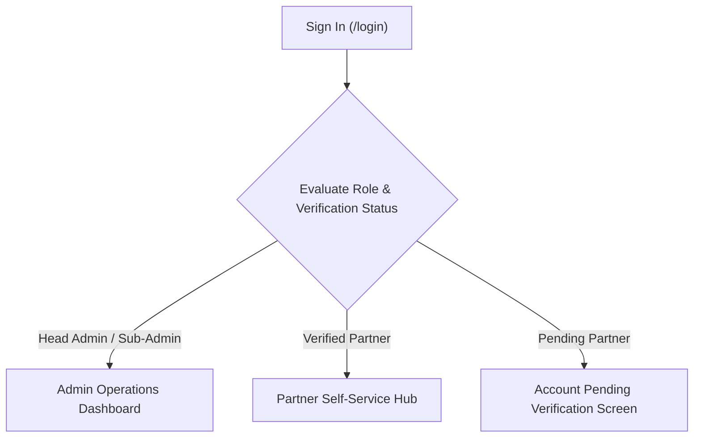
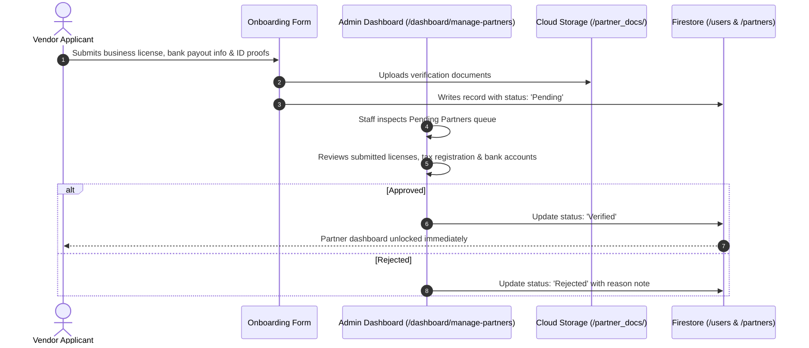

# Admin & Partner Operations Manual

Welcome to the operational manual for the **Thaiseva Admin Portal and Partner Dashboard**. This manual provides comprehensive, step-by-step procedures for daily operations, catalog governance, booking lifecycles, billing, and compliance management.

---

## 1. Access, Navigation & Dashboard Global Layout

Users sign in via `/login` using their registered email and password (or passwordless Email OTP). The interface dynamically personalizes navigation options based on assigned permissions:

### Global Interface Elements
- **Dynamic Sidebar Navigation:** Located on the left. On mobile or tablet devices, use the hamburger menu button in the top header.
- **Top Header Bar:** Displays current page breadcrumbs, quick global search filter, notification bell alerts, and user profile avatar for account settings and logout.
- **Role-Based Views:**
  - **Head Admin:** Complete platform governance, sub-admin management, financial summaries, and account deletion approvals.
  - **Sub-Admin:** Daily operations, partner document vetting, booking management, and customer support chat.
  - **Verified Partners:** Strictly scoped to their own listings, room calendars, assigned trips, and payout statements.

---

## 2. Administrator Operational Procedures

### 2.1 General Operations & Analytics

#### Platform Statistics & Revenue Analytics (`/dashboard/admin-statistics`)
- Displays real-time Gross Merchandise Value (GMV), total completed orders, active partner counts, and monthly user growth charts.
- **Exporting Financial Records:** Click **Export to Excel** at the top right to download full spreadsheet manifests compiled via `exportAdminStatisticsExcel.js` for accounting audits.

#### User Directory (`/dashboard/user-data`)
- Browse all registered consumer mobile app users.
- Inspect user profile details, contact emails, registration dates, and linked bookings.

#### Promotional Coupons Management (`/dashboard/coupons`)
- Create promotional discount codes for marketing campaigns.
- Configure coupon code, discount type (**Percentage** or **Fixed THB**), minimum cart spend, and expiration date.
- Uses `voucher-code-generator` for bulk campaign code creation.

#### Push Notifications Dispatch (`/dashboard/manage-notifications`)
- Broadcast announcements and operational alerts to consumer mobile apps or partner dashboards.
- Filter audience by user role (e.g., *All Travelers*, *All Hotel Partners*, *All Drivers*).

#### Sub-Admin Governance (`/dashboard/sub-admins`) *(Head Admin Only)*
- Provision new operational staff accounts.
- Assign granular operational scopes or revoke access for departed personnel.

---

### 2.2 Partner Onboarding & Credential Verification

When a business applies to become a Thaiseva partner, their account is placed into `Pending` status:

1. Navigate to **General Partners → Manage Partners**.
2. Filter table by **Status: Pending**.
3. Click **Review** on the target application to inspect business registration documents, TAT tourism licenses, driver's licenses, and bank account details.
4. If documents satisfy legal standards, click **Verify Partner**. The partner gains instant access to their self-service tools.

---

### 2.3 Accommodation & Room Availability Management

#### Hotel Listings Directory (`/dashboard/hotels`)
- Add new hotel properties or update existing profiles (name, star rating, address, GPS coordinates, property amenities, and photo galleries).
- Configure room types under the hotel profile (rack rates, discounted rates, maximum guest capacity, bed configurations).

#### Room Availability Calendar Overrides (`/dashboard/hotel-room-availability`)
Hoteliers manage their own inventory, but platform administrators can intervene during offline emergencies:
1. Select the target hotel property from the dropdown.
2. Locate the specific room type and date cell on the availability calendar.
3. Click the date to view **Total Inventory**, **Locked Holds**, and **Confirmed Bookings**.
4. Select **Manual Lock / Block Dates** to take rooms offline.
5. Click **Release Orphaned Holds** if a customer's abandoned checkout hold failed to expire automatically.

---

### 2.4 Travel, Sightseeing & Transport Management

#### Sightseeing & Tour Packages (`/dashboard/sightseeing-packages`)
- Manage guided tours, adventure excursions, and multi-day packages.
- Define day-by-day itineraries, inclusions (e.g., lunch, speedboat, entry tickets), exclusions, and pricing structures (`pricePerAdult`, `pricePerChild`, `extraAdult`).
- Link partner hotels to packages for seamless multi-product bundle rendering.

#### Transport & Fleet Operations (`/dashboard/taxi-van-management`)
- Register fleet vehicles (`transportVehicles`), license plates, and seat capacities.
- Assign verified drivers to specific vehicles.
- Review incoming ride requests (`car_bookings`) across car, van, airport taxi, and self-drive rentals.
- Set quoted prices for custom passenger routes before dispatching trips to drivers.

---

### 2.5 Dynamic Billing & Invoicing Engine (`/dashboard/invoices`)

The portal includes an integrated PDF billing engine powered by `@react-pdf/renderer` and `jspdf-autotable`:
1. Navigate to **Invoices / Billing**.
2. Select the partner company and specify the billing cycle (e.g., Bi-weekly or Monthly).
3. The system aggregates all completed orders, calculating:
   - **Gross Merchandise Value (GMV)**
   - **Platform Commission Deductions**
   - **Net Payout Payable to Partner**
4. Click **Preview Invoice** to inspect the live client-side PDF document.
5. Click **Generate & Issue PDF** to record the invoice in `partner_invoices` and export an official statement.

---

### 2.6 Account Deletion Compliance (`/dashboard/deletion-requests`)

To comply with the Thailand Personal Data Protection Act (PDPA):
1. Navigate to **General Operations → Deletion Requests**.
2. Review pending requests. The **Days Remaining** column tracks the statutory 30-day grace period.
3. Requests with 0 or negative days remaining appear in the **Due** tab.
4. Click **Approve & Delete Login Account**.
5. Confirm the warning dialog. The system invokes `deleteUserFunction`, permanently destroying the Firebase Auth account and timestamping the record as `Completed`.

---

## 3. Partner Self-Service Procedures

### 3.1 Hotel Partners
- **Managing Added Rooms:** Configure room types, upload high-resolution photos, list room amenities (WiFi, Bathtub, Balcony), and set nightly rack rates.
- **Room Availability Calendar:** The most critical daily tool. Partners must click and block dates whenever their hotel is booked offline by phone or walk-in guests to prevent overbooking on Thaiseva.
- **Today's Arrivals Manifest:** Real-time list of guests checking in today, displaying guest names, check-in/out dates, and payment settlement flags.

### 3.2 Transport & Driver Partners
- **Assigned Rides:** View scheduled pickups, flight numbers, passenger headcounts, luggage counts, and drop-off destinations.
- **Trip Status Updates:** Update ride status to **En Route**, **Picked Up**, or **Completed** so dispatch operators and passengers track trip progress in real-time.

### 3.3 Multi-Channel Support Messaging
- Access live support directly from the top navigation bar.
- Dedicated channels exist for **Customer Support**, **Driver Support**, **Hotel Support**, and **Local Partner Support**.
- **Voice Audio Notes:** Click the microphone icon to record and send voice messages directly to Thaiseva operations staff for rapid communication while on the road.

---

## 4. Operational Best Practices & Troubleshooting

- **Double Booking Prevention:** Hotel partners must update their Room Availability calendar at least once daily. Thaiseva is not liable for double-bookings caused by out-of-date partner calendars.
- **Browser Caching:** The portal uses real-time Firestore listeners (`onSnapshot`). If data tables appear stalled due to localized network drops, perform a hard refresh (`Ctrl + Shift + R` or `Cmd + Shift + R`).
- **Partner KYC Enforcement:** Never verify a partner without verifying their government-issued ID and commercial bank payout documentation.
