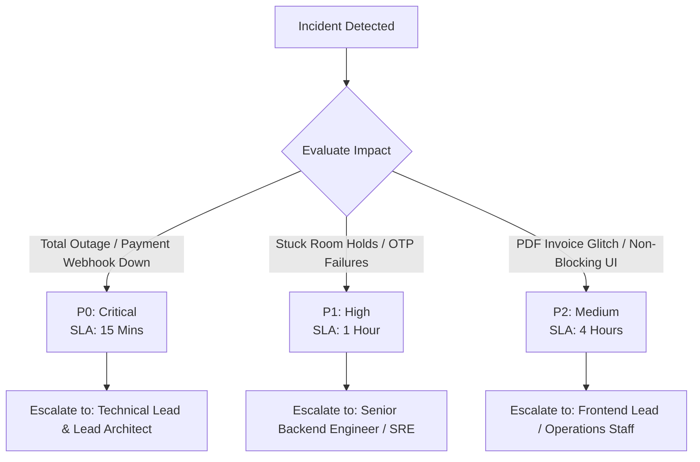

# Operations & Incident Response Runbook

**Audience:** Site Reliability Engineers (SRE), DevOps, Technical Leads, Senior Operations Staff  
**System:** Thaiseva Production Environment (`gothai-admin` / Region `asia-east2`)  
**Scope:** Real-Time Incident Response, Troubleshooting Workflows & Disaster Recovery

---

## 1. Severity Levels & Incident Escalation Matrix



| Severity Level | Definition | Response SLA | Resolution SLA | Escalation Target |
|---|---|:---:|:---:|---|
| **P0 - Critical** | Complete portal downtime, Stripe payment webhook failures, or checkout API returning 500 errors across all categories. | **15 minutes** | **2 hours** | Technical Lead & Lead Architect |
| **P1 - High** | Hotel room stock holds failing to expire (false "Sold Out" state), partner portal login failure, or Zoho OTP delivery failure. | **1 hour** | **4 hours** | Senior Backend Engineer / SRE |
| **P2 - Medium** | Client-side PDF invoice generation failing for specific partners, Chart.js statistics not loading, non-blocking UI bugs. | **4 hours** | **24 hours** | Frontend Lead / Operations |

---

## 2. Standard Troubleshooting Procedures

### Scenario 1: Stuck Room Holds (False "Sold Out" Errors)
- **Symptom:** A hotel reports empty rooms, but web/mobile clients display "No Rooms Available" for target dates.
- **Root Cause:** A traveler initiated checkout, acquiring an atomic 15-minute hold on room stock via `/lockHotelStock`, but closed their browser without completing payment. If the expiration trigger experienced latency, the hold remains active in Firestore.
- **Diagnosis:**
  1. Inspect the target hotel inventory collection: `HotelDB/{hotelId}/availability/`.
  2. Query active hold records where `expiresAt < now()` and `status == 'active'`.
- **Resolution:**
  - **Automated Trigger (HTTP):** Invoke the expiration function directly:
    ```bash
    curl -X POST https://asia-east2-gothai-admin.cloudfunctions.net/expireHotelStockHolds \
      -H "Content-Type: application/json" \
      -d '{"hotelId": "TARGET_HOTEL_ID"}'
    ```
  - **Manual Fix via Admin Portal:**
    1. Navigate to **Hotel Related → Room Availability**.
    2. Select the affected hotel and date cell.
    3. Click **Release Orphaned Holds**.

---

### Scenario 2: Stripe Payment Succeeded but Booking Remains "Pending"
- **Symptom:** Customer card charged by Stripe, but the order in `hotelBookingData` or `travelBookingDetails` still reflects `isPaymentDone: false` and `status: 'Pending'`.
- **Root Cause:** Stripe webhook delivery timeout, HMAC signature mismatch, or unhandled exception during post-payment inventory conversion.
- **Diagnosis:**
  1. Open the [Stripe Dashboard → Developers → Webhooks](https://dashboard.stripe.com/webhooks).
  2. Inspect failed deliveries to `/stripeWebhook`. Note HTTP response code (e.g., 400 Signature Failure or 500 Function Error).
  3. Filter Google Cloud Logging:
     ```text
     resource.type="cloud_function"
     resource.labels.function_name="stripeWebhook"
     severity>=WARNING
     ```
- **Resolution:**
  1. **Webhook Resend:** In the Stripe Dashboard, locate the failed event and click **Resend Event**.
  2. **Secret Mismatch:** If signature verification fails, re-synchronize `STRIPE_WEBHOOK_SECRET` in Google Secret Manager.
  3. **Client-Side Force Sync:** Invoke the verification endpoint:
     ```bash
     curl -X POST https://asia-east2-gothai-admin.cloudfunctions.net/verifySession \
       -H "Content-Type: application/json" \
       -H "Authorization: Bearer <ADMIN_ID_TOKEN>" \
       -d '{"sessionId": "cs_live_sampleSession123"}'
     ```
  4. **Manual Administrative Override:** Under **Bookings Record**, open the order modal, input the Stripe transaction ID (`pi_...`), and click **Force Reconcile & Mark Paid**.

---

### Scenario 3: Missing Firestore Composite Index Error
- **Symptom:** Administrative data tables (e.g., Bookings, User Directory) fail to load with a red error alert or blank table.
- **Root Cause:** A newly deployed query combined an equality filter (`==`) with a range filter (`>`, `<`) or sort (`orderBy`) without an active composite index in Firestore.
- **Diagnosis:**
  Open Chrome DevTools Console. Locate the Firestore error message:
  ```text
  FirebaseError: The query requires an index. You can create it here: https://console.firebase.google.com/...
  ```
- **Resolution:**
  1. Click the auto-generated link in the error log to trigger immediate index creation in the Firebase Console.
  2. Add the corresponding index configuration into `firestore.indexes.json` in the codebase so future deployments do not overwrite it.
  3. Re-deploy indexes via CLI:
     ```bash
     firebase deploy --only firestore:indexes
     ```

---

### Scenario 4: Zoho ZeptoMail OTP Delivery Failures
- **Symptom:** Partners and administrators report they are not receiving the 6-digit email sign-in code.
- **Diagnosis:**
  1. Inspect Cloud Logging:
     ```text
     resource.labels.function_name="sendEmailOtp"
     severity>=ERROR
     ```
  2. Check Zoho ZeptoMail Console: Inspect bounce rates, credit balance, and domain DKIM/SPF status.
- **Resolution:**
  1. If Zoho credits are exhausted, recharge transactional email credits in the Zoho portal.
  2. If error is `OTP security configuration is incomplete`, verify `OTP_HASH_KEY` secret is set and at least 32 characters long.
  3. Temporary Fallback: Advise staff to use standard email and password credentials until mail delivery recovers.

---

### Scenario 5: Accidental / Erroneous User Account Deletion
- **Symptom:** A customer submits an account deletion request by mistake and contacts support to restore their account within the 30-day grace period.
- **Resolution:**
  1. Navigate to **General Operations → Deletion Requests**.
  2. Locate the user's pending request.
  3. Click **Cancel Deletion Request**.
  4. Status updates to `Cancelled`. The scheduled deletion is aborted, and their account login remains active.

---

### Scenario 6: Super Admin Emergency Access Recovery (Custom Claims Script)
- **Symptom:** Head Admin loses administrative access or needs to grant elevated privileges to a new engineering lead without editing `firestore.rules`.
- **Resolution:** Run the emergency claims script using the Firebase Admin SDK from a secure local terminal:
  ```javascript
  // scripts/grantAdminClaim.js
  const admin = require("firebase-admin");
  admin.initializeApp();

  const targetUid = "TARGET_USER_UID";
  admin.auth().setCustomUserClaims(targetUid, { admin: true })
    .then(() => console.log(`Successfully granted admin claim to ${targetUid}`))
    .catch(console.error);
  ```
  Execute:
  ```bash
  GOOGLE_APPLICATION_CREDENTIALS="./serviceAccountKey.json" node scripts/grantAdminClaim.js
  ```

---

## 3. Cloud Logging & Monitoring Queries

Useful filter strings to paste into the Google Cloud Logging Explorer:

```text
# Filter all errors across Cloud Functions in asia-east2
resource.type="cloud_function"
resource.labels.region="asia-east2"
severity>=ERROR

# Monitor Stripe Webhook events and signature errors
resource.labels.function_name="stripeWebhook"
jsonPayload.message=~"Stripe"

# Monitor Account Deletions
resource.labels.function_name="deleteUserFunction"

# Monitor Room Stock Hold Expirations
resource.labels.function_name="expireHotelStockHolds"

# Monitor Email OTP operations
resource.labels.function_name="sendEmailOtp" OR resource.labels.function_name="verifyEmailOtp"
```

---

## 4. Disaster Recovery & Scheduled Backups

### 4.1 Scheduled Firestore Backups
To protect against catastrophic accidental data loss or ransomware attacks, Firestore collections must be exported to Google Cloud Storage on a daily schedule:
```bash
# Manual export command
gcloud firestore export gs://thaiseva-backups/$(date +%Y-%m-%d) \
  --project gothai-admin
```

### 4.2 Disaster Recovery RTO & RPO Targets
- **Recovery Time Objective (RTO):** $< 2$ hours to restore full database state from Cloud Storage bucket.
- **Recovery Point Objective (RPO):** $< 24$ hours (daily backup snapshot) + real-time Firestore Point-in-Time Recovery (PITR) for the previous 7 days.
