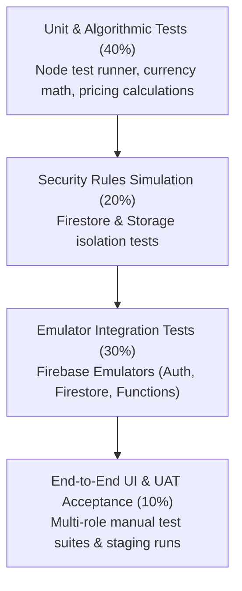

# Test Strategy & Quality Assurance Plan

> Privacy/security status updated 11 October 2026: [current verified status](../05-security/DATA_PRIVACY_PDPA.md) supersedes older privacy, role, retention and deployment claims below. One Admin staff role is active; current erasure removes scoped records and queues remaining review, rather than proving complete deletion. Historical gaps remain open, Secret Manager migration is IAM-blocked, and Storage/uploads were not changed. Earlier plans, example rules and compliance assertions are not evidence of live readiness.

**System:** Thaiseva Admin Portal, Partner Dashboard & Booking Ecosystem  
**Target Codebase:** `Thaiseva-Admin-Portal-Web-App`  
**Quality Lead:** Senior QA Lead / Test Architect  
**Version:** 1.0 (Enterprise Quality Standard)

---

## 1. Testing Pyramid & Quality Philosophy

The Thaiseva testing strategy is designed to balance speed, cost, and risk mitigation across serverless Cloud Functions, client Single-Page Applications (SPA), and NoSQL database security rules:



| Layer | Focus Area | Framework / Tooling | Target Coverage | Execution Stage |
|---|---|---|:---:|---|
| **Unit Testing** | Pricing calculations, satang currency conversion, OTP hashing, date parsing | Node.js Test Runner (`node --test`), Jest | $\ge 85\%$ | Local pre-commit / Pre-build |
| **Security Rules Testing** | Tenant isolation, `isAdmin()`, `isOwner()`, unauthorized writes | `@firebase/rules-unit-testing`, Emulator | 100% of rules | Pre-deployment |
| **Emulator Integration** | Booking checkout lifecycles, stock hold expiration, Stripe webhook idempotency | Firebase Emulator Suite (`asia-east2`), Axios | Key core flows | CI/CD & Staging |
| **Manual UAT & E2E** | Multi-tenant UI flows, PDF invoice rendering, chat voice notes | Staging Environment, Cross-browser | Feature releases | Pre-production |

---

## 2. Serverless Backend Test Architecture (`functions/test/`)

Cloud Functions testing leverages Node's native test runner (`node --test`) paired with the **Firebase Emulator Suite**, ensuring zero test pollution against live production databases.

### 2.1 OTP Verification Flow Unit & Integration Testing
- **Unit Test Execution:**
  ```bash
  cd functions
  npm run test
  ```
  *Compiles TypeScript (`tsc`) and runs `test/otp.test.cjs` validating OTP generation, hashing, rate limits, and 5-minute expiry logic.*
- **Emulator Integration Execution:**
  ```bash
  cd functions
  npm run test:otp:integration
  ```
  *Launches Auth and Firestore emulators using `../firebase.otp-test.json` under project `demo-thaiseva-otp` to verify end-to-end token verification.*

---

## 3. Concurrency & Race Condition Verification

Preventing hotel overbookings is a critical business priority. Automated tests must simulate high-concurrency contention scenarios:

### 3.1 Scenario: Double-Booking Contention Test
- **Objective:** Verify that when only **1 room** remains, two simultaneous customer checkout holds do not both succeed.
- **Test Protocol:**
  1. Initialize test hotel in Firestore emulator: `totalRooms: 1`, `lockedRooms: 0`, `bookedRooms: 0`.
  2. Dispatch two asynchronous `Promise.all()` requests to `/lockHotelStock` for the same date range:
     ```javascript
     const [resA, resB] = await Promise.all([
       axios.post(`${EMULATOR_URL}/lockHotelStock`, payloadUserA),
       axios.post(`${EMULATOR_URL}/lockHotelStock`, payloadUserB)
     ]);
     ```
  3. **Expected Assertions:**
     - Exactly **one** request receives `HTTP 200 OK` with a valid `holdToken`.
     - Exactly **one** request receives `HTTP 409 Conflict` with `code: 'ROOM_UNAVAILABLE'`.
     - Target document in `hotelRoomInventory` reflects `lockedRooms: 1` (never 2).

---

## 4. Stripe Webhook & Idempotency Testing

Stripe guarantees at-least-once webhook delivery, meaning webhooks can be retried multiple times for the same transaction.

### 4.1 Test Protocol: Webhook Replay Assertion
1. Generate mock Stripe `checkout.session.completed` event containing metadata `{ bookingId: "bk_test_123" }`.
2. Compute valid HMAC-SHA256 signature using `STRIPE_WEBHOOK_SECRET`.
3. Dispatch webhook to `/stripeWebhook` $\rightarrow$ Expect `HTTP 200 OK`, booking status becomes `Accepted`, `isPaymentDone: true`.
4. Re-dispatch the identical webhook payload immediately $\rightarrow$ Expect `HTTP 200 OK` (acknowledged), with **no duplicate inventory decrement** and no duplicate customer notifications.

---

## 5. Master QA Test Cases Matrix

### 5.1 Hotel & Accommodation Module

| Test ID | Test Scenario | Steps | Expected Outcome | Severity |
|---|---|---|---|:---:|
| `TC-HOTEL-01` | Query Available Rooms | Call `/checkHotelStock` for dates with free inventory. | Returns `available: true`, accurate `freeRooms` count, and total amount. | Critical |
| `TC-HOTEL-02` | Prevent Overbooking | Call `/checkHotelStock` when all inventory is booked or locked. | Returns `available: false`, `freeRooms: 0`. | Critical |
| `TC-HOTEL-03` | 15-Minute Hold Creation | Call `/lockHotelStock` with valid room parameters. | Returns `holdToken`, `ttlSeconds: 900`, increments locked count in Firestore. | High |
| `TC-HOTEL-04` | Expired Hold Auto-Release | Create hold, advance clock by 16 minutes, invoke `/expireHotelStockHolds`. | Hold document transitions to expired; locked count restored to free inventory. | High |
| `TC-HOTEL-05` | Admin Calendar Override | Super Admin manually blocks date cell in Room Availability calendar. | Consumer web/mobile app immediately reflects room as unavailable. | High |

### 5.2 Transport & Fleet Module

| Test ID | Test Scenario | Steps | Expected Outcome | Severity |
|---|---|---|---|:---:|
| `TC-TRANS-01` | Reject Online Stripe | Submit `/createCarBooking` with `paymentMethod: 'STRIPE'`. | Request rejected with `HTTP 400` and code `TRANSPORT_NO_STRIPE`. | High |
| `TC-TRANS-02` | Admin Price Quote Flow | User submits ride request $\rightarrow$ Admin inputs quoted amount in portal. | User polls `getTransportBooking` and receives quoted price and status `Accepted`. | High |
| `TC-TRANS-03` | Driver Dispatch | Admin assigns driver to ride $\rightarrow$ Driver logs in. | Ride appears in Driver's **Assigned Rides** manifest with pickup time and passenger phone. | Medium |

### 5.3 Compliance & Account Deletion (PDPA)

| Test ID | Test Scenario | Steps | Expected Outcome | Severity |
|---|---|---|---|:---:|
| `TC-PDPA-01` | 30-Day Grace Period Filter | Request submitted with `createdAt` = today $\rightarrow$ check `DeletionRequests.jsx`. | Displays in `Pending Requests` with `29` or `30` days remaining. | Medium |
| `TC-PDPA-02` | Overdue Requests Filter | Seed request with `createdAt` 35 days ago. | Request automatically appears in the `Due / Action Required` tab with negative days remaining. | High |
| `TC-PDPA-03` | Approve Deletion Execution | Head Admin clicks **Approve Account Deletion**. | Invokes `deleteUserFunction`; user cannot sign in with Firebase Auth; direct Firestore profiles removed; request `Erasure Pending`, remaining records queued for review. | Critical |
| `TC-PDPA-04` | Cancel Deletion Request | Admin clicks **Cancel Request** within grace period. | Request marked `Cancelled`; user can sign in normally; no data destroyed. | High |

---

## 6. Pre-Release Quality Gate Checklist

Prior to approving any release for production deployment, the QA Lead must certify:

- [ ] **Automated Tests:** All unit and emulator tests exit with status 0.
- [ ] **Firestore Rules Coverage:** All modified collections have verified tenant isolation assertions.
- [ ] **Cross-Browser Verification:** Admin dashboard renders cleanly on Chromium (Chrome, Edge), Firefox, and Safari.
- [ ] **Mobile Responsiveness:** Sidebar collapsing and data table horizontal scrolling verified on mobile viewports ($\le 768$px).
- [ ] **PDF Rendering:** Dynamic invoices generate without page clipping, font corruption, or commission calculation errors.
- [ ] **No Console Errors:** Zero unhandled JavaScript exceptions in browser developer console.
