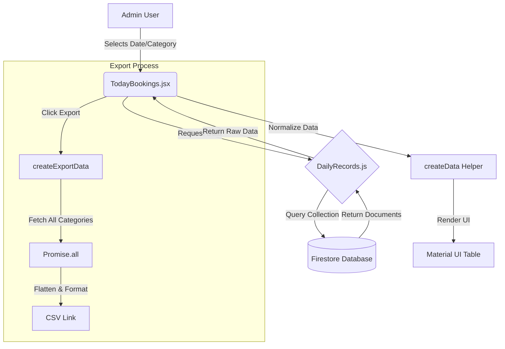

# Record Section Technical Reference Manual

## 1. Overview
The **Record Section** (represented by the `TodayBookings` component) is the financial and operational reconciliation hub of the Thaiseva Admin Portal. It allows administrators to view, filter, invoice, and manage daily bookings across all service verticals (Rooms, Sightseeing, Taxis, Self-drive).

## 2. Component Architecture

### 2.1 File Location
- **Main Interface:** `src/pages/dashboard/adminDashboard/todayBookingData/TodayBookings.jsx`
- **Service Logic:** `src/services/DailyRecords.js`

### 2.2 Key Dependencies
- **UI Framework:** Material UI (`@mui/material`, `@mui/icons-material`)
- **Backend SDK:** Firebase Firestore (`firebase/firestore`)
- **Reporting:** `@react-pdf/renderer` (PDF Invoices), `react-csv` (CSV Export)
- **State/Context:** `AuthContext` (Permissions), `PartnerContext` (Contact Info)

## 3. Data Flow & Logic

### 3.1 Data Ingestion (The "How")
The system does not load all data at once. It uses **Server-Side Pagination** to fetch data in chunks (pages).

**The Workflow:**
1. **User Action:** Admin selects "Taxi Bookings" and changes the date to "2024-12-01".
2. **Effect Trigger:** `useEffect` in `TodayBookings.jsx` detects changes in `queryCategory`, `startDate`, or `endDate`.
3. **Service Call:** `fetchTodayBooking(...)` is called from `DailyRecords.js`.
4. **Query Execution:**
   - A Firestore `query` is built specific to the category (e.g., `carBookingsCollection`).
   - **Filters:** `status == 'Accepted'` AND `timestamp >= startDate` AND `timestamp <= endDate`.
   - **Sorting:** `orderBy('timestamp', 'desc')` (Newest first).
   - **Pagination:** Uses `startAfter(lastDoc)` to fetch the next set of records.

### 3.2 Data Normalization via `setupDataProperly`
Since every collection has different field names (e.g., Taxis have `Driver.name`, Hotels have `hotelName`), the frontend normalizes this into a single structure using `createData`.

| Unified Field | Taxi Source | Room Source | Sightseeing Source |
| :--- | :--- | :--- | :--- |
| **Provider** | `Driver.name` | `hotelName` | `Provider.name` |
| **User Contact** | `contact` | `guestDetails.phone` | `guestDetails.phoneNumber` |
| **Amount** | `AmountOffered` | `amount` | `price` |
| **Time** | `timestamp` | `orderedAt` | `orderedAt` |

### 3.3 State Management
The component maintains complex state to handle the data view:
- `matchedRequirements`: Array of the actual booking objects currently displayed.
- `lastDocs`: An array storing the last document snapshot of each page (critical for Firestore cursor-based pagination).
- `generationUserInvoices` / `generationPartnerInvoices`: Objects tracking which specific row's invoice is currently being generated/downloaded.

## 4. Capabilities & Features

### 4.1 Financial Calculations
The system automatically splits the booking amount into **User Share** and **Partner Share** based on the commission rate.
- **Formula:** `Partner Amount = User Amount - (User Amount * Commission %)`
- This logic is encapsulated inside the `createData` function.

### 4.2 Reports & Exports
- **CSV Export (`createExportData`):** This function triggers a massive asynchronous operation. It iterates through *all four* categories (Room, Sightseeing, Taxi, Selfdrive), fetches the accepted bookings for the selected date range, normalizes them, and flattens them into a single downloadable CSV file.
- **PDF Invoices:** Uses `PDFDownloadLink` to generate legal invoices on the fly. It passes the normalized row data to `<UserInvoice />` or `<PartnerInvoice />` components.

### 4.3 Transaction Management
- **Payment Clearing:** The `handleClear` function allows admins to mark a transaction as settled. This updates the document in Firestore with `isPaymentClear: true`.
- **Validation:** A browser `confirm()` dialog prevents accidental updates.

## 5. Technical Stack Diagram

## 6. Edge Cases & Error Handling
- **Missing Data:** If a field (like `providerContact`) is missing in the database, the logical OR (`|| "-"`) operator ensures the UI renders a hyphen instead of crashing.
- **Empty States:** A custom UI block with the `FilterList` icon appears if the query returns 0 results.
- **Loading:** A skeleton loader (`LoadingContent`) replaces the table rows during data fetching to improve Perceived Performance.

---
**Report Generated By:** Antigravity Agent
**Date:** 2025-12-19
